# gvawatermark

Overlays the metadata on the video frame to visualize the inference
results.

With `device=GPU`, the element draws with OpenCL straight into the planes of
`NV12` frames in video memory: `video/x-raw(memory:VAMemory)` on Linux, and
`video/x-raw(memory:D3D11Memory)` or `video/x-raw(memory:D3D12Memory)` on
Windows. The frame is not copied to system memory, which the CPU renderer has to
do for every frame in video memory.

- The GPU renderer draws the same pixels as the CPU renderer: boxes, labels and
  their backgrounds, keypoints and their connections, instance segmentation
  masks, and blurred regions.
- Its cost depends on the area the watermark covers, not on the frame size:
  labels are rasterized on the CPU once and reused across frames. Blurring large
  regions is the expensive part, see [Performance consideration](#performance-consideration).
- Frames in another format, and frames with rotated regions (from oriented
  detection models such as YOLO-OBB), are drawn by the CPU renderer instead,
  one frame at a time.
- Semantic segmentation masks are drawn only on `BGRx`, `BGRA` and `BGR` frames,
  by the CPU renderer. Neither renderer draws them on `NV12`, and on `I420` the
  CPU renderer draws no segmentation masks at all: such frames stop the pipeline
  with an error.
- The GPU renderer is built when OpenCL is found, and on Linux also VA-API. If
  the GPU cannot share the frames with OpenCL, the element logs a warning and
  uses the CPU renderer.
- On Linux, `device` defaults to `CPU`. Set `device=GPU` and keep the frames in
  VAMemory:

  ```bash
  gst-launch-1.0 filesrc location=${VIDEO_FILE} ! decodebin3 ! "video/x-raw(memory:VAMemory)" ! \
    gvadetect model=${MODEL_FILE} device=GPU pre-process-backend=va-surface-sharing ! queue ! \
    gvawatermark device=GPU ! vapostproc ! autovideosink
  ```

> **Note:** On Linux, the GPU renderer draws into the VA surface itself. A decoder
> may still use that surface as a reference picture, and a `tee` shares it with
> its other branches, so the watermark can show up in later frames and in the
> other branches. The CPU renderer is not affected. To prevent it, copy the frame
> right before `gvawatermark`. The copy does not change the pixels:
>
> ```bash
> ... ! vapostproc disable-passthrough=true ! "video/x-raw(memory:VAMemory),format=NV12" ! gvawatermark device=GPU ! ...
> ```

See [Displaying analysis results with gvawatermark](../dev_guide/performance_guide.md#8-displaying-analysis-results-with-gvawatermark)
for when to choose the CPU or the GPU.

On Windows, the element also accepts `video/x-raw(memory:D3D11Memory)` and
`video/x-raw(memory:D3D12Memory)` in `NV12` and `BGRA`, and differs from the
Linux listing below:

- `device` defaults to `GPU` on D3D11Memory and D3D12Memory, and to `CPU` on
  system memory. `device=GPU` with system memory is an error.
- Either renderer first copies the frame into a texture of its own on the GPU,
  so the watermark does not show up in other branches of a `tee` or in the
  decoder's reference frames.
- With the D3D12 decoders, the pipeline stays in D3D12Memory when every element
  accepts it, which is faster than D3D11Memory:

  ```bash
  gst-launch-1.0 filesrc location=${VIDEO_FILE} ! decodebin3 ! gvadetect model=${MODEL_FILE} device=GPU ! queue ! \
    gvawatermark ! d3d12videosink
  ```

```bash
Pad Templates:
  SINK template: 'sink'
    Availability: Always
    Capabilities:
      video/x-raw
                format: { (string)BGRx, (string)BGRA, (string)BGR, (string)NV12, (string)I420 }
                  width: [ 1, 2147483647 ]
                height: [ 1, 2147483647 ]
              framerate: [ 0/1, 2147483647/1 ]
      video/x-raw(memory:DMABuf)
                format: { (string)RGBA, (string)I420 }
                  width: [ 1, 2147483647 ]
                height: [ 1, 2147483647 ]
              framerate: [ 0/1, 2147483647/1 ]
      video/x-raw(memory:VASurface)
                format: { (string)NV12 }
                  width: [ 1, 2147483647 ]
                height: [ 1, 2147483647 ]
              framerate: [ 0/1, 2147483647/1 ]
      video/x-raw(memory:VAMemory)
                format: { (string)NV12 }
                  width: [ 1, 2147483647 ]
                height: [ 1, 2147483647 ]
              framerate: [ 0/1, 2147483647/1 ]

  SRC template: 'src'
    Availability: Always
    Capabilities:
      video/x-raw
                format: { (string)BGRx, (string)BGRA, (string)BGR, (string)NV12, (string)I420 }
                  width: [ 1, 2147483647 ]
                height: [ 1, 2147483647 ]
              framerate: [ 0/1, 2147483647/1 ]
      video/x-raw(memory:DMABuf)
                format: { (string)RGBA, (string)I420 }
                  width: [ 1, 2147483647 ]
                height: [ 1, 2147483647 ]
              framerate: [ 0/1, 2147483647/1 ]
      video/x-raw(memory:VASurface)
                format: { (string)NV12 }
                  width: [ 1, 2147483647 ]
                height: [ 1, 2147483647 ]
              framerate: [ 0/1, 2147483647/1 ]
      video/x-raw(memory:VAMemory)
                format: { (string)NV12 }
                  width: [ 1, 2147483647 ]
                height: [ 1, 2147483647 ]
              framerate: [ 0/1, 2147483647/1 ]

Element has no clocking capabilities.
Element has no URI handling capabilities.

Pads:
  SINK: 'sink'
    Pad Template: 'sink'
  SRC: 'src'
    Pad Template: 'src'

Element Properties:
  async-handling      : The bin will handle Asynchronous state changes
                        flags: readable, writable
                        Boolean. Default: false
  displ-cfg           : Comma separated list of KEY=VALUE parameters of displayed notations.
                        Available options:
                        * show-labels=<bool> enable or disable displaying text labels, default true
                        * font-scale=<double 0.1 to 2.0> scale factor for text labels, default 0.5
                        * thickness=<uint> bounding box thickness, default 2
                        * color-idx=<int> color-table entry for bounding box, keypoints, and text, default -1 (per-object colors). Built-in table: 0 red, 1 green, 2 blue, 3 yellow, 4 cyan, 5 magenta, 6-17 intermediate hues, 18 black, 19 white
                        * color-table=<path> file with the colors picked by label id or tracking id, one R,G,B color (0 to 255) per line, '#' starts a comment, default built-in table of 20 colors
                        * font-type=<string> font type for text labels, default triplex. Supported fonts: simplex, plain, duplex, complex, triplex, complex_small, script_simplex, script_complex
                        * draw-txt-bg=<bool> enable or disable displaying text labels background, by enabling it the text color is set to black or white, whichever contrasts better with the background, default true
                        * show-roi=<string> colon-separated list of labels to include (only these objects will be shown), default empty
                        * hide-roi=<string> colon-separated list of labels to exclude (these objects will be hidden), default empty
                        * enable-blur=<bool> enable ROI blurring for privacy protection, default false
                          NOTE : Blurring is applied only when "enable-blur=true"; if no "show-blur-roi" / "hide-blur-roi" filters are set, all ROIs are blurred
                          NOTE : show-blur-roi takes precedence over hide-blur-roi when both are specified
                        * show-blur-roi=<string> colon-separated list of object labels to blur (e.g., "face:person")
                        * hide-blur-roi=<string> colon-separated list of labels to exclude from blurring (show-blur-roi takes precedence)
                        * text-x=<float> x position (pixels) for full-frame text (e.g. from gvagenai), default 0
                        * text-y=<float> y position (pixels) for full-frame text (e.g. from gvagenai), default 25
                        * ff-custom-txt=<string> extra custom text for full-frame display (limit 20 characters), default empty
                          NOTE : text-x and text-y apply to ff-custom-txt position

                        e.g.: displ-cfg=show-labels=false
                        e.g.: displ-cfg=font-scale=0.5,thickness=3,color-idx=2,font-type=plain
                        e.g.: displ-cfg=color-table=/path/to/colors.txt
                        e.g.: displ-cfg=show-labels=true,show-roi=person:car:truck
                        e.g.: displ-cfg=show-labels=true,hide-roi=bottle:cup
                        e.g.: displ-cfg=enable-blur=true,show-blur-roi=face:person
                        e.g.: displ-cfg=text-y=680 (place full-frame text near bottom of a 720p frame)
                        e.g.: displ-cfg=text-y=680,ff-custom-txt='Custom Text' (place 'Custom Text' near bottom of a 720p frame)

                        flags: readable, writable
                        String. Default: null
  device              : Supported devices are CPU and GPU. Default is CPU on system memory and GPU on video memory
                        flags: readable, writable
                        String. Default: null
  displ-avgfps        : If true, display the average FPS read from gvafpscounter element on the output video.
                        The gvafpscounter element must be present in the pipeline.
                        e.g. ... ! gvawatermark displ-avgfps=true ! gvafpscounter ! ...
                        flags: readable, writable
                        Boolean. Default: false
  message-forward     : Forwards all children messages
                        flags: readable, writable
                        Boolean. Default: false
  name                : The name of the object
                        flags: readable, writable
                        String. Default: "gvawatermark0"
  parent              : The parent of the object
                        flags: readable, writable
                        Object of type "GstObject"
```

## Visual Examples

The following examples demonstrate how different `displ-cfg` parameters affect the watermark appearance:

### Font Scale

Controls the size of text labels displayed on detected objects.

**Small Font Scale (`font-scale=0.7`)**
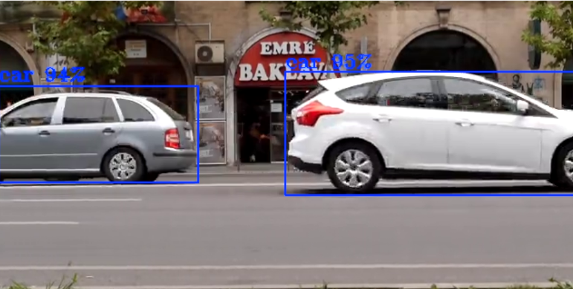

**Large Font Scale (`font-scale=2.0`)**  
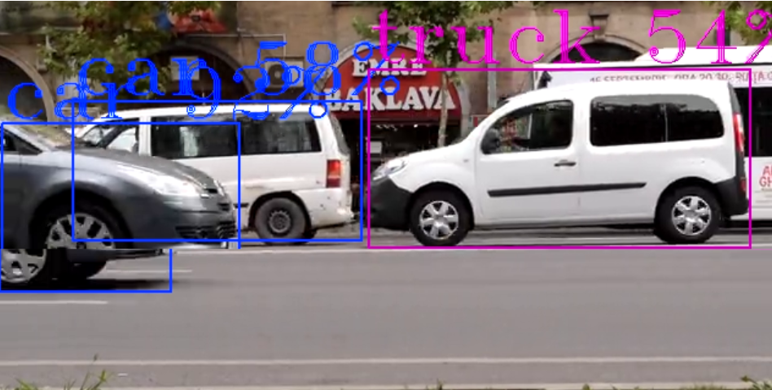

### Label Display

**Labels Disabled (`show-labels=false`)**
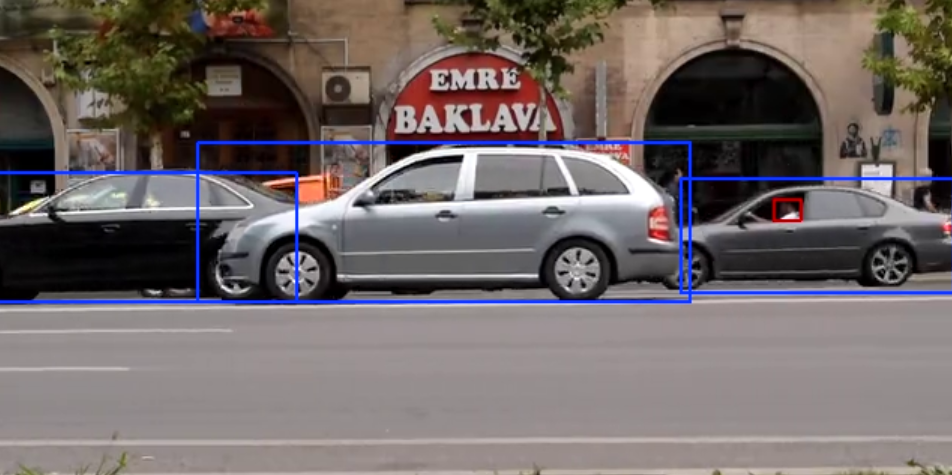

*Shows only bounding boxes without text labels*

### Text Background

**Text Background Enabled (`draw-txt-bg=true`)**
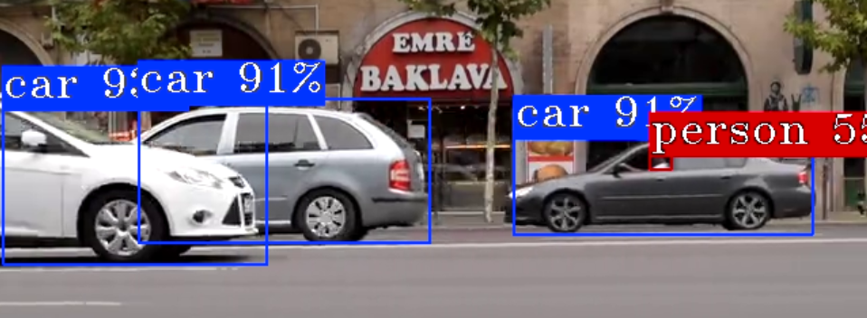

*Blue background makes text more readable over complex backgrounds*

The background takes the object's color and the text is drawn in black or white, whichever contrasts
better with it: black on light colors such as yellow, green and cyan, white on dark and saturated ones
such as blue and red.

### Color Index

**Red Color (`color-idx=0`)**
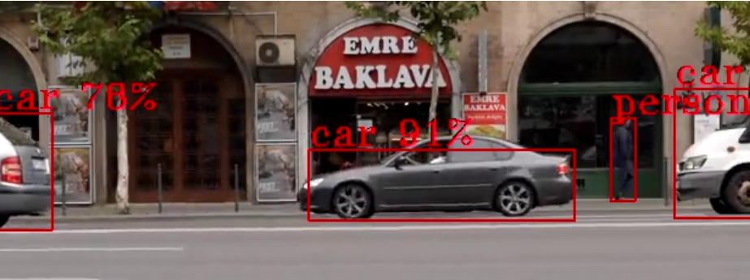

*Uses red color for bounding boxes and text*

### Color Table

Objects are colored from a table of 20 built-in colors, by their tracking id when they have one and by
their label id otherwise. Landmarks and keypoints take their colors from the same table, by point index.
`color-table=<path>` replaces the built-in table with colors read from a file:

- one color per line, as red, green and blue components from 0 to 255, separated by commas or spaces
- `#` starts a comment, empty lines are skipped
- an id beyond the end of the table wraps around, so a single line draws every object in that color
- `color-idx=<n>` picks entry `n` of this table for every bounding box and label, from 0 to the number of colors minus one

```text
# colors.txt, picked by label id: 0 person, 1 car, 2 bicycle
255, 64, 64     # person
64, 160, 255    # car
255, 200, 0     # bicycle
```

e.g `displ-cfg=color-table=/path/to/colors.txt`

### Font Types

**Font Comparison**
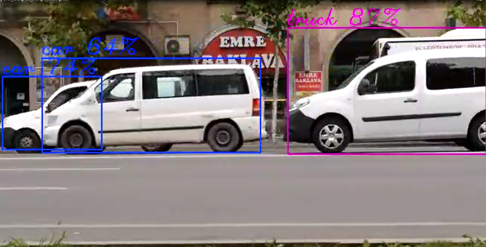

*Comparison of different font types (simplex vs complex)*

**Default Triplex Font**
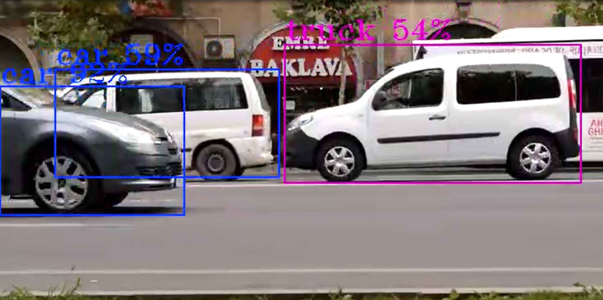

*The default triplex font provides good readability*

### Label Filtering

You can selectively show or hide detected objects based on their labels using filtering parameters:

**Include Labels (`show-roi=person:car:truck`)**
- Only objects with labels "person", "car", or "truck" will be displayed
- All other detected objects will be hidden
- Useful for focusing on specific object types

e.g `displ-cfg=show-labels=true,show-roi=car`
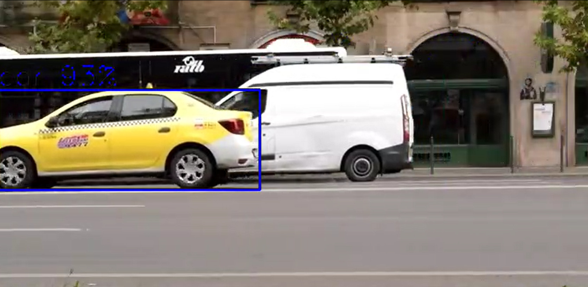

**Exclude Labels (`hide-roi=bottle:cup:laptop`)**
- Objects with labels "bottle", "cup", or "laptop" will be hidden
- All other detected objects will be displayed
- Useful for removing distracting or irrelevant objects from the display

e.g `displ-cfg=show-labels=true,hide-roi=car`
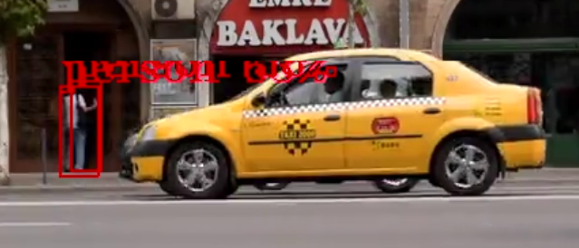

**Filter Priority**
- If both `show-roi` and `hide-roi` are specified, `show-roi` takes precedence
- Empty lists mean no filtering is applied

### Blur Feature

The gvawatermark element supports privacy protection through region of interest (ROI) blurring using a Gaussian blur with a dynamic kernel size as ~1/5 of each ROI dimension (minimum 7, always odd)
so the blur strength scales with the region. This feature is useful for anonymizing faces, license plates, or other sensitive content in video streams.

#### Blur Configuration Parameters

Blur functionality is controlled through the `displ-cfg` parameter with these options:

- **enable-blur=<bool\>** - Enable or disable blur feature (default: false) Blurring is applied only when "enable-blur=true"; if no "show-blur-roi" / "hide-blur-roi" filters are set, all ROIs are blurred.

- **show-blur-roi=<string\>** - Colon-separated list of object labels to blur (e.g., "person:face")
- **hide-blur-roi=<string\>** - Colon-separated list of object labels to exclude from blurring

#### Blur Examples

**Basic Blur (All detected objects)**
```bash
# Blur all detected ROIs
displ-cfg=enable-blur=true
```
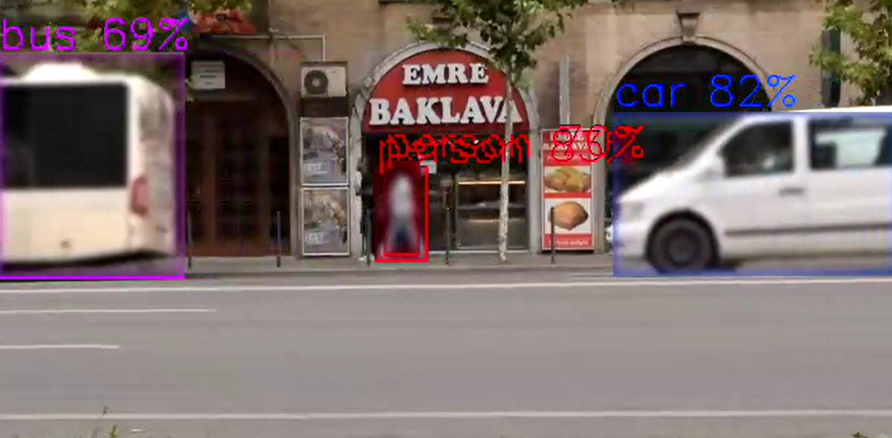

**Selective Blur (Include specific labels)**
```bash
# Blur only faces and persons
displ-cfg=enable-blur=true,show-blur-roi=face:person
```
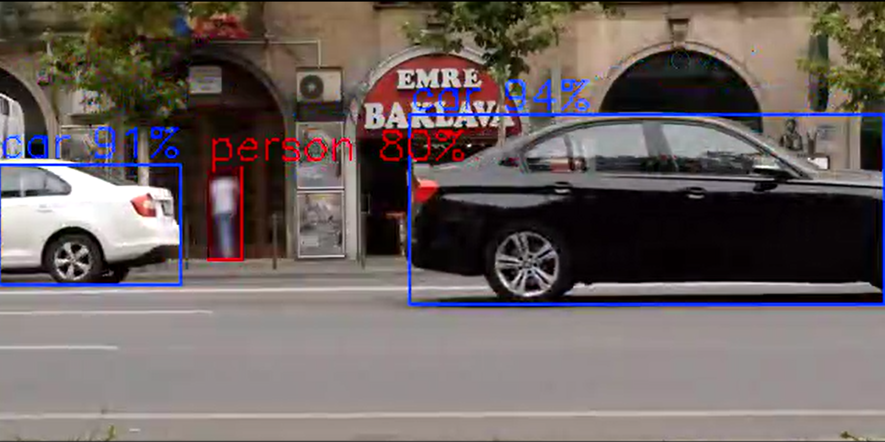

```bash
# Blur only cars
displ-cfg=enable-blur=true,show-blur-roi=car
```
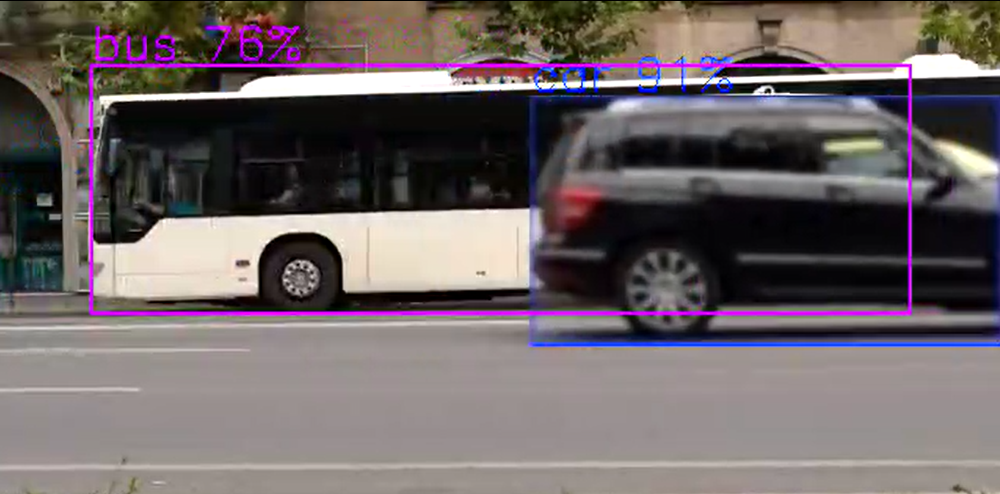

**Exclude Blur (Blur all except specific labels)**
```bash
# Blur all objects except cars and trucks
displ-cfg=enable-blur=true,hide-blur-roi=car:truck

# Blur all except persons
displ-cfg=enable-blur=true,hide-blur-roi=person
```

**Combined with Display Options**
```bash
# Blur faces with custom display settings
displ-cfg=enable-blur=true,show-blur-roi=face,show-labels=false,thickness=1

# Blur with labels and colored boxes
displ-cfg=enable-blur=true,show-blur-roi=person:face,color-idx=0,font-scale=0.8
```

#### Filter Precedence Rules

`show-blur-roi` takes precedence over `hide-blur-roi`. When `show-blur-roi` is specified and not empty, only objects matching those labels will be blurred, and `hide-blur-roi` is ignored.

1. **show-blur-roi specified and not empty**: Only labels in show-blur-roi are blurred
2. **show-blur-roi empty or unspecified**: All labels are blurred except those in hide-blur-roi
3. **Neither specified**: All detected ROIs are blurred when enable-blur=true

### Performance consideration

Blurring runs on whichever device the element is set to, including `device=GPU`.

Unlike the rest of the watermark, the cost of a blur is proportional to the area
of the regions being blurred, on either device. Blurring a large share of the
frame is therefore expensive no matter the device, and gets more so with
resolution.

### Configuration Examples

```bash
# Minimal labels with smaller font
displ-cfg=show-labels=true,show-roi=false

# Large text with background
displ-cfg=font-scale=2.0,draw-txt-bg=true

# Colored thin boxes with simple font  
displ-cfg=color-idx=0,thickness=1,font-type=simplex

# Object colors from a custom color table
displ-cfg=color-table=/path/to/colors.txt

# Complete custom styling
displ-cfg=font-scale=1.5,thickness=3,color-idx=2,font-type=complex,draw-txt-bg=true

# Show only specific object types
displ-cfg=show-labels=true,show-roi=person:car:truck

# Hide specific object types
displ-cfg=show-labels=true,hide-roi=bottle:cup:laptop

# Combine filtering with styling
displ-cfg=show-labels=true,show-roi=person:car,font-scale=1.2,color-idx=1

# Move full-frame text (e.g. gvagenai result) to near the bottom of a 720p frame
displ-cfg=text-y=680

# Combine text position with other options
displ-cfg=font-scale=1.5,color-idx=1,thickness=5,text-y=680

# Privacy protection with blur
displ-cfg=enable-blur=true,show-blur-roi=face:person,show-labels=false

# Blur all except specific objects
displ-cfg=enable-blur=true,hide-blur-roi=car:truck,thickness=1
```

### FPS Display

**Average FPS Display (`displ-avgfps=true`)**
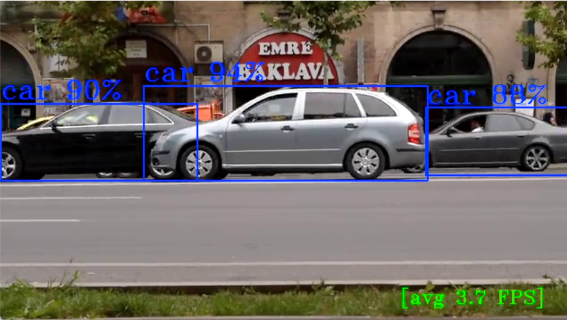

*Displays average FPS counter when `gvafpscounter` element is present in pipeline*

## Watermark Metadata API

See [Watermark Metadata](../dev_guide/metadata.md#watermark-metadata) in the metadata developer guide for
full API and Python usage examples.
