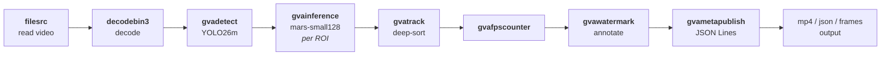

# People Detection & Tracking with Deep SORT

Detects and tracks people in a video using YOLO26m for detection and the Deep SORT
algorithm with a Mars-Small-128 re-identification model for robust multi-object
tracking. The pipeline is built with `gst-launch-1.0` and is optimized for Intel
Core Ultra 3 processors (CPU/GPU).

## What It Does

1. **Decodes** the input video from a local file (`filesrc` → `decodebin3`)
2. **Detects** people in each frame using YOLO26m (`gvadetect`)
3. **Extracts** a 128-dimensional appearance feature vector per detected person using Mars-Small-128 (`gvainference`, run per ROI)
4. **Tracks** people across frames using the Deep SORT algorithm — Kalman filter + cosine distance + IoU matching (`gvatrack`)
5. **Counts** throughput (`gvafpscounter`) and **annotates** frames with bounding boxes and tracking IDs (`gvawatermark`)
6. **Publishes** detection/tracking metadata (`gvametaconvert` → `gvametapublish`)
7. Depending on the requested output, either **encodes** the annotated video (`videoconvert` → `vah264enc`/`vah264lpenc`/`x264enc` → `h264parse` → `mp4mux` → `filesink`) or **writes PNG frames** (`vapostproc` → `videoconvert` → `pngenc` → `multifilesink`)



The pipeline uses the following elements:

* **filesrc** — GStreamer element that reads video from a local file
* **decodebin3** — GStreamer element that auto-selects the best decoder (hardware-accelerated when available)
* **gvadetect** — DL Streamer inference element that runs YOLO26m object detection (`threshold=0.6`, `batch-size=1`)
* **gvainference** — DL Streamer inference element that extracts 128-dim appearance features per detected person ROI using Mars-Small-128 (`inference-region=roi-list`, `object-class=person`)
* **gvatrack** — DL Streamer tracking element using the Deep SORT algorithm (`tracking-type=deep-sort`)
* **gvafpscounter** — DL Streamer element that reports pipeline throughput (FPS) to the console
* **gvawatermark** — DL Streamer element that overlays bounding boxes and tracking IDs on video frames (person ROIs only)
* **gvametaconvert** / **gvametapublish** — DL Streamer elements for metadata serialization to JSON Lines
* **vah264enc** / **vah264lpenc** — Intel VA-API hardware H.264 encoder (falls back to `x264enc` if neither is available)
* **mp4mux** — GStreamer element that packages the encoded stream into an MP4 container
* **vapostproc** / **pngenc** / **multifilesink** — used only in `frames` output mode to write individual annotated PNG frames
* **videorate** — inserted only in `frames` output mode when `INTERVAL` > 1, to thin out the number of saved PNGs without affecting detection/tracking

## Prerequisites

* DL Streamer installed (or run via the DL Streamer Docker image), with GStreamer VA-API plugins for GPU encoding
* Intel Core Ultra 3 processor (or any Intel system with integrated GPU); the script falls back to CPU automatically if `/dev/dri` is not present
* `curl` (to download the default sample video, if needed)

### Models

The script expects the following pre-converted OpenVINO IR models under the fixed models
directory set by `MODELS_DIR` in the script:

* **YOLO26m** (detection) — any precision `.xml`/`.bin` under `yolo26m/FP16/`
* **Mars-Small-128** (re-identification) — `mars-small128/FP32/mars_small128_fp32.xml` (+ matching `.bin`)

If the models are missing, generate them with the repository's model conversion scripts in
[`scripts/download_models`](../../../../scripts/download_models). See
[`scripts/download_models/README.md`](../../../../scripts/download_models/README.md) for setup,
usage, and exact commands for the Ultralytics (YOLO26m) and other-models (Mars-Small-128)
conversion flows.

### Video

If no input video is given, the script downloads a default sample clip to `videos/people.mp4`
from Pexels (`https://www.pexels.com/download/video/39182823/?fps=24.0&h=720&w=1280`) on first
run. You can also pass any local video file instead.

## Running the Sample

```bash
./people_detection_tracking.sh [INPUT] [DEVICE] [OUTPUT] [INTERVAL] [FRAMES_DIR]
```

```bash
# Default: videos/people.mp4, GPU, annotated MP4 output
./people_detection_tracking.sh

# Custom video, CPU inference
./people_detection_tracking.sh /path/to/video.mp4 CPU

# Detection/tracking metadata only (JSON Lines), no video encoding
./people_detection_tracking.sh /path/to/video.mp4 GPU json

# Save every annotated frame as a PNG
./people_detection_tracking.sh /path/to/video.mp4 GPU frames

# Save roughly every 10th annotated frame as a PNG (same detection/tracking results)
./people_detection_tracking.sh /path/to/video.mp4 GPU frames 10
```

Show usage help:

```bash
./people_detection_tracking.sh --help
```

## Command-Line Arguments

| Argument   | Position | Default              | Description |
|------------|----------|-----------------------|--------------|
| `INPUT`    | 1        | `videos/people.mp4`  | Path to the input video file. Downloaded automatically if the default path doesn't exist. |
| `DEVICE`   | 2        | `GPU`                 | Inference device for `gvadetect`/`gvainference`/`gvatrack`. Supported: `CPU`, `GPU`. Falls back to `CPU` if no GPU (`/dev/dri`) is available. |
| `OUTPUT`   | 3        | `mp4`                 | Output artifact: `mp4` (annotated video), `json` (detection metadata), or `frames` (annotated PNG frames). |
| `INTERVAL` | 4        | `1`                   | Only used when `OUTPUT=frames`. Saves roughly every Nth processed frame as a PNG (1 = save all). Detection/tracking still runs on every frame; `INTERVAL` only thins out the saved PNGs via a `videorate` stage placed right before `pngenc`. |
| `FRAMES_DIR` | 5      | `results/people_detection_tracking-<DEVICE>_<video>_frames/` | Only used when `OUTPUT=frames`. Overrides the directory PNG frames are written to. |

## Output

Results are written to the `results/` directory, named after the device and input file:

* `results/people_detection_tracking-<DEVICE>_<video>.mp4` — annotated output video with bounding boxes and tracking IDs (`OUTPUT=mp4`)
* `results/people_detection_tracking-<DEVICE>_<video>.jsonl` — detection and tracking metadata in JSON Lines format (`OUTPUT=json`)
* `results/people_detection_tracking-<DEVICE>_<video>_frames/frame_NNNNN.png` — annotated PNG frames (`OUTPUT=frames`)

The script also prints the resolved model paths, the full `gst-launch-1.0` pipeline string, and the output location before running.
