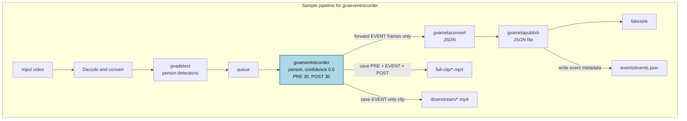

# gvaeventrecorder Sample

- `gvaeventrecorder` reads object-detection metadata and records video clips around detections of configured classes. It saves the complete PRE/EVENT/POST sequence to disk, but forwards only live EVENT-phase frames downstream; buffered PRE frames are not replayed, and POST frames are not forwarded.
- This sample uses `gvadetect` to detect people. The full PRE/EVENT/POST video is saved in `full-clip/`; the EVENT-only frames also continue through the pipeline and are saved separately as an EVENT-only clip in `downstream/`. Detection and event metadata is published to JSON.

## Pipeline



## Requirements

- DL Streamer installed and its GStreamer environment configured.
- A readable input video file.
- A readable OpenVINO IR object-detection model (`.xml` and matching `.bin`) that includes the `person` class.
- Writable storage for the output directory.

## Run

```bash
./gvaeventrecorder.sh <input-video> <detection-model.xml> <output-directory>
```

Example with placeholder paths:

```bash
./gvaeventrecorder.sh /path/to/video.mp4 /path/to/model.xml /path/to/output
```

The script creates the output directories if they do not exist. Pipeline settings are fixed in the script:

| Setting | Element | Value | Description |
|---|---|---:|---|
| `target-classes` | `gvaeventrecorder` | `person` | Records events for person detections. |
| `confidence-threshold` | `gvaeventrecorder` | 0.5 | Minimum confidence for a detection to trigger or continue an event. |
| `pre-event-frames` | `gvaeventrecorder` | 30 | Frames retained from before the event. |
| `post-event-frames` | `gvaeventrecorder` | 30 | Frames retained after the event ends. |
| `event-gap-frames` | `gvaeventrecorder` | 3 | Missing detections tolerated before the event ends. |

Event clips use the default software encoder.

## Output

- Full video clips containing PRE, EVENT, and POST frames: `<output-directory>/full-clip/`.
- Separate EVENT-only clips containing the same EVENT-phase frames forwarded downstream: `<output-directory>/downstream/`.
- Detection and event metadata: `<output-directory>/events/events.json`.

The full PRE/EVENT/POST clips are written to disk; only EVENT-phase frames are sent onward. Saving the separate EVENT-only clip does not consume those buffers: they continue through `gvametapublish` to the next pipeline element, `fakesink` in this sample.
Clip filenames follow `event_<class>_<timestamp>_<counter>.mp4`; downstream clips have the `_downstream` suffix.

## See Also

- [gvaeventrecorder element documentation](../../../../docs/user-guide/elements/gvaeventrecorder.md)
- [Samples overview](../../../README.md)
