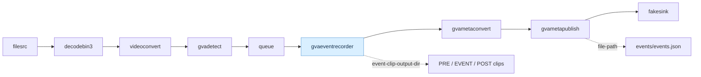

# gvaeventrecorder Sample

- `gvaeventrecorder` reads object-detection metadata and records video clips around detections of configured classes. It saves the complete PRE/EVENT/POST sequence to disk and forwards the same sequence of video buffers downstream.
- This sample uses `gvadetect` to detect people. Once a person triggers an event, cached PRE buffers are sent immediately, followed by EVENT and POST buffers as they arrive. Full video clips are saved in `event-clip/`. Detection and event metadata is published to JSON.

## Pipeline

The pipeline detects people, records the complete PRE/EVENT/POST video sequence, and publishes event metadata:



## Requirements

- DL Streamer installed and its GStreamer environment configured.
- A readable input video file.
- A readable OpenVINO IR object-detection model (`.xml` and matching `.bin`) that includes the `person` class.
- Writable storage for the output directory.

## Run

```bash
./gvaeventrecorder.sh <input-video> <detection-model.xml> <output-directory>
```

Example with placeholder paths:

```bash
./gvaeventrecorder.sh /path/to/video.mp4 /path/to/model.xml /path/to/output
```

The third argument sets the output directory for the recorded clips: the script configures the `gvaeventrecorder` property `event-clip-output-dir` as `<output-directory>/event-clip/`. This sample does not expose that property as a separate command-line option. The script creates the output directories if they do not exist. Other pipeline settings are fixed in the script:

| Setting | Element | Value | Description |
|---|---|---:|---|
| `target-classes` | `gvaeventrecorder` | `person` | Records events for person detections. |
| `confidence-threshold` | `gvaeventrecorder` | 0.5 | Minimum confidence for a detection to trigger or continue an event. |
| `pre-event-frames` | `gvaeventrecorder` | 30 | Frames retained from before the event. |
| `post-event-frames` | `gvaeventrecorder` | 30 | Frames retained after the event ends. |
| `event-gap-frames` | `gvaeventrecorder` | 3 | Missing detections tolerated before the event ends. |

Event clips use the default software encoder.

## Output

- Full video clips containing PRE, EVENT, and POST frames: `<output-directory>/event-clip/`.
- Detection and event metadata: `<output-directory>/events/events.json`.

The full PRE/EVENT/POST clips are written to disk. Their video buffers also continue through `gvametapublish` to the next pipeline element, `fakesink` in this sample. No EVENT-only files are created. Overlapping recording windows share one downstream stream without duplicate frames.
Clip filenames follow `event_<class>_<timestamp>_<counter>.mp4`.

## See Also

- [gvaeventrecorder element documentation](../../../../docs/user-guide/elements/gvaeventrecorder.md)
- [Samples overview](../../../README.md)
