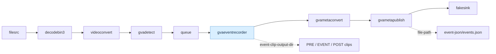

# gvaeventrecorder Sample (gst-launch command line)

This sample demonstrates event-based video recording with a `gst-launch-1.0` pipeline built from a YOLOv8s person detector followed by the `gvaeventrecorder` element.

## How It Works

The sample constructs a GStreamer pipeline string and runs it with `gst-launch-1.0`:



The pipeline combines the following elements:

* `filesrc` for reading the input video file
* `decodebin3` and `videoconvert` for video decoding and conversion
* `gvadetect` for full-frame person detection with YOLOv8s
* `gvaeventrecorder` for recording video clips around detections of the configured classes
* `gvametaconvert` and `gvametapublish` for writing detection and event metadata to JSON output
* `fakesink` as the pipeline sink

When `gvadetect` finds a person, `gvaeventrecorder` starts an event. Cached PRE buffers are sent downstream immediately, followed by EVENT and POST buffers as they arrive.
The complete PRE/EVENT/POST sequence is saved to disk as video clips in `event-clips/`, while the same video buffers continue downstream. Detection and event metadata is published to `event-json/events.json`.

## Requirements

- DL Streamer installed and its GStreamer environment configured.
- A readable input video file.
- A readable OpenVINO IR object-detection model (`.xml` and matching `.bin`) that includes the `person` class.
- Writable storage for the output directory.

## Input video and model

The sample needs a video with people and a YOLOv8s detection model. The script does not download either of them; you must provide both.

### Video

Provide an input video that contains people and pass it with `--input`. For example, you can download [people-detection.mp4](https://github.com/intel-iot-devkit/sample-videos/raw/master/people-detection.mp4) from the [intel-iot-devkit/sample-videos](https://github.com/intel-iot-devkit/sample-videos) repository:

```bash
curl -fL -o people-detection.mp4 \
    https://github.com/intel-iot-devkit/sample-videos/raw/master/people-detection.mp4
```

### Model

This sample expects the `yolov8s` model in FP16 precision from Ultralytics, converted to OpenVINO IR.

Use the model conversion scripts in [scripts/download_models/](../../../../scripts/download_models/README.md) to prepare it.
Before running them, create and activate the dedicated model-download virtual environment described in [scripts/download_models/README.md](../../../../scripts/download_models/README.md).

Pass the resulting OpenVINO IR model XML to the script with `--model`. Keep its matching `.bin` weights file alongside it.

## Usage

The **`gvaeventrecorder.sh`** script runs the pipeline on a video and writes event clips and metadata to the output directory. `--input`, `--model` and `--output` are required.

| Option | Default | Description |
|---|---|---|
| `--input <video.mp4>` | — (required) | Input video file. |
| `--model <model.xml>` | — (required) | OpenVINO IR detection model used by `gvadetect`; its matching `.bin` file must be alongside it. |
| `--output <directory>` | — (required) | Output directory, created if it does not exist. Clips go to `event-clips/` and metadata to `event-json/events.json`. |
| `-h`, `--help` | — | Prints the usage and exits. |

The input video and the model file must already exist.

Run with your own video, model and output directory:

```bash
./gvaeventrecorder.sh \
    --input /path/to/video.mp4 \
    --model /path/to/model.xml \
    --output /path/to/output
```

**NOTE:** The following recorder settings are set by the script and cannot be changed from the command line:
> - `target-classes=person`
> - `confidence-threshold=0.5`
> - `pre-event-frames=30`, `post-event-frames=30`, `event-gap-frames=3`

## Output

- Full video clips containing PRE, EVENT, and POST frames: `<output-directory>/event-clips/`.
- Detection and event metadata: `<output-directory>/event-json/events.json`.

The full PRE/EVENT/POST clips are written to disk. Their video buffers also continue through `gvametapublish` to the next pipeline element, `fakesink` in this sample. No EVENT-only files are created. Overlapping recording windows share one downstream stream without duplicate frames.

Clip filenames follow `event_<class>_<timestamp>_<counter>.mp4`.

## See Also

- [gvaeventrecorder element documentation](../../../../docs/user-guide/elements/gvaeventrecorder.md)
- [gvaframeselect sample](../gvaframeselect/README.md)
- [gvaroiscale sample](../gvaroiscale/README.md)
- [Samples overview](../../../README.md)
