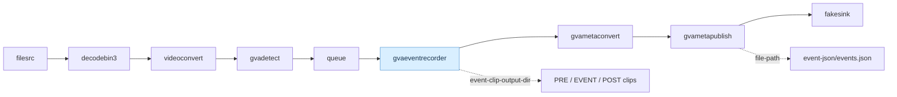

# gvaeventrecorder Sample

- `gvaeventrecorder` reads object-detection metadata and records video clips around detections of configured classes. It saves the complete PRE/EVENT/POST sequence to disk and forwards the same sequence of video buffers downstream.
- This sample uses `gvadetect` to detect people. Once a person triggers an event, cached PRE buffers are sent immediately, followed by EVENT and POST buffers as they arrive. Full video clips are saved in `event-clips/`. Detection and event metadata is published to JSON.

## Pipeline

The pipeline detects people, records the complete PRE/EVENT/POST video sequence, and publishes event metadata:



## Requirements

- DL Streamer installed and its GStreamer environment configured.
- A readable input video file.
- A readable OpenVINO IR object-detection model (`.xml` and matching `.bin`) that includes the `person` class.
- Writable storage for the output directory.

## Input video and model

The sample needs a video with people and a YOLOv8s detection model. Both are downloaded automatically if they are missing, so manual download is optional.

### Video

- **Source:** [people-detection.mp4](https://github.com/intel-iot-devkit/sample-videos/raw/master/people-detection.mp4) from the [intel-iot-devkit/sample-videos](https://github.com/intel-iot-devkit/sample-videos) repository.
- **Manual download**, run from this sample's directory:

  ```bash
  mkdir -p video
  curl -fL -o video/people-detection.mp4 \
      https://github.com/intel-iot-devkit/sample-videos/raw/master/people-detection.mp4
  ```

### Model

- **Source:** the pretrained `yolov8s.pt` weights from Ultralytics, which the export script fetches automatically, converted to OpenVINO IR (FP16) with [`scripts/download_models/download_ultralytics_models.py`](../../../../scripts/download_models/download_ultralytics_models.py).
- **Manual download**, run from this sample's directory (see the [download_models README](../../../../scripts/download_models/README.md#2-ultralytics-conversion) for details):

  ```bash
  uv venv .ultralytics_models_venv
  source .ultralytics_models_venv/bin/activate
  uv pip install --index-strategy unsafe-best-match \
      -r ../../../../scripts/download_models/requirements_download_ultralytics_models.txt
  python ../../../../scripts/download_models/download_ultralytics_models.py \
      --model yolov8s.pt --outdir models/public/yolov8s/FP16 --half
  ```

### Automatic download

If the default video or model is missing, `gvaeventrecorder.sh` downloads it itself. Everything is stored in the directory that contains the script:

| Item | Location |
|---|---|
| Video | `video/people-detection.mp4` |
| Model | `models/public/yolov8s/FP16/yolov8s.xml` and `.bin`; the downloaded weights stay in `models/yolov8s.pt` |
| Python environment for the export | `.ultralytics_models_venv/`, created only if needed and removed after a successful export |

Downloading needs network access, and the first model export takes a few minutes. Nothing is downloaded when you pass your own `--input` or `--model`; such a path must exist.

## Usage

The **`gvaeventrecorder.sh`** script runs the pipeline on a video and writes event clips and metadata to the output directory. All options are optional; an omitted option uses its default, located next to the script. If you run the script without any options, it tries to download the default video and model on its own, then runs the pipeline with them.

| Option | Default | Description |
|---|---|---|
| `--input <video.mp4>` | `video/people-detection.mp4` | Input video. If the default is missing, it is downloaded from [intel-iot-devkit/sample-videos](https://github.com/intel-iot-devkit/sample-videos/raw/master/people-detection.mp4). |
| `--model <model.xml>` | `models/public/yolov8s/FP16/yolov8s.xml` | OpenVINO IR detection model used by `gvadetect`. If the default is missing, it is exported with [`download_ultralytics_models.py`](../../../../scripts/download_models/download_ultralytics_models.py) in a local `.ultralytics_models_venv` Python environment (needs network access). |
| `--output <directory>` | `output/` | Output directory, created if it does not exist. Clips go to `event-clips/` and metadata to `event-json/events.json`. |
| `-h`, `--help` | — | Prints the usage and exits. |

If you pass your own `--input` or `--model`, the file must already exist. The script then downloads and exports nothing, and does not fall back to the default.

Run with the defaults:

```bash
./gvaeventrecorder.sh
```

Run with your own video:

```bash
./gvaeventrecorder.sh \
    --input /path/to/video.mp4
```

Run with your own video, model and output directory:

```bash
./gvaeventrecorder.sh \
    --input /path/to/video.mp4 \
    --model /path/to/model.xml \
    --output /path/to/output
```

**NOTE:** The recorder settings are fixed in the script and cannot be changed from the command line:
> - `target-classes=person`
> - `confidence-threshold=0.5`
> - `pre-event-frames=30`, `post-event-frames=30`, `event-gap-frames=3`
> - `flush-interval-ms=3000` with the default software encoder: each clip is written as a fragmented MP4 while the event is being recorded.

## Output

- Full video clips containing PRE, EVENT, and POST frames: `<output-directory>/event-clips/`.
- Detection and event metadata: `<output-directory>/event-json/events.json`.

The full PRE/EVENT/POST clips are written to disk. Their video buffers also continue through `gvametapublish` to the next pipeline element, `fakesink` in this sample. No EVENT-only files are created. Overlapping recording windows share one downstream stream without duplicate frames.

Clip filenames follow `event_<class>_<timestamp>_<counter>.mp4`.

## See Also

- [gvaeventrecorder element documentation](../../../../docs/user-guide/elements/gvaeventrecorder.md)
- [gvaframeselect sample](../gvaframeselect/README.md)
- [gvaroiscale sample](../gvaroiscale/README.md)
- [Samples overview](../../../README.md)
