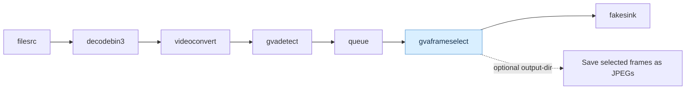

# gvaframeselect Sample

- `gvaframeselect` selects evenly spaced frames from each input block, caches them until the frame budget is collected, computes a shared ROI, then forwards the selected buffers in order. It can also save copies of the selected frames as JPEG images.
- This sample runs `gvadetect` with the supplied OpenVINO IR model, then selects up to eight frames from every 900-frame block. It saves selected frames as JPEG images and continues forwarding them to `fakesink`.

## Pipeline

The script reads and decodes the input video, converts it to raw video frames, and runs `gvadetect` before frame selection so detection metadata is available to `gvaframeselect`:



`gvaframeselect` selects up to eight evenly spaced frames from each 900-frame block by default, calculates a shared ROI from their detections, and forwards the selected buffers in order. It also writes JPEG copies to the output directory. `fakesink` consumes the forwarded buffers without displaying or encoding them, keeping this sample focused on frame selection and export.

## Requirements

- DL Streamer installed and its GStreamer environment configured.
- A readable video file.
- A readable OpenVINO IR object-detection model (`.xml` and matching `.bin`) that includes the `person` class.
- Writable storage for the output directory.

## Run

```bash
./gvaframeselect.sh [options] <input-video> <detection-model.xml> <output-directory>
```

The second positional argument is required: provide the path to the OpenVINO IR detector XML used by `gvadetect`. Its matching `.bin` weights file must be available alongside it.

Optional pipeline settings:

| Option | Element | Default | Range | Description |
|---|---|---:|---:|---|
| `--sub-stream-frames N` | `gvaframeselect` | 900 | 1-4294967295 | Number of input frames in each selection block. |
| `--frame-budget k` | `gvaframeselect` | 8 | 1-4294967295 | Maximum selected frames per block. |

Example with placeholder paths:

```bash
./gvaframeselect.sh /path/to/video.mp4 /path/to/model.xml /path/to/output
```

The selection settings can also be passed explicitly using the same `--option value` format as the other CLI samples:

```bash
./gvaframeselect.sh --sub-stream-frames 900 --frame-budget 8 \
    /path/to/video.mp4 /path/to/model.xml /path/to/output
```

The element defaults to `target-classes=person,vehicle`, `confidence-threshold=0.5`, and
`roi-padding=0`. When combining it with `gvaeventrecorder`, set the selector's confidence
threshold to the same value configured on the recorder.

For a full block of `N` frames and a budget of `k`, selected positions are evenly spaced from the first frame to the last. If `k=1`, only the first frame is selected; if `k >= N`, every frame is forwarded. The selection pattern restarts at each full block and when an input buffer has the `DISCONT` flag. A short final block uses the same pattern and is not recalculated for its shorter length.

When used after `gvaeventrecorder`, the selector flushes a partial selection at `event=stop`. Set its `confidence-threshold` to the same value as the recorder; the property is configured independently and is not propagated automatically. The `target-classes` and `roi-padding` properties control which detections contribute to the shared ROI and how many pixels are added around it.

## Output

- JPEG copies of selected frames: `<output-directory>/frame_XXXXXXXX.jpg`.
- The same selected video buffers continue downstream to `fakesink`; saving JPEGs does not consume them.
- Each forwarded frame carries its stream frame number in its buffer offset (`GST_BUFFER_OFFSET`). The number counts every input frame, including dropped frames, starts at zero, and resets on a new stream.
- The detector must provide a `person` class, as selected frames are intended to demonstrate detections before frame selection.

## See Also

- [gvaframeselect element documentation](../../../../docs/user-guide/elements/gvaframeselect.md)
- [Samples overview](../../../README.md)