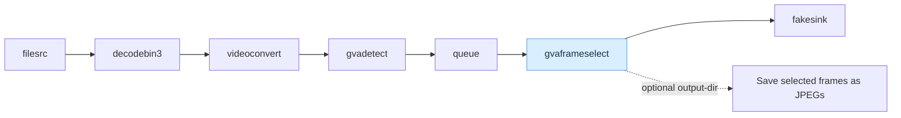

# gvaframeselect Sample (gst-launch command line)

This sample demonstrates frame selection with a `gst-launch-1.0` pipeline built from a YOLOv8s person detector followed by the `gvaframeselect` element.

## How It Works

The sample constructs a GStreamer pipeline string and runs it with `gst-launch-1.0`:



The pipeline combines the following elements:

* `filesrc` for reading the input video file
* `decodebin3` and `videoconvert` for video decoding and conversion to raw video frames
* `gvadetect` for full-frame person detection with YOLOv8s, so detection metadata is available to `gvaframeselect`
* `gvaframeselect` for selecting evenly spaced frames from each block of frames and computing a shared ROI
* `fakesink` as the pipeline sink

`gvaframeselect` selects evenly spaced frames from each input block, caches them until the frame budget is collected, computes a shared ROI from their detections, and forwards the selected buffers in order. By default it selects up to eight frames from every 140-frame block. It also saves copies of the selected frames as JPEG images in `selected_frames/`. `fakesink` consumes the forwarded buffers without displaying or encoding them, keeping this sample focused on frame selection and export.

## Requirements

- DL Streamer installed and its GStreamer environment configured.
- A readable input video file.
- A readable OpenVINO IR object-detection model (`.xml` and matching `.bin`) that includes the `person` class.
- Writable storage for the output directory.

## Input video and model

The sample needs a video with people and a YOLOv8s detection model. The script does not download either of them; you must provide both.

### Video

Use any local video supported by GStreamer that contains people, and pass its path with `--input`. The video used in examples is only illustrative; obtain a suitable clip from a source available to you.

### Model

This sample expects the `yolov8s` model in FP16 precision from Ultralytics, converted to OpenVINO IR.

Use the model conversion scripts in [scripts/download_models/](../../../../scripts/download_models/README.md) to prepare it.
Before running them, create and activate the dedicated model-download virtual environment described in [scripts/download_models/README.md](../../../../scripts/download_models/README.md).

Pass the resulting OpenVINO IR model XML to the script with `--model`. Keep its matching `.bin` weights file alongside it.

## Usage

The **`gvaframeselect.sh`** script runs the pipeline on a video and saves the selected frames as JPEG images in the output directory. `--input`, `--model` and `--output` are required. The selection options are optional and use their defaults when omitted.

| Option | Default | Description |
|---|---|---|
| `--input <video.mp4>` | — (required) | Input video file. |
| `--model <model.xml>` | — (required) | OpenVINO IR detection model used by `gvadetect`; its matching `.bin` file must be alongside it. |
| `--output <directory>` | — (required) | Output directory, created if it does not exist. Selected frames go to `selected_frames/`. |
| `--sub-stream-frames N` | 140 | Number of input frames in each selection block (1-4294967295). |
| `--frame-budget k` | 8 | Maximum selected frames per block (1-4294967295). |
| `-h`, `--help` | — | Prints the usage and exits. |

The input video and the model file must already exist. A custom `--model` must be an OpenVINO IR detector XML used by `gvadetect`, with its matching `.bin` weights file alongside it.

Run with your own video, model, output directory and selection settings:

```bash
./gvaframeselect.sh \
    --input /path/to/video.mp4 \
    --model /path/to/model.xml \
    --output /path/to/output \
    --sub-stream-frames 140 \
    --frame-budget 8
```


### How frames are selected

For a full block of `N` frames and a budget of `k`, selected positions are evenly spaced from the first frame to the last. If `k=1`, only the first frame is selected; if `k >= N`, every frame is forwarded. The selection pattern restarts at each full block and when an input buffer has the `DISCONT` flag. A short final block uses the same pattern and is not recalculated for its shorter length.

The `target-classes` and `roi-padding` properties control which detections contribute to the shared ROI and how many pixels are added around it. Every selected frame in the block receives that same ROI. If the entire selection has no accepted detections, the shared ROI covers the full frame.

When `gvaframeselect` is placed after `gvaeventrecorder` and before `gvaroiscale`, as in the [gvaroiscale sample](../gvaroiscale/README.md):

- the selector flushes a partial selection at `event=stop`;
- the shared ROI is also applied to PRE and POST event frames that have no accepted detections, so `gvaroiscale` crops the same area from every selected frame of the event;
- set the selector's `confidence-threshold` to the same value as the recorder; the property is configured independently and is not propagated automatically.

## Output

- JPEG copies of selected frames: `<output-directory>/selected_frames/frame_XXXXXXXX.jpg`.

The same selected video buffers continue downstream to `fakesink`; saving JPEGs does not consume them.

Each forwarded frame carries its stream frame number in its buffer offset (`GST_BUFFER_OFFSET`). The number counts every input frame, including dropped frames, starts at zero, and resets on a new stream.

## See Also

- [gvaframeselect element documentation](../../../../docs/user-guide/elements/gvaframeselect.md)
- [gvaeventrecorder sample](../gvaeventrecorder/README.md)
- [gvaroiscale sample](../gvaroiscale/README.md)
- [Samples overview](../../../README.md)