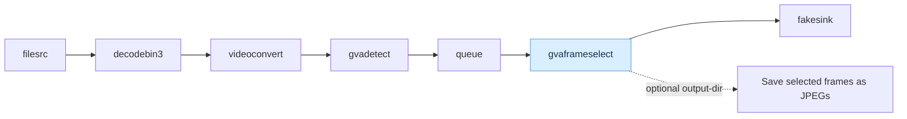

# gvaframeselect Sample

- `gvaframeselect` selects evenly spaced frames from each input block, caches them until the frame budget is collected, computes a shared ROI, then forwards the selected buffers in order. It can also save copies of the selected frames as JPEG images.
- This sample runs `gvadetect` with the supplied OpenVINO IR model, then selects up to eight frames from every 140-frame block. It saves selected frames as JPEG images and continues forwarding them to `fakesink`.

## Pipeline

The script reads and decodes the input video, converts it to raw video frames, and runs `gvadetect` before frame selection so detection metadata is available to `gvaframeselect`:



`gvaframeselect` selects up to eight evenly spaced frames from each 140-frame block by default, calculates a shared ROI from their detections, and forwards the selected buffers in order. It also writes JPEG copies to the output directory. `fakesink` consumes the forwarded buffers without displaying or encoding them, keeping this sample focused on frame selection and export.

## Requirements

- DL Streamer installed and its GStreamer environment configured.
- A readable input video file.
- A readable OpenVINO IR object-detection model (`.xml` and matching `.bin`) that includes the `person` class.
- Writable storage for the output directory.

## Input video and model

The sample needs a video with people and a YOLOv8s detection model. Both are downloaded automatically if they are missing, so manual download is optional.

### Video

- **Source:** [people-detection.mp4](https://github.com/intel-iot-devkit/sample-videos/raw/master/people-detection.mp4) from the [intel-iot-devkit/sample-videos](https://github.com/intel-iot-devkit/sample-videos) repository.
- **Manual download**, run from this sample's directory:

  ```bash
  mkdir -p video
  curl -fL -o video/people-detection.mp4 \
      https://github.com/intel-iot-devkit/sample-videos/raw/master/people-detection.mp4
  ```

### Model

- **Source:** the pretrained `yolov8s.pt` weights from Ultralytics, which the export script fetches automatically, converted to OpenVINO IR (FP16) with [`scripts/download_models/download_ultralytics_models.py`](../../../../scripts/download_models/download_ultralytics_models.py).
- **Manual download**, run from this sample's directory (see the [download_models README](../../../../scripts/download_models/README.md#2-ultralytics-conversion) for details):

  ```bash
  uv venv .ultralytics_models_venv
  source .ultralytics_models_venv/bin/activate
  uv pip install --index-strategy unsafe-best-match \
      -r ../../../../scripts/download_models/requirements_download_ultralytics_models.txt
  python ../../../../scripts/download_models/download_ultralytics_models.py \
      --model yolov8s.pt --outdir models/public/yolov8s/FP16 --half
  ```

### Automatic download

If the default video or model is missing, `gvaframeselect.sh` downloads it itself. Everything is stored in the directory that contains the script:

| Item | Location |
|---|---|
| Video | `video/people-detection.mp4` |
| Model | `models/public/yolov8s/FP16/yolov8s.xml` and `.bin`; the downloaded weights stay in `models/yolov8s.pt` |
| Python environment for the export | `.ultralytics_models_venv/`, created only if needed and removed after a successful export |

Downloading needs network access, and the first model export takes a few minutes. Nothing is downloaded when you pass your own `--input` or `--model`; such a path must exist.

## Usage

The **`gvaframeselect.sh`** script runs the pipeline on a video and saves the selected frames as JPEG images in the output directory. All options are optional; an omitted option uses its default, located next to the script. If you run the script without any options, it tries to download the default video and model on its own, then runs the pipeline with them.

| Option | Default | Description |
|---|---|---|
| `--input <video.mp4>` | `video/people-detection.mp4` | Input video. If the default is missing, it is downloaded from [intel-iot-devkit/sample-videos](https://github.com/intel-iot-devkit/sample-videos/raw/master/people-detection.mp4). |
| `--model <model.xml>` | `models/public/yolov8s/FP16/yolov8s.xml` | OpenVINO IR detection model used by `gvadetect`. If the default is missing, it is exported with [`download_ultralytics_models.py`](../../../../scripts/download_models/download_ultralytics_models.py) in a local `.ultralytics_models_venv` Python environment (needs network access). |
| `--output <directory>` | `output/` | Output directory, created if it does not exist. Selected frames go to `selected_frames/`. |
| `--sub-stream-frames N` | 140 | Number of input frames in each selection block (1-4294967295). |
| `--frame-budget k` | 8 | Maximum selected frames per block (1-4294967295). |
| `-h`, `--help` | — | Prints the usage and exits. |

If you pass your own `--input` or `--model`, the file must already exist. The script then downloads and exports nothing, and does not fall back to the default. A custom `--model` must be an OpenVINO IR detector XML used by `gvadetect`, with its matching `.bin` weights file alongside it.

Run with the defaults:

```bash
./gvaframeselect.sh
```

Run with your own video:

```bash
./gvaframeselect.sh \
    --input /path/to/video.mp4
```

Run with your own video, model, output directory and selection settings:

```bash
./gvaframeselect.sh \
    --input /path/to/video.mp4 \
    --model /path/to/model.xml \
    --output /path/to/output \
    --sub-stream-frames 450 \
    --frame-budget 12
```

**NOTE:** The following `gvaframeselect` settings are fixed in the script and cannot be changed from the command line:
> - `roi-padding=16`
> - `target-classes=person,vehicle` and `confidence-threshold=0.5` (element defaults)

### How frames are selected

For a full block of `N` frames and a budget of `k`, selected positions are evenly spaced from the first frame to the last. If `k=1`, only the first frame is selected; if `k >= N`, every frame is forwarded. The selection pattern restarts at each full block and when an input buffer has the `DISCONT` flag. A short final block uses the same pattern and is not recalculated for its shorter length.

The `target-classes` and `roi-padding` properties control which detections contribute to the shared ROI and how many pixels are added around it. Every selected frame in the block receives that same ROI. If the entire selection has no accepted detections, the shared ROI covers the full frame.

When `gvaframeselect` is placed after `gvaeventrecorder` and before `gvaroiscale`, as in the [gvaroiscale sample](../gvaroiscale/README.md):

- the selector flushes a partial selection at `event=stop`;
- the shared ROI is also applied to PRE and POST event frames that have no accepted detections, so `gvaroiscale` crops the same area from every selected frame of the event;
- set the selector's `confidence-threshold` to the same value as the recorder; the property is configured independently and is not propagated automatically.

## Output

- JPEG copies of selected frames: `<output-directory>/selected_frames/frame_XXXXXXXX.jpg`.

The same selected video buffers continue downstream to `fakesink`; saving JPEGs does not consume them.

Each forwarded frame carries its stream frame number in its buffer offset (`GST_BUFFER_OFFSET`). The number counts every input frame, including dropped frames, starts at zero, and resets on a new stream.

## See Also

- [gvaframeselect element documentation](../../../../docs/user-guide/elements/gvaframeselect.md)
- [gvaeventrecorder sample](../gvaeventrecorder/README.md)
- [gvaroiscale sample](../gvaroiscale/README.md)
- [Samples overview](../../../README.md)