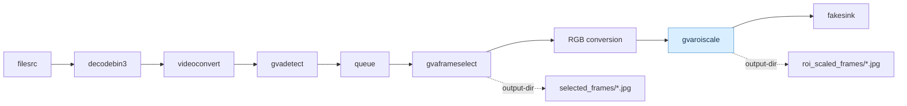

# gvaroiscale Sample

- `gvaroiscale` reads object-detection metadata (`GstAnalyticsRelationMeta`) attached to each RGB frame and selects all ROIs matching `target-classes`. It processes ROIs in descending confidence order and suppresses same-class duplicates with an intersection-over-union (IoU) above 0.5. Each remaining ROI is cropped, resized while preserving its aspect ratio, and centered on a black canvas at the configured output dimensions. It can optionally save each scaled ROI as a JPEG image.
- This sample uses `gvaframeselect` to choose up to eight frames from each 900-frame block, then passes them through `gvaroiscale` to crop and scale matching `person` ROIs to 448x448 RGB. A selected frame can produce multiple scaled ROI frames. Both selected frames and scaled ROI frames are saved as JPEG images.

## Pipeline

The pipeline selects frames, converts them to RGB, then crops and scales matching ROIs. Both JPEG output paths are optional and configured with `output-dir`:



## Requirements

- DL Streamer installed and its GStreamer environment configured.
- A readable video file.
- An OpenVINO IR object-detection model (`.xml` and matching `.bin`) that includes the `person` class.
- Writable storage for the output directory.

## Run

```bash
./gvaroiscale.sh [options] <input-video> <detection-model.xml> <output-directory>
```

Optional pipeline settings:

| Option | Element | Default | Range | Description |
|---|---|---:|---:|---|
| `--out-width N` | `gvaroiscale` | 448 | 1-8192 | Width of the scaled ROI image. |
| `--out-height N` | `gvaroiscale` | 448 | 1-8192 | Height of the scaled ROI image. |
| `--sub-stream-frames N` | `gvaframeselect` | 900 | 1-4294967295 | Number of input frames in each selection block. |
| `--frame-budget N` | `gvaframeselect` | 8 | 1-4294967295 | Maximum selected frames per block. |

Set `--out-width` and `--out-height` to the input dimensions expected by the model in the next pipeline element. Some VLMs accept dynamic image sizes or resize inputs internally, so check the model's requirements; the sample defaults are not universal.

Example with placeholder paths:

```bash
./gvaroiscale.sh /path/to/video.mp4 /path/to/model.xml /path/to/output
```

Override pipeline settings as needed:

```bash
./gvaroiscale.sh --sub-stream-frames 450 --frame-budget 12 --out-width 640 --out-height 384 \
	/path/to/video.mp4 /path/to/model.xml /path/to/output
```

The pipeline converts selected frames to RGB before `gvaroiscale`, which requires RGB input. The `target-classes=person` setting ensures only person detections are used for ROI cropping.

## Output

- Cropped and scaled ROI frames: `<output-directory>/roi_scaled_frames/frame_XXXXXXXX.jpg`
- Selected source frames for gvaroielement: `<output-directory>/selected_frames/frame_XXXXXXXX.jpg`

Saving frames to `roi_scaled_frames` does not consume them: the same scaled ROI frames continue to the next pipeline element, which is `fakesink` in this sample.
Frames without a matching person ROI are dropped by `gvaroiscale` and are not written to the scaled ROI directory.

## See Also

- [gvaroiscale element documentation](../../../../docs/user-guide/elements/gvaroiscale.md)
- [Samples overview](../../../README.md)