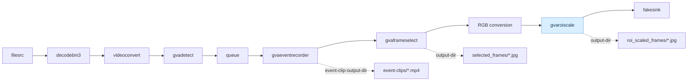

# gvaroiscale Sample (gst-launch command line)

This sample demonstrates ROI cropping and scaling with a `gst-launch-1.0` pipeline built from a YOLOv8s person detector followed by the `gvaeventrecorder`, `gvaframeselect` and `gvaroiscale` elements.

## How It Works

The sample constructs a GStreamer pipeline string and runs it with `gst-launch-1.0`. It selects frames, converts them to RGB, then crops and scales matching ROIs.



The pipeline combines the following elements:

* `filesrc` for reading the input video file
* `decodebin3` and `videoconvert` for video decoding and conversion
* `gvadetect` for full-frame person detection with YOLOv8s
* `gvaeventrecorder` for recording video clips around detections of the configured classes
* `gvaframeselect` for choosing up to eight frames from each 140-frame block
* `videoconvert` for converting the selected frames to RGB, which `gvaroiscale` requires
* `gvaroiscale` for cropping and scaling matching `person` ROIs to 448x448 RGB
* `fakesink` as the pipeline sink

`gvaroiscale` reads object-detection metadata (`GstAnalyticsRelationMeta`) attached to each RGB frame and selects all ROIs matching `target-classes`. It processes ROIs in descending confidence order and suppresses same-class duplicates with an intersection-over-union (IoU) above 0.5. Each remaining ROI is cropped, resized while preserving its aspect ratio, and centered on a black canvas at the configured output dimensions. A selected frame can produce multiple scaled ROI frames. Selected frames and scaled ROI frames are saved as JPEG images.

## Requirements

- DL Streamer installed and its GStreamer environment configured.
- A readable input video file.
- A readable OpenVINO IR object-detection model (`.xml` and matching `.bin`) that includes the `person` class.
- Writable storage for the output directory.

## Input video and model

The sample needs a video with people and a YOLOv8s detection model. The script does not download either of them; you must provide both.

### Video

Use any local video supported by GStreamer that contains people, and pass its path with `--input`. The video used in examples is only illustrative; obtain a suitable clip from a source available to you.

### Model

This sample expects the `yolov8s` model in FP16 precision from Ultralytics, converted to OpenVINO IR.

Use the model conversion scripts in [scripts/download_models/](../../../../scripts/download_models/README.md) to prepare it.
Before running them, create and activate the dedicated model-download virtual environment described in [scripts/download_models/README.md](../../../../scripts/download_models/README.md).

Pass the resulting OpenVINO IR model XML to the script with `--model`. Keep its matching `.bin` weights file alongside it.

## Usage

The **`gvaroiscale.sh`** script runs the pipeline on a video and writes event clips, selected frames and scaled ROI frames to the output directory. `--input`, `--model` and `--output` are required. The frame-selection and output-dimension options are optional and use their defaults when omitted.

| Option | Default | Description |
|---|---|---|
| `--input <video.mp4>` | — (required) | Input video file. |
| `--model <model.xml>` | — (required) | OpenVINO IR detection model used by `gvadetect`; its matching `.bin` file must be alongside it. |
| `--output <directory>` | — (required) | Output directory, created if it does not exist. Clips go to `event-clips/`, selected frames to `selected_frames/` and scaled ROI frames to `roi_scaled_frames/`. |
| `--sub-stream-frames N` | 140 | Number of input frames in each selection block (1-4294967295). Use at least the length of the longest event, because the frames are spread evenly over the whole block. |
| `--frame-budget N` | 8 | Maximum selected frames per block (1-4294967295). |
| `--out-width N` | 448 | Width of the scaled ROI image (1-8192). |
| `--out-height N` | 448 | Height of the scaled ROI image (1-8192). |
| `-h`, `--help` | — | Prints the usage and exits. |

The input video and the model file must already exist. A custom `--model` must be an OpenVINO IR detector XML used by `gvadetect`, with its matching `.bin` weights file alongside it.

Set `--out-width` and `--out-height` to the input dimensions expected by the model in the next pipeline element. Some VLMs accept dynamic image sizes or resize inputs internally, so check the model's requirements; the sample defaults are not universal.

Run with your own video, model, output directory and pipeline settings:

```bash
./gvaroiscale.sh \
    --input /path/to/video.mp4 \
    --model /path/to/model.xml \
    --output /path/to/output \
    --sub-stream-frames 140 \
    --frame-budget 8 \
    --out-width 640 \
    --out-height 384
```

**NOTE:** The following settings are fixed in the script and cannot be changed from the command line:
> - `gvaeventrecorder`: `target-classes=person`, `confidence-threshold=0.5`, `pre-event-frames=30`, `post-event-frames=30`, `event-gap-frames=3`
> - `gvaframeselect`: `target-classes=person`, `roi-padding=16`
> - `gvaroiscale`: `target-classes=person`
> - Selected frames are converted to RGB before `gvaroiscale`, which requires RGB input.

## Output

- Event clips recorded by `gvaeventrecorder`: `<output-directory>/event-clips/event_<class>_<timestamp>_<counter>.mp4`
- Cropped and scaled ROI frames: `<output-directory>/roi_scaled_frames/frame_XXXXXXXX.jpg`
- Selected source frames saved by `gvaframeselect`: `<output-directory>/selected_frames/frame_XXXXXXXX.jpg`

Saving frames to `roi_scaled_frames` does not consume them: the same scaled ROI frames continue to the next pipeline element, which is `fakesink` in this sample.

Frames without a matching person ROI are dropped by `gvaroiscale` and are not written to the scaled ROI directory.

## See Also

- [gvaroiscale element documentation](../../../../docs/user-guide/elements/gvaroiscale.md)
- [gvaeventrecorder sample](../gvaeventrecorder/README.md)
- [gvaframeselect sample](../gvaframeselect/README.md)
- [Samples overview](../../../README.md)