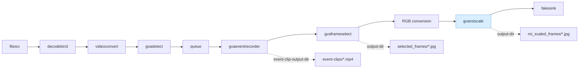

# gvaroiscale Sample

- `gvaroiscale` reads object-detection metadata (`GstAnalyticsRelationMeta`) attached to each RGB frame and selects all ROIs matching `target-classes`. It processes ROIs in descending confidence order and suppresses same-class duplicates with an intersection-over-union (IoU) above 0.5. Each remaining ROI is cropped, resized while preserving its aspect ratio, and centered on a black canvas at the configured output dimensions. It can optionally save each scaled ROI as a JPEG image.
- This sample uses `gvaframeselect` to choose up to eight frames from each 140-frame block, then passes them through `gvaroiscale` to crop and scale matching `person` ROIs to 448x448 RGB. A selected frame can produce multiple scaled ROI frames. Both selected frames and scaled ROI frames are saved as JPEG images.

## Pipeline

The pipeline selects frames, converts them to RGB, then crops and scales matching ROIs. Both JPEG output paths are optional and configured with `output-dir`:



## Requirements

- DL Streamer installed and its GStreamer environment configured.
- A readable input video file.
- A readable OpenVINO IR object-detection model (`.xml` and matching `.bin`) that includes the `person` class.
- Writable storage for the output directory.

## Input video and model

The sample needs a video with people and a YOLOv8s detection model. Both are downloaded automatically if they are missing, so manual download is optional.

### Video

- **Source:** [people-detection.mp4](https://github.com/intel-iot-devkit/sample-videos/raw/master/people-detection.mp4) from the [intel-iot-devkit/sample-videos](https://github.com/intel-iot-devkit/sample-videos) repository.
- **Manual download**, run from this sample's directory:

  ```bash
  mkdir -p video
  curl -fL -o video/people-detection.mp4 \
      https://github.com/intel-iot-devkit/sample-videos/raw/master/people-detection.mp4
  ```

### Model

- **Source:** the pretrained `yolov8s.pt` weights from Ultralytics, which the export script fetches automatically, converted to OpenVINO IR (FP16) with [`scripts/download_models/download_ultralytics_models.py`](../../../../scripts/download_models/download_ultralytics_models.py).
- **Manual download**, run from this sample's directory (see the [download_models README](../../../../scripts/download_models/README.md#2-ultralytics-conversion) for details):

  ```bash
  uv venv .ultralytics_models_venv
  source .ultralytics_models_venv/bin/activate
  uv pip install --index-strategy unsafe-best-match \
      -r ../../../../scripts/download_models/requirements_download_ultralytics_models.txt
  python ../../../../scripts/download_models/download_ultralytics_models.py \
      --model yolov8s.pt --outdir models/public/yolov8s/FP16 --half
  ```

### Automatic download

If the default video or model is missing, `gvaroiscale.sh` downloads it itself. Everything is stored in the directory that contains the script:

| Item | Location |
|---|---|
| Video | `video/people-detection.mp4` |
| Model | `models/public/yolov8s/FP16/yolov8s.xml` and `.bin`; the downloaded weights stay in `models/yolov8s.pt` |
| Python environment for the export | `.ultralytics_models_venv/`, created only if needed and removed after a successful export |

Downloading needs network access, and the first model export takes a few minutes. Nothing is downloaded when you pass your own `--input` or `--model`; such a path must exist.

## Usage

The **`gvaroiscale.sh`** script runs the pipeline on a video and writes event clips, selected frames and scaled ROI frames to the output directory. All options are optional; an omitted option uses its default, located next to the script. If you run the script without any options, it tries to download the default video and model on its own, then runs the pipeline with them.

| Option | Default | Description |
|---|---|---|
| `--input <video.mp4>` | `video/people-detection.mp4` | Input video. If the default is missing, it is downloaded from [intel-iot-devkit/sample-videos](https://github.com/intel-iot-devkit/sample-videos/raw/master/people-detection.mp4). |
| `--model <model.xml>` | `models/public/yolov8s/FP16/yolov8s.xml` | OpenVINO IR detection model used by `gvadetect`. If the default is missing, it is exported with [`download_ultralytics_models.py`](../../../../scripts/download_models/download_ultralytics_models.py) in a local `.ultralytics_models_venv` Python environment (needs network access). |
| `--output <directory>` | `output/` | Output directory, created if it does not exist. Clips go to `event-clips/`, selected frames to `selected_frames/` and scaled ROI frames to `roi_scaled_frames/`. |
| `--sub-stream-frames N` | 140 | Number of input frames in each selection block (1-4294967295). Use at least the length of the longest event, because the frames are spread evenly over the whole block. |
| `--frame-budget N` | 8 | Maximum selected frames per block (1-4294967295). |
| `--out-width N` | 448 | Width of the scaled ROI image (1-8192). |
| `--out-height N` | 448 | Height of the scaled ROI image (1-8192). |
| `-h`, `--help` | — | Prints the usage and exits. |

If you pass your own `--input` or `--model`, the file must already exist. The script then downloads and exports nothing, and does not fall back to the default. A custom `--model` must be an OpenVINO IR detector XML used by `gvadetect`, with its matching `.bin` weights file alongside it.

Set `--out-width` and `--out-height` to the input dimensions expected by the model in the next pipeline element. Some VLMs accept dynamic image sizes or resize inputs internally, so check the model's requirements; the sample defaults are not universal.

Run with the defaults:

```bash
./gvaroiscale.sh
```

Run with your own video:

```bash
./gvaroiscale.sh \
    --input /path/to/video.mp4
```

Run with your own video, model, output directory and pipeline settings:

```bash
./gvaroiscale.sh \
    --input /path/to/video.mp4 \
    --model /path/to/model.xml \
    --output /path/to/output \
    --sub-stream-frames 450 \
    --frame-budget 12 \
    --out-width 640 \
    --out-height 384
```

**NOTE:** The following settings are fixed in the script and cannot be changed from the command line:
> - `gvaeventrecorder`: `target-classes=person`, `confidence-threshold=0.5`, `pre-event-frames=30`, `post-event-frames=30`, `event-gap-frames=3`
> - `gvaframeselect`: `target-classes=person`, `roi-padding=16`
> - `gvaroiscale`: `target-classes=person`
> - Selected frames are converted to RGB before `gvaroiscale`, which requires RGB input.

## Output

- Event clips recorded by `gvaeventrecorder`: `<output-directory>/event-clips/event_<class>_<timestamp>_<counter>.mp4`
- Cropped and scaled ROI frames: `<output-directory>/roi_scaled_frames/frame_XXXXXXXX.jpg`
- Selected source frames saved by `gvaframeselect`: `<output-directory>/selected_frames/frame_XXXXXXXX.jpg`

Saving frames to `roi_scaled_frames` does not consume them: the same scaled ROI frames continue to the next pipeline element, which is `fakesink` in this sample.

Frames without a matching person ROI are dropped by `gvaroiscale` and are not written to the scaled ROI directory.

## See Also

- [gvaroiscale element documentation](../../../../docs/user-guide/elements/gvaroiscale.md)
- [gvaeventrecorder sample](../gvaeventrecorder/README.md)
- [gvaframeselect sample](../gvaframeselect/README.md)
- [Samples overview](../../../README.md)