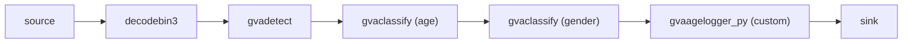
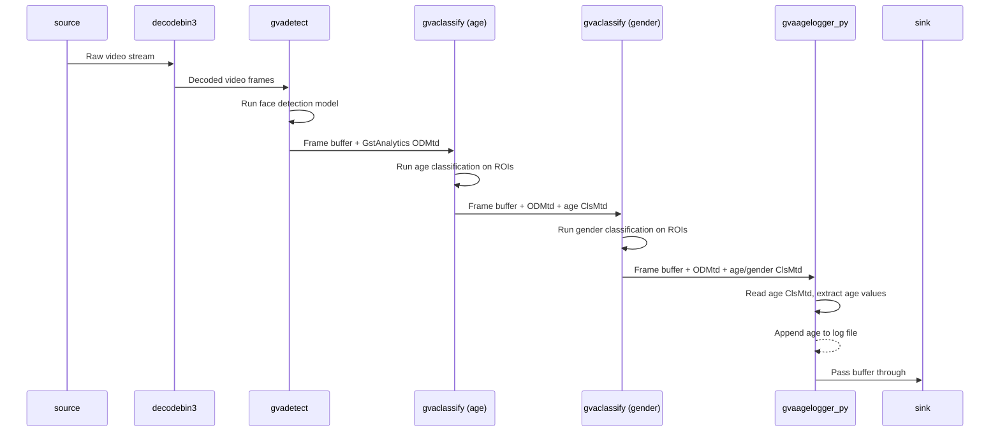

# Python Element Sample - Face Detection and Classification

This sample demonstrates how to replace `gvapython`-based post-processing with standard DLStreamer elements (`gvadetect`, `gvaclassify`) and a custom GStreamer Python element (`gvaagelogger_py`) for age logging. Faces are detected, then classified for **age** and **gender** in two chained `gvaclassify` stages.


See [smart_nvr](../../../python/smart_nvr/) sample as reference for custom Python element pattern.

## Overview

This document describes:
* the pipeline architecture and data flow ([How It Works](#how-it-works))
* the models used and where they are stored ([Models](#models))
* environment requirements ([Prerequisites](#prerequisites))
* how to run the sample and available options ([Running](#running))
* what to expect on the console and on disk ([Sample Output](#sample-output))

## How It Works

The pipeline detects faces and runs two chained classification stages on the detected ROIs — first for age, then for gender — and finally logs detected age labels to a file using a custom Python element:



* **gvadetect** — replaces `gvainference` + `gvapython(ssd_object_detection.py)`. Handles face detection model post-processing internally.
* **gvaclassify (age)** — runs the age model on detected ROIs and produces GstAnalytics classification metadata (ClsMtd) with age-group labels (e.g. `20-29`, `30-39`).
* **gvaclassify (gender)** — runs the gender model on the same ROIs and adds another ClsMtd entry with `Female` / `Male` labels.
* **gvaagelogger_py** — replaces `gvapython(age_logger.py)`. Custom Python element that reads age ClsMtd metadata and logs age values to a file.

Data flow between pipeline elements:



Configurable element properties (via gst-launch-1.0):
* `log-file-path` - Path to the age log file (default: "/tmp/age_log.txt")


## Models

The sample script requires specific models in OpenVINO™ IR format; the model paths are hard-coded and cannot be changed via arguments:
* `arnabdhar_YOLOv8-Face-Detection` — face detection (used by `gvadetect`), loaded from `$MODELS_PATH/public/arnabdhar_YOLOv8-Face-Detection/FP16/arnabdhar_YOLOv8-Face-Detection.xml`; prepare it with `download_ultralytics_models.py`.
* `dima806_fairface_age_image_detection` — age estimation (used by the first `gvaclassify`), loaded from `$MODELS_PATH/public/dima806_fairface_age_image_detection/FP16/dima806_fairface_age_image_detection.xml`; prepare it with `download_hf_models.py`.
* `dima806_fairface_gender_image_detection` — gender classification (used by the second `gvaclassify`), loaded from `$MODELS_PATH/public/dima806_fairface_gender_image_detection/FP16/dima806_fairface_gender_image_detection.xml`; prepare it with `download_hf_models.py`.

See [scripts/download_models](../../../../../scripts/download_models/README.md) for the helper scripts. `MODELS_PATH` must be set before running the sample. The models used to validate this sample are listed in [Validation](#validation).

## Prerequisites

The GStreamer Python plugin (`libgstpython.so`) must be available in `GST_PLUGIN_PATH`. The sample shell script automatically adds the local `plugins/` directory to `GST_PLUGIN_PATH`.

### Install Python Dependencies

This sample only needs the Python packages already provided by the DL
Streamer installation (GStreamer Python bindings). If you installed DL
Streamer natively and skipped them, see
[Step 9: Install Python dependencies](../../../../../docs/user-guide/dev_guide/advanced_install/advanced_install_guide_compilation.md#step-9-install-python-dependencies-optional)
in the Advanced Install Guide. The Docker image already includes them.

## Running

Before running, ensure the DL Streamer environment is properly configured and
`MODELS_PATH` points to the models prepared in [Models](#models).

```sh
./face_detection_and_classification.sh [INPUT_VIDEO] [DEVICE] [SINK_ELEMENT]
```

The sample requires `INPUT_VIDEO`; device and sink are optional:
1. [INPUT_VIDEO] to specify input video file.
   The input could be
   * local video file
   * web camera device (ex. `/dev/video0`)
   * RTSP camera (URL starting with `rtsp://`) or other streaming source (ex URL starting with `http://`)

  Use any video supported by GStreamer; a clip containing faces is useful for this example. An optional sample is [`head-pose-face-detection-female-and-male.mp4`](https://raw.githubusercontent.com/intel-iot-devkit/sample-videos/master/head-pose-face-detection-female-and-male.mp4).

2. [DEVICE] to specify device for detection and classification (used for both age and gender models). Default CPU.
   Please refer to OpenVINO™ toolkit documentation for supported devices.
   https://docs.openvinotoolkit.org/latest/openvino_docs_IE_DG_supported_plugins_Supported_Devices.html

3. [SINK_ELEMENT] to choose output mode:
   * display - render (default)
   * fps - FPS only
   * json - write metadata to output.json
   * display-and-json - render and write metadata
   * file - render to file

Age values are logged to `/tmp/age_log.txt` (configurable via `log-file-path` property on `gvaagelogger_py`).

Examples:
```sh
# Use any local video or supported stream that contains faces.
./face_detection_and_classification.sh /path/to/video.mp4 CPU display

# Use the same input with CPU, FPS-only mode (no display required)
./face_detection_and_classification.sh \
  /path/to/video.mp4 \
    CPU fps

# Use a local video and write metadata to output.json
./face_detection_and_classification.sh \
  /path/to/video.mp4 \
    CPU json

# Local video file (replace with an existing path on your machine), CPU, file output
./face_detection_and_classification.sh <MP4_FILE_PATH> CPU file


# Web camera (requires a connected /dev/videoN device and a display)
./face_detection_and_classification.sh /dev/video0 GPU display

# RTSP camera (replace the URL with your actual stream)
./face_detection_and_classification.sh rtsp://<camera-host>:554/<stream-path> CPU json
```

## Sample Output

The sample:
* Prints gst-launch-1.0 full command line into console
* Starts the command and either visualizes video with bounding boxes and age + gender labels or prints FPS
* Logs detected ages to `/tmp/age_log.txt`

## Validation

This sample was validated with:

- Models: `arnabdhar_YOLOv8-Face-Detection`, `dima806_fairface_age_image_detection`, `dima806_fairface_gender_image_detection` (FP16)
- Video: [`head-pose-face-detection-female-and-male.mp4`](https://github.com/intel-iot-devkit/sample-videos/raw/master/head-pose-face-detection-female-and-male.mp4)

## See also
* [Samples overview](../../../../README.md)

