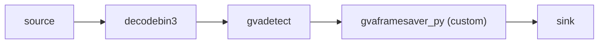
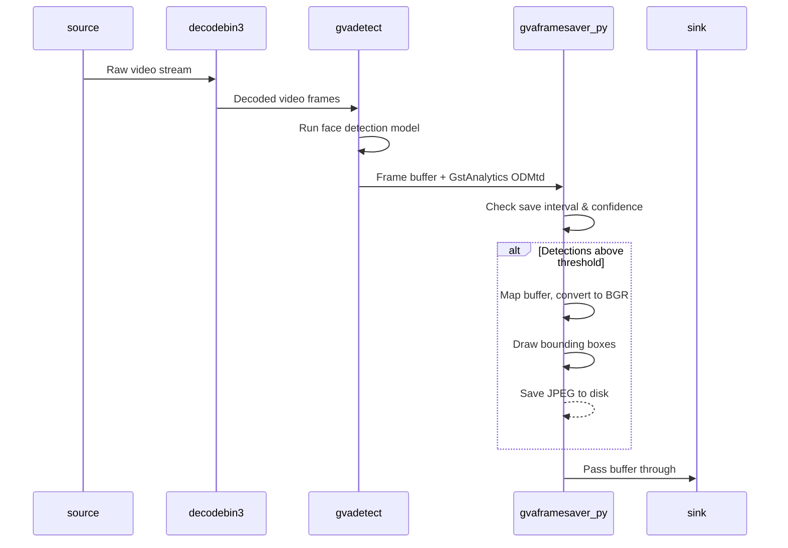

Prepare the example model with the general [`download_ultralytics_models.py`](../../../../scripts/download_models/README.md#2-ultralytics-conversion) helper. From the repository root:
# Python Element Sample - Save Frames with ROI Only

This sample demonstrates a custom GStreamer Python element (`gvaframesaver_py`) that saves video frames containing detected objects. It replaces the previous `gvapython`-based approach with a proper GStreamer element using GstAnalytics metadata API.

See [smart_nvr](../../../python/smart_nvr/) sample as reference for custom Python element pattern.

## Overview

This document describes:
* the pipeline architecture and data flow ([How It Works](#how-it-works))
* the models used and where they are stored ([Models](#models))
* environment requirements ([Prerequisites](#prerequisites))
* how to run the sample and available options ([Running](#running))
* what to expect on the console and on disk ([Sample Output](#sample-output))

## How It Works

The pipeline uses `gvadetect` for object detection and `gvaframesaver_py` custom Python element for saving frames:



The custom `gvaframesaver_py` element (`plugins/python/gvaFrameSaver.py`):
* Reads GstAnalytics detection metadata (ODMtd) from each buffer
* Saves frames to disk when objects are detected above confidence threshold
* Draws bounding boxes and labels on saved images
* Rate-limits saves to avoid excessive disk I/O
* Works with multiple video formats (NV12, I420, BGR, BGRA, BGRX)

Data flow between pipeline elements:



Configurable element properties (via gst-launch-1.0):
* `output-dir` - Directory for saved frames (default: "saved_frames")
* `save-interval` - Minimum seconds between saves (default: 2.0)
* `min-confidence` - Minimum detection confidence threshold (default: 0.5)

## Models

The example uses `arnabdhar/YOLOv8-Face-Detection` for face detection; any compatible OpenVINO face detector can be used by setting `DETECT_MODEL_PATH`. Prepare a suitable model with the general [`download_ultralytics_models.py`](../../../../scripts/download_models/README.md#2-ultralytics-conversion) helper; see its README for supported models and setup.

### Model storage location

By default, the sample looks for the model at `$MODELS_PATH/public/arnabdhar_YOLOv8-Face-Detection/FP16/arnabdhar_YOLOv8-Face-Detection.xml`. Set `DETECT_MODEL_PATH` to use another compatible model XML.


## Prerequisites

The GStreamer Python plugin (`libgstpython.so`) must be available in `GST_PLUGIN_PATH`. The sample shell script automatically adds the local `plugins/` directory to `GST_PLUGIN_PATH`.

If Python requirements are not installed yet:

```sh
uv pip install opencv-python-headless numpy
```

## Running

Before running, ensure the DL Streamer environment is properly configured and the model has been prepared as described above. Use any local video, stream URL, or camera supported by GStreamer.

```sh
./save_frames_with_roi.sh <INPUT_VIDEO> [DEVICE] [SINK_ELEMENT]
```

The sample requires `INPUT_VIDEO`. Use any local video supported by GStreamer, a camera device such as `/dev/video0`, or a stream URI.
`DEVICE` is optional and defaults to `GPU`. `SINK_ELEMENT` is optional and defaults to `fps`; use `display` to render frames.

Custom element properties can be set by modifying the pipeline in the shell script, e.g.:
```sh
gvaframesaver_py output-dir=/tmp/detections save-interval=1.0 min-confidence=0.7
```

Examples:
```sh
# Use any local video supported by GStreamer, GPU detection, FPS mode
./save_frames_with_roi.sh /path/to/video.mp4

# Local video file, CPU detection, FPS mode
./save_frames_with_roi.sh /path/to/video.mp4 CPU fps

# Web camera, GPU detection, display mode
./save_frames_with_roi.sh /dev/video0 GPU display

# RTSP camera, CPU detection, display mode
./save_frames_with_roi.sh rtsp://192.168.1.100:554/stream CPU display
```

## Sample Output

The sample:
* Prints gst-launch-1.0 full command line into console
* Starts the command and visualizes video with bounding boxes around detected faces or prints out fps
* Saves frames with detections to the `saved_frames` directory (created automatically)
* Prints status message for each saved frame

Example output in console:
```
Saved: saved_frames/frame_00000.jpg
Saved: saved_frames/frame_00001.jpg
Saved: saved_frames/frame_00002.jpg
```

## See also
* [Samples overview](../../../../README.md)

