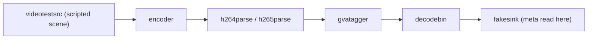
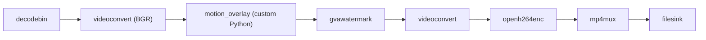

# gvatagger Motion Tagging Sample

This sample demonstrates `gvatagger`, a coded-size motion tagger for H.264/H.265 streams.

`gvatagger` looks only at the size of the picture-data NAL units of each access unit: no decoding,
no pixels. While nothing moves, P-frames shrink to a few bytes; motion forces the encoder to spend
bits. An exponential moving average (EMA) tracks the size of a quiet frame, and a frame larger than
`max(k * baseline, baseline + margin)` is tagged as motion.

Every access unit is passed through unchanged and gets a `GvaTriggerMeta` custom meta:

| Field | Type | Meaning |
|-------|------|---------|
| `motion` | boolean | frame is larger than the threshold |
| `keyframe` | boolean | frame is an IDR |

The meta survives decoding (`avdec_h264`, `openh264dec`, `vah264dec`, `vah265dec`, `decodebin`),
so elements after the decoder can skip inference on quiet frames. This sample reads it after the
decoder and prints a motion summary.



By default a synthetic 20 s scene is generated and encoded:

| Time | Phase | Content |
|------|-------|---------|
| 0-5 s | static | `smpte75` color bars |
| 5-8 s | ball | small moving ball |
| 8-13 s | static | `smpte75` color bars |
| 13-15 s | noise | full-frame noise |
| 15-20 s | static | `smpte75` color bars |

## Running

### Prerequisites

DL Streamer must be installed. No extra Python packages are needed.

### Run the Sample

The quickest way is the shell script: it generates the synthetic scene, prints the motion summary
and writes an annotated MP4.

```bash
cd samples/gstreamer/python/gvatagger_motion
./gvatagger_motion.sh
```

Or specify custom input/output, the encoder for the synthetic scene, the motion threshold `k`,
or extra options:

```bash
./gvatagger_motion.sh /path/to/input.mp4 /tmp/output.mp4
ENCODER=vah265 ./gvatagger_motion.sh
K=2.5 ./gvatagger_motion.sh /path/to/input.mp4 /tmp/output.mp4
./gvatagger_motion.sh synthetic /tmp/output.mp4 --margin 32 --min-baseline 50
```

Default input: `synthetic` (generated scene, encoded with `openh264`)  
Default output: `/tmp/gvatagger_motion_output.mp4`  
Default `K`: `1.5`. Lower is more sensitive (fewer missed events, more false alarms); raise it
when quiet scenes are tagged as motion.

To see GStreamer debug/info logs, set `GST_DEBUG` (same syntax as the `GST_DEBUG` environment
variable; default is `*:3`, GStreamer's INFO level):

```bash
GST_DEBUG="gvatagger:6" ./gvatagger_motion.sh
GST_DEBUG="*:1" ./gvatagger_motion.sh   # errors only
```

### Run in Docker

Mount the sample and a host directory for the result:

```bash
cd samples/gstreamer/python/gvatrigger_motion
mkdir -p results
docker run --rm -v $PWD:/sample -v $PWD/results:/results intel/dlstreamer:latest \
    /sample/gvatrigger_motion.sh synthetic /results/gvatrigger_motion_output.mp4
```

For the VA encoders, also pass the GPU: `--device /dev/dri --group-add $(stat -c %g /dev/dri/renderD128) -e ENCODER=vah265`.
To tune the threshold, add `-e K=2.5`. To change the log level (default `*:3`), add `-e GST_DEBUG="gvatagger:6"`.

### Run Directly with Python

```bash
python3 gvatagger_motion.py
python3 gvatagger_motion.py --gst-debug "gvatagger:6"
```

GStreamer logging defaults to `*:3` (INFO); pass `--gst-debug "*:1"` for errors only, or a specific
category like `gvatagger:6` for per-frame size/baseline/motion traces.

`gvafpscounter` is part of the pipeline and prints the decoded frame rate to stdout every second.

Options:

| Option | Default | Description |
|--------|---------|-------------|
| `--encoder` | `openh264` | encoder for the synthetic scene: `openh264` (CPU), `vah264`, `vah265` (Intel GPU, constant QP) |
| `--input` | - | H.264/H.265 video file or URI to tag instead of the synthetic scene |
| `--k` | `1.5` | motion threshold multiplier |
| `--margin` | `8` | minimum byte margin above the baseline |
| `--min-baseline` | `10` | baseline floor in bytes |
| `--output` | - | write an MP4 with a red border and a `MOTION` label on frames tagged as motion |

Run on a recording or a camera:

```bash
python3 gvatagger_motion.py --input /path/to/video.mp4
python3 gvatagger_motion.py --input rtsp://<camera>/stream
```

### Video Output

With `--output`, decoded frames go through a small Python element (`motion_overlay`) that reads
`GvaTriggerMeta` and, on motion frames, attaches DL Streamer watermark meta (a red border and a
`MOTION DETECTED` label). `gvawatermark` renders it and the result is encoded to MP4:



```bash
python3 gvatagger_motion.py --output /tmp/gvatagger_motion.mp4
python3 gvatagger_motion.py --input /path/to/video.mp4 --output /tmp/gvatagger_motion.mp4
```

Keyframes are always tagged `motion=false`, so the overlay is not drawn on them even during motion.

To see the per-frame size and baseline used for each decision:

```bash
GST_DEBUG=gvatagger:6 python3 gvatagger_motion.py 2>&1 | grep "motion="
```

## Sample Output

```text
=== gvatrigger motion summary ===
decoded frames      : 600
frames with meta    : 600
keyframes           : 10
motion frames       : 217 (36.2%)
inference skippable : 383 (63.8%)

phase         frames   motion  motion %
static         0-149       63     42.0%
ball         150-239       88     97.8%
static       240-389        3      2.0%
noise        390-449       59     98.3%
static       450-599        4      2.7%
```

(`--encoder vah265`)

## Reading the Results

* **First ~2 s are tagged as motion.** The baseline is seeded from the first 60 non-IDR frames;
  until then every frame is tagged `motion=true` so nothing is missed.
* **Isolated single-frame hits right after keyframes** are the first P-frame after an IDR, which
  is larger than a regular quiet P-frame. The defaults favor recall over false alarms.
* **Motion that never stops becomes the baseline.** If the whole input moves (e.g. a looping
  animation), the warm-up average already contains that motion and later frames look quiet.
* **`openh264` keeps tagging motion after the noise phase.** In bitrate mode it spends extra bits
  for ~1.5 s to rebuild quality; the VA encoders in constant-QP mode do not.
* **Constant-bitrate (CBR) streams** pad quiet frames up to the target bitrate, which hides the
  size signal. Prefer VBR or constant-QP streams.
