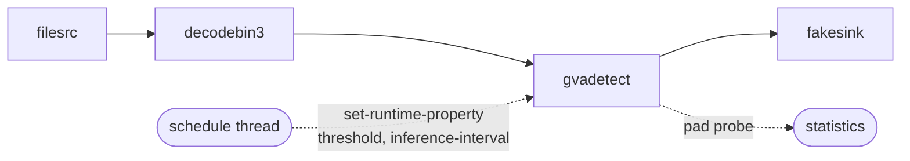

# Changing gvadetect Properties While the Pipeline Is Running

This sample shows how to change `threshold` and `inference-interval` of a running `gvadetect` element, without
restarting the pipeline, and how to find out whether each change was accepted. It runs a detection pipeline and steps
through a schedule of changes from a separate thread, comparing the detections of each phase. Changes that must be
refused (out-of-range values, properties that cannot change while running, unknown properties) are shown as well.
It can also be driven by hand, with commands typed while the pipeline runs.

> Add dedicated Sample showing functionality of changing the inference-interval and threshold for gvadetect element

## What It Does

1. **Detects** objects with `gvadetect` (YOLO11s), starting with `threshold=0.5` and `inference-interval=1`.
2. **Changes the properties** of the running element in phases, through the `set-runtime-property` signal and, in one
   phase, with `set_property()`.
3. **Rewinds the input** at the start of each phase, so that every phase sees the same frames and the numbers can be
   compared.
4. **Counts the detections** of each phase with a pad probe on the output of `gvadetect`.
5. **Asks for changes that must be refused** and prints the status the element answers with.
6. **Prints a table** with the detections of every phase.



- `gvadetect`: object detection. `threshold` and `inference-interval` are the properties that can be changed while it
  runs. Every other property is read once, when the element starts.
- `fakesink sync=true`: plays the video at its own speed, so that a phase lasts as many seconds as it says.

## Prerequisites

- DL Streamer installed on the host, or a DL Streamer Docker image
- Intel Edge AI system with integrated GPU (or `--device CPU`)

### Install Python Dependencies

Inside the DL Streamer Docker image or a DL Streamer installation everything the sample needs is already there. On
another system, install the Python binding it uses with [`uv`](https://astral.sh/uv)
(`curl -LsSf https://astral.sh/uv/install.sh | sh`):

```bash
uv venv .runtime-property-change-venv
source .runtime-property-change-venv/bin/activate
uv pip install -r requirements.txt
```

## Prepare Video and Models (One-Time Setup)

### Download Video

The sample works with any video that has objects the model knows. This one shows traffic on a highway
(1280x720, 60 fps). It is rewound at the start of each phase, so it needs to be only as long as one phase.

```bash
mkdir -p videos && curl -L -o videos/highway.mp4 \
    -H "Referer: https://www.pexels.com/" \
    -H "User-Agent: Mozilla/5.0 (X11; Linux x86_64) AppleWebKit/537.36" \
    "https://videos.pexels.com/video-files/2103099/2103099-hd_1280_720_60fps.mp4"
```

This sample uses Pexels video #2103099 (a police highway scene), as in the
[heterogeneous systems guide](../../../../docs/user-guide/dev_guide/heterogeneous_systems_guide.md).

## Models

This sample expects one OpenVINO IR model: `yolo11s` in FP16 precision from Ultralytics, for object detection.

Use the model conversion scripts in [scripts/download_models/](../../../../scripts/download_models/README.md) to
prepare it. Before running them, create and activate the dedicated model-download virtual environment described in
[scripts/download_models/README.md](../../../../scripts/download_models/README.md). Then, from that folder:

```bash
python download_ultralytics_models.py --model yolo11s.pt --half --outdir "$HOME/models/public/yolo11s/FP16"
```

Set the `MODELS_PATH` environment variable to the main directory the models are downloaded to, so that the model is
found at `$MODELS_PATH/public/yolo11s/FP16/yolo11s.xml`:

```bash
export MODELS_PATH="$HOME/models"
```

To use another detection model, give its `.xml` file with `--model`.

## Running the Sample

```bash
python3 runtime_property_change.py --input videos/highway.mp4
```

In the DL Streamer Docker image, with the models mounted:

```bash
docker run --init --rm \
    -u "$(id -u):$(id -g)" \
    -e PYTHONUNBUFFERED=1 \
    -v "$(pwd)":/app -w /app \
    -v "${MODELS_PATH}":/models -e MODELS_PATH=/models \
    --device /dev/dri \
    --group-add $(stat -c "%g" /dev/dri/render*) \
    intel/dlstreamer:latest \
    python3 runtime_property_change.py --input videos/highway.mp4
```

Use another device or a shorter schedule:

```bash
python3 runtime_property_change.py --input videos/highway.mp4 --device CPU --phase-seconds 4
```

### Interactive mode

`--interactive` has no schedule. The detections of the last second are printed every second, and the properties are
changed with commands typed on the standard input:

```bash
python3 runtime_property_change.py --input videos/highway.mp4 --interactive
```

```text
threshold 0.9          change the confidence threshold
interval 5             change the inference interval (1 = every frame)
set batch-size 8       try any property, to see how it is refused
show                   print the current values
quit                   stop the pipeline
```

## Example Output

The first frame appears only after the model is compiled, so the schedule starts then. Every change prints what the
element answered, and the table at the end compares the phases (YOLO11s on a GPU, 5 s per phase, 0.5 s of each phase
not counted, shortened):

```text
=== higher threshold ===
[signal]  threshold: 0.5 -> 0.9  (APPLIED)
=== every 5th frame ===
[signal]  threshold: 0.9 -> 0.5  (APPLIED)
[signal]  inference-interval: 1 -> 5  (APPLIED)
=== back to the start ===
[direct]  inference-interval: 5 -> 1  (set_property)

Requests that must be refused:
  (above the range 0..1)
  [signal]  threshold='1.5' refused: INVALID_VALUE - value '1.5' is out of range [0.000000, 1.000000]
  (read once, when the element starts)
  [signal]  device='CPU' refused: NOT_MUTABLE - property 'device' cannot be changed in state PLAYING, only before the element starts
  (there is no such property)
  [signal]  no-such-property='1' refused: NOT_FOUND - no such property
Nothing was changed: threshold=0.50, inference-interval=1, batch-size=1

Phase                                                     Frames  With det.  Detections  Det./frame  Min conf.
--------------------------------------------------------------------------------------------------------------
baseline (threshold=0.50, inference-interval=1)              108         90          90        0.83       0.84
higher threshold (threshold=0.90, inference-interval=1)      108          5           5        0.05       0.90
lower threshold (threshold=0.10, inference-interval=1)       108         91         104        0.96       0.10
every 5th frame (threshold=0.50, inference-interval=5)       108         18          18        0.17       0.86
back to the start (threshold=0.50, inference-interval=1)     108         90          90        0.83       0.84
```

The numbers depend on the video and the model. What to look at:

- **Threshold:** the lowest confidence seen in a phase (`Min conf.`) follows the threshold, and the number of
  detections goes down when it is raised and up when it is lowered.
- **Inference interval:** with `inference-interval=5` only every 5th frame goes through the model, so about one frame in
  five has detections. Frames in between carry none. Add [`gvatrack`](../../../../docs/user-guide/elements/gvatrack.md)
  after `gvadetect` to carry the objects over those frames.
- **Back to the start:** the last phase has the values of the first, and the same numbers.

## How It Works

### STEP 1: The pipeline

```python
f'{src} ! decodebin3 caps="video/x-raw(ANY)" ! '
f'gvadetect name=detect model="{model}" device={device} batch-size=1 threshold=0.5 inference-interval=1 ! '
"fakesink sync=true"
```

The element is given a name, so that the application can look it up with `pipeline.get_by_name("detect")` and keep a
reference to it while the pipeline runs.

### STEP 2: Changing a property and checking the result

The `set-runtime-property` action signal takes the name of the property and its value as text, like a REST API
would, and returns a `Gst.Structure` with the fields `status`, `code`, `message`, `property`, `previous` and `current`:

```python
result = detect.emit("set-runtime-property", "threshold", "0.9")
if result.get_value("status") != 0:
    print(result.get_value("code"), result.get_value("message"))
```

| `status` | `code` | Meaning |
| --- | --- | --- |
| 0 | `APPLIED` | The property was set and reads back with the new value |
| 1 | `NOT_FOUND` | There is no such property |
| 2 | `NOT_MUTABLE` | The property cannot be changed in the current state of the element |
| 3 | `INVALID_VALUE` | The value is not of the type of the property, or is out of its range |
| 4 | `NOT_APPLIED` | The property did not take the value |

A refused request changes nothing, and the pipeline keeps running.

The same properties can be set with `detect.set_property("inference-interval", 1)` from any thread. That takes effect
in the same way, but there is no status: a refused value only logs a warning, so the sample reads the value back. The
last phase of the schedule does this.

### STEP 3: When a change takes effect

- `inference-interval` applies from the next frame.
- `threshold` applies from the next inference result that is converted. It replaces the confidence threshold of the
  model for all of its output layers.

Results that are already being processed when a change is made may still use the old value, so the first
`SETTLE_SECONDS` of each phase are not counted.

### STEP 4: Comparing phases on the same frames

At the start of each phase after the first, the sample seeks the input back to the beginning with a flushing seek.
Only the playback position goes back: the pipeline, the element and the model keep running. Without it each phase would
see a different part of the video, and a quiet stretch would look like an effect of the threshold. If the input cannot be
rewound (for example a live stream), the sample says so and the phases see different frames.

### STEP 5: Counting detections

A pad probe on the output of `gvadetect` reads the regions of interest of each frame with `gstgva.VideoFrame`:

```python
frame = VideoFrame(buffer, caps=pad.get_current_caps())
collector.on_frame([roi.confidence() for roi in frame.regions()])
```

### STEP 6: Refused requests

After the last phase the sample asks for changes that cannot be made, one for each kind of answer: a value above the
range, a value that is not a number, a value below the minimum, two properties that are only read when the element
starts (`device`, `batch-size`), and a property that does not exist. Each is answered with its status and message, and
the values are read back to show that nothing changed.

Only `threshold` and `inference-interval` are meant to change while running. See
[Changing properties at runtime](../../../../docs/user-guide/elements/gvadetect.md#changing-properties-at-runtime)
for what applies when elements share a model.

## Command-Line Arguments

| Argument | Default | Description |
|---|---|---|
| `--input` | required | Video file path or `rtsp://` URI |
| `--model` | `$MODELS_PATH/public/yolo11s/FP16/yolo11s.xml` | Detection model (`.xml`), see [Models](#models) |
| `--device` | `GPU` | Inference device. `NPU` and `GPU` fall back to what is available |
| `--phase-seconds` | `6` | How long each phase of the schedule lasts. The input is rewound at each phase, so it must be at least this long |
| `--interactive` | off | No schedule: change the properties by typing commands, and print the detections of every second |

## Output

The sample writes no files. It prints the changes with their status while it runs, and the table of phases at the end.
It exits with `0` when the pipeline finishes and `1` on a pipeline error.
