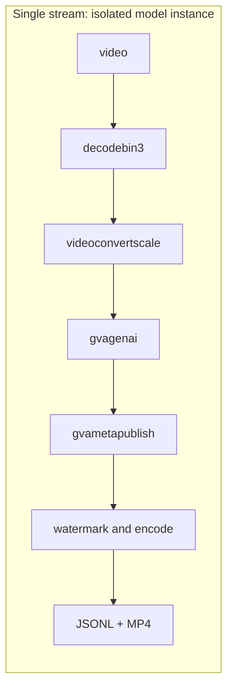
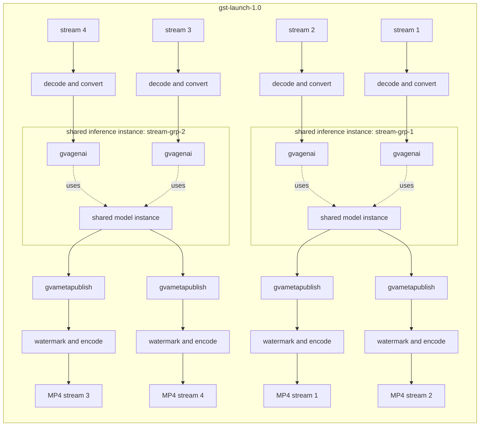

# VLM Alerts

This sample demonstrates an edge AI alerting pipeline using Vision-Language Models (VLMs).

It shows how to:

- Run a VLM — exported to OpenVINO IR beforehand — inside a DL Streamer pipeline
- Generate structured JSON alerts per processed frame, including a confidence score
- Produce MP4 output with the inference result overlaid on each frame
- Run a single video stream (default) or four streams grouped into two model-sharing groups

> **Note:** the sample never downloads media or models. Prepare the input video and export
> the model beforehand, as described below.

## Use Case: Alert-Based Monitoring

VLMs can help accurately detect rare or contextual events using natural language prompts — for example, detecting a police car in a traffic video.
This enables alerting for events, like in prompts:

- Is there a police car?
- Is there smoke or fire?
- Is a person lying on the ground?

## Download Video

Download an example video file:

```code
curl -L -o 2103099-hd_1280_720_60fps.mp4 \
    "https://videos.pexels.com/video-files/2103099/2103099-hd_1280_720_60fps.mp4"
```

Pass the file with `--video-path`. The flag is repeatable; extra inputs are only used by the
four-stream scenario (**`--stream-groups`**).

## Prepare Model

Any image-text-to-text model supported by optimum-intel can be used. Smaller models (1B-4B parameters) are recommended for edge deployment. For example, OpenGVLab/InternVL3_5-2B.

Export the model once with the [Hugging Face model conversion](../../../../scripts/download_models/README.md#1-hugging-face-conversion) script. Exporting into `$MODELS_PATH/public` keeps the model in the layout shared with the other DL Streamer samples:

```code
export MODELS_PATH="$HOME"/models
python3 ../../../../scripts/download_models/download_hf_models.py \
    --model OpenGVLab/InternVL3_5-2B \
    --outdir "${MODELS_PATH}/public" \
    --extra_args --task image-text-to-text
```

Exported this way, the model is picked up automatically: `--model-path` defaults to
`public/OpenGVLab_InternVL3_5-2B`, which is resolved inside `$MODELS_PATH`. To use a different
model, pass the exported directory explicitly. A relative path is looked up in the current
directory and then in `$MODELS_PATH`.

## Pipeline Architecture

The pipeline is built dynamically in Python using **`Gst.parse_launch`**. Two scenarios
are supported.

### Scenario 1 (default): single stream

One independent source, decoder, inference element, JSONL file, and MP4 file. Each
**`gvagenai`** loads its own isolated model instance.



### Scenario 2 (**`--stream-groups`**): four streams, two model-sharing groups

Four independent streams split into two groups of two:

- Streams 1 and 2 use **`model-instance-id=stream-grp-1`**
- Streams 3 and 4 use **`model-instance-id=stream-grp-2`**

Within each group, the two **`gvagenai`** elements share one loaded OpenVINO model instance;
inference calls on a shared instance are serialized, which reduces memory use but can
limit throughput. The two groups load separate model instances. Provide up to four inputs
by repeating **`--video-path`**; if fewer are given, they are cycled to fill the
four streams.



Each stream has an independent source, decoder, inference element, and MP4
file. The branches run in one process and contain queues around the inference/output
stages.

## Setup

```sh
cd samples/gstreamer/python/vlm_alerts
```

A DL Streamer build that includes the `gvagenai` element is required
(the `intel/dlstreamer` Docker image already provides it). No Python
environment setup is needed: `vlm_alerts.py` only imports the GStreamer
Python bindings (`gi`), which the Docker image installs system-wide already.
If you're using a native (non-Docker) installation instead, make sure
PyGObject is available as described in the
[DL Streamer Installation Guide](../../../../docs/user-guide/install/install_guide_index.md).

<u>2. Install dependencies:</u>
```code
curl -LO https://raw.githubusercontent.com/openvinotoolkit/openvino.genai/refs/heads/releases/2026/3/samples/export-requirements.txt
uv pip install -r export-requirements.txt
uv pip install -r requirements.txt
```

`requirements.txt` overrides two packages from `export-requirements.txt`:

- `transformers` must be compatible with `optimum-intel` for OpenVINO export.
- `openvino-tokenizers` must match the OpenVINO runtime used by DL Streamer to avoid binary incompatibility.

**Note:** these dependencies are needed for the one-time model export described in
[Prepare Model](#prepare-model). Running the sample itself requires only DL Streamer and its
GStreamer Python bindings.

A DL Streamer build that includes the `gvagenai` element is required.

## Running

Required arguments:

- `--prompt`
- `--video-path`

`--model-path` defaults to `$MODELS_PATH/public/OpenGVLab_InternVL3_5-2B`; pass it explicitly to
use a different model.

### Single stream (default)

Run one video stream with an isolated model instance:

```code
python3 vlm_alerts.py \
    --video-path 2103099-hd_1280_720_60fps.mp4 \
    --prompt "Is there a police car? Answer yes or no."
```

### Four streams in two model-sharing groups

Use **`--stream-groups`** to run four video branches in one pipeline. Repeat
**`--video-path`** to provide up to four inputs; if fewer are provided,
the inputs are cycled to fill all four streams. Each pair of **`gvagenai`** elements shares
one model instance: streams 1-2 use **`model-instance-id=stream-grp-1`**, and streams 3-4
use **`model-instance-id=stream-grp-2`**.

```code
python3 vlm_alerts.py \
    --stream-groups \
    --video-path 2103099-hd_1280_720_60fps.mp4 \
    --prompt "Is there a police car? Answer yes or no."
```

Each stream writes `<ModelName>-<video_stem>-stream<N>.jsonl` and
`<ModelName>-<video_stem>-stream<N>.mp4`.

Optional arguments:

| Argument | Default | Description |
|---|---|---|
| `--model-path` | `public/OpenGVLab_InternVL3_5-2B` | Path to an OpenVINO model exported beforehand. A relative path is looked up in the current directory and in `$MODELS_PATH` |
| `--stream-groups` | off | Run four streams split into two model-sharing groups of two, each group with its own `model-instance-id` |
| `--device` | `GPU` | Inference device |
| `--max-tokens` | `1` | Maximum tokens in the model response |
| `--num-beams` | `4` | Beam search width. Values ≥ 2 enable beam search and produce a confidence score; `1` means greedy decoding with no confidence |
| `--frame-rate` | `1.0` | Frames per second passed to `gvagenai` |
| `--results-dir` | `./results` | Directory for output files |
| `--output-json` | *(unset)* | Path of the JSON Lines output file, overriding `<results-dir>/<ModelName>-<video_stem>.jsonl`. With `--stream-groups` the stream suffix is inserted before the extension |

## Output

Default single-stream scenario:

```
results/<ModelName>-<video_stem>.jsonl
results/<ModelName>-<video_stem>.mp4
```

Four-stream scenario (`--stream-groups`), one pair per stream:

```
results/<ModelName>-<video_stem>-stream<N>.jsonl
results/<ModelName>-<video_stem>-stream<N>.mp4
```

The `.jsonl` file contains one JSON record per processed frame. 
The `.mp4` file contains the processed video with the inference result and confidence percentage overlaid on every frame.

Use `--output-json` to write the JSON Lines file to an explicit path, for example when the
results are consumed by an automated test.

### Help

To display all available arguments and defaults:

```code
python3 vlm_alerts.py --help
```
