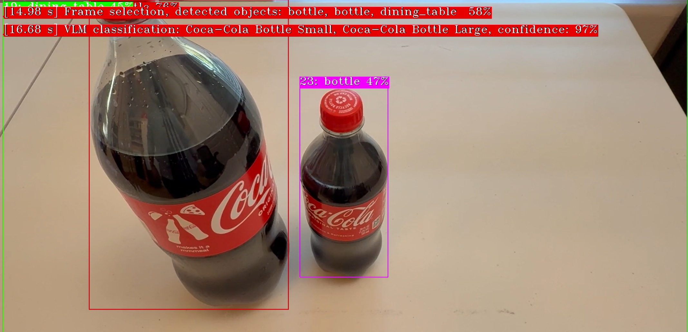
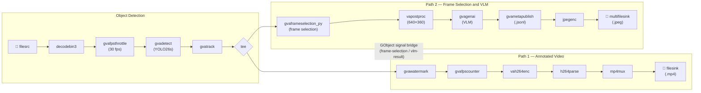

# VLM-assisted Self Checkout

This sample demonstrates a self-checkout pipeline that combines **Computer Vision object detection** with a **Vision-Language Model (VLM)** for intelligent item classification — all inside a single DL Streamer GStreamer pipeline.



The system detects objects on the counter, waits until they are tracked for a configurable duration, selects inventory items matching detected object category, and finally asks the VLM to identify exact inventory items visible. Example VLM prompt (auto-generated from `inventory.txt`):

> *Which of the following items is visible in this image: Coca-Cola Bottle Small, Coca-Cola Bottle Medium, Coca-Cola Bottle Large? Reply only with names of detected items. If no items from the list are visible, reply None.*

Both the object detection model and the VLM run locally on the edge AI device. Note that detailed VLM object classification is accomplished in real time within 1–2 seconds (snapshot taken on an Intel® Core™ Ultra 285H edge device).

## What It Does

1. **Detects** objects in each video frame using a YOLO26s model (`gvadetect`)
2. **Tracks** detected objects across frames (`gvatrack`) and filters by visibility duration
3. **Selects** frames of interest for enhanced VLM classification using a custom Python element (`gvaframeselection_py`, see `plugins/python/gvaFrameSelection.py`)
4. **Classifies** tracked items against a known inventory using a VLM (`gvagenai`, for example MiniCPM-V 4.5)
5. **Publishes** structured JSONL results and saves snapshot images of classified items
6. **Writes** an annotated output video with watermarked detection and VLM classification results (`gvawatermark`)



The pipeline uses a **tee** to split into two parallel paths:
- **Path 1 (Video):** Watermarks detection/VLM results onto frames and encodes to a video file stored on local disk
- **Path 2 (Analytics):** Runs the custom `gvaframeselection_py` frame-selection element, VLM classification, JSONL publishing, and JPEG snapshot export

A **GObject signal bridge** communicates analytics results from Path 2 back to Path 1 for real-time watermark overlay.


## Prerequisites

- DL Streamer installed on host, or DL Streamer docker image
- Intel EdgeAI System with integrated GPU/NPU (or set `--detect-device CPU --genai-device CPU`)
- Python dependencies installed with:

```bash
uv venv --system-site-packages .vlm-self-checkout-venv
source .vlm-self-checkout-venv/bin/activate
uv pip install -r requirements.txt
```

> **Note:** the sample never downloads media or models. Prepare the input video and export
> both models beforehand, as described below.

## Download Video

Download an example self-checkout video file:

```bash
curl -L -o checkout.mp4 "https://www.pexels.com/download/video/35256160"
```

Pass the file with `--video-path`.

## Prepare Models

Both models are exported once, outside of the sample, with the
[model conversion scripts](../../../../scripts/download_models/README.md) (each script
documents its own virtual environment and requirements file).

### Detection (YOLO26s)

Export an Ultralytics detection model to OpenVINO IR with the
[Ultralytics conversion](../../../../scripts/download_models/README.md#2-ultralytics-conversion):

```bash
python3 ../../../../scripts/download_models/download_ultralytics_models.py \
    --model yolo26s.pt \
    --outdir ./models \
    --int8
```

This produces `models/yolo26s_int8_openvino_model/yolo26s.xml`, which is passed with
`--detect-model-path`.

### VLM (MiniCPM-V-4.5)

Export an image-text-to-text model to OpenVINO IR with the
[Hugging Face conversion](../../../../scripts/download_models/README.md#1-hugging-face-conversion):

```bash
python3 ../../../../scripts/download_models/download_hf_models.py \
    --model openbmb/MiniCPM-V-4_5 \
    --outdir ./models
```

This produces `models/openbmb_MiniCPM-V-4_5/`, which is passed with `--vlm-model-path`.

A relative model path is looked up in the current directory and then in `$MODELS_PATH` (the
model store shared with other DL Streamer samples), so a model already present there can be
referenced by its relative path only.

## Running the Sample

Basic usage:

```bash
python3 vlm_self_checkout.py \
    --video-path checkout.mp4 \
    --detect-model-path ./models/yolo26s_int8_openvino_model/yolo26s.xml \
    --vlm-model-path ./models/openbmb_MiniCPM-V-4_5
```

With non-default devices and a custom inventory:

```bash
python3 vlm_self_checkout.py \
    --video-path checkout.mp4 \
    --inventory-file my-custom-inventory.txt \
    --detect-model-path ./models/yolo11s_int8_openvino_model/yolo11s.xml \
    --detect-device NPU \
    --vlm-model-path ./models/Qwen_Qwen2-VL-2B-Instruct \
    --genai-device GPU
```

With models taken from the shared model store (`$MODELS_PATH`):

```bash
python3 vlm_self_checkout.py \
    --video-path /path/to/checkout.mp4 \
    --detect-model-path public/yolo26s/INT8/yolo26s.xml \
    --vlm-model-path openbmb_MiniCPM-V-4_5
```

## Custom GStreamer Element: `gvaframeselection_py`

The `plugins/python/gvaFrameSelection.py` file implements a custom `GstBase.BaseTransform` element that provides frame-selection logic:

- **Drops** frames with no detected objects
- **Filters out** excluded object types (configured via `excluded_objects.txt`, e.g., `person`, `dining_table`)
- **Tracks** how long each object has been visible using `GstAnalytics.TrackingMtd`
- **Passes** a frame once an object is tracked for at least `threshold` milliseconds (default: 1500)
- **Dynamically updates** the `gvagenai` prompt with matching inventory items from `inventory.txt`

## Configuration Files

| File | Purpose |
|---|---|
| `config/inventory.txt` | List of known inventory items (one per line). Used to generate targeted VLM prompts. |
| `config/excluded_objects.txt` | Object types to ignore during tracking (e.g., `person`, `dining_table`). |

## Command-Line Arguments

| Argument | Default | Description |
|---|---|---|
| `--video-path` | *(required)* | Path to a local video file |
| `--detect-model-path` | *(required)* | Path to a detection model `.xml` exported beforehand. A relative path is looked up in the current directory and in `$MODELS_PATH` |
| `--detect-device` | `GPU` | Device for YOLO detection inference |
| `--threshold` | `0.4` | Detection confidence threshold (not frame selection threshold) |
| `--inventory-file` | `config/inventory.txt` | Path to inventory items list |
| `--excluded-objects-file` | `config/excluded_objects.txt` | Path to excluded object types list |
| `--vlm-model-path` | *(required)* | Path to an OpenVINO VLM model directory exported beforehand. A relative path is looked up in the current directory and in `$MODELS_PATH` |
| `--genai-device` | `GPU` | Device for VLM inference |
| `--genai-prompt` | Self-checkout item description | Initial prompt for VLM inference |
| `--results-dir` | `./results` | Directory for output files |
| `--output-json` | *(unset)* | Path of the JSON Lines output file, overriding `<results-dir>/vlm_self_checkout-<video_stem>.jsonl` |

## Output

Results are written to the `results/` directory (or `--results-dir`):

- `vlm_self_checkout-<video>.mp4` — annotated output video with watermarked detections and VLM results
- `vlm_self_checkout-<video>.jsonl` — structured JSON Lines with VLM classification metadata (or the file given by `--output-json`)
- `vlm_self_checkout-<video>-*.jpeg` — snapshot images of frames sent to the VLM
