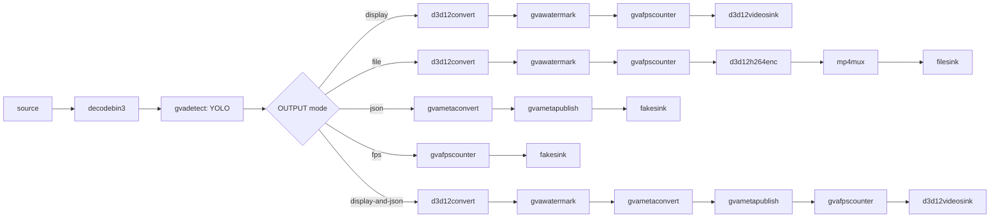

# Object Detection and Classification with Yolo models (Windows)

This sample demonstrates how to construct object detection pipelines via `gst-launch-1.0` command-line utility using YOLO models on Windows.

## How It Works

This sample utilizes GStreamer command-line tool `gst-launch-1.0` which can build and run GStreamer pipeline described in a string format.
The string contains a list of GStreamer elements separated by exclamation mark `!`, each element may have properties specified in the format `property`=`value`.

This sample builds GStreamer pipeline of the following elements:

- `filesrc` or `urisourcebin` for input from file/URL
- `decodebin3` for video decoding (automatically selects the D3D12 hardware decoder when available)
- [gvadetect](https://docs.openedgeplatform.intel.com/dev/edge-ai-libraries/dlstreamer/elements/gvadetect.html) for full-frame object detection
- [gvawatermark](https://docs.openedgeplatform.intel.com/dev/edge-ai-libraries/dlstreamer/elements/gvawatermark.html) for bounding boxes visualization
- `d3d12convert` (or `d3d11convert`) for GPU-accelerated video conversion
- `d3d12videosink` (or `d3d11videosink`) for rendering output video to screen

> **NOTE**: `sync=false` property in the video sink element disables real-time synchronization so pipeline runs as fast as possible

## Pipeline Architecture

This pipeline performs object detection using a YOLO model. After decoding, `gvadetect` runs inference on each frame. The output branch is selected at startup via the `OUTPUT` parameter and determines how detected metadata and video are handled — from live display with overlays, to MP4 file recording, JSON metadata logging, FPS benchmarking, or a combined display-and-JSON mode.

The diagram shows the default GPU/NPU pipeline, which keeps frames in D3D12 memory from the decoder to the sink. The elements used with the other pre-processing backends are listed in [Pre-processing Backend Selection](#pre-processing-backend-selection).



## Windows-Specific Features

### D3D11 and D3D12 Pre-processing Backends

On Windows with GPU or NPU devices, this sample uses **Direct3D** pre-processing backends instead of VA-API (Linux):

- `d3d12` / `d3d11`: the frame is resized and color-converted on the GPU, then passed to OpenVINO™ through system memory.
- `d3d12-surface-sharing` / `d3d11-surface-sharing`: the pre-processed frame is passed to the OpenVINO™ GPU plugin without leaving GPU memory. Supported on GPU only; on NPU the element falls back to `d3d12` / `d3d11`.

The D3D12 backends work directly on the frames from the D3D12 decoders. The D3D11 backends need the decoder to copy each frame into D3D11 memory.

### Pre-processing Backend Selection

| Device | Default Backend         |
| ------ | ----------------------- |
| CPU    | `opencv`                |
| GPU    | `d3d12-surface-sharing` |
| NPU    | `d3d12`                 |

The elements after `gvadetect` determine which memory type it receives, so the sample selects them from the backend. A `d3d12` backend accepts only D3D12 memory and a `d3d11` backend only D3D11 memory:

| Backend                          | Conversion     | Display          | File encoder                       |
| -------------------------------- | -------------- | ---------------- | ---------------------------------- |
| `d3d12`, `d3d12-surface-sharing` | `d3d12convert` | `d3d12videosink` | `d3d12h264enc rate-control=cqp` \* |
| `d3d11`, `d3d11-surface-sharing` | `d3d11convert` | `d3d11videosink` | `mfh264enc`                        |
| `ie`, `opencv`                   | `videoconvert` | `autovideosink`  | `openh264enc`                      |

\* Falls back to `d3d12download ! mfh264enc` when the GPU has no D3D12 video encoder. Constant QP rate control is used because the default rate control of `d3d12h264enc` produces broken streams with some drivers.

The D3D backends require a GPU or NPU device.

## Models

The sample uses YOLO models from different repositories. The model preparation and conversion method depends on the model source.

For yolov5nu, yolov8s (8n-obb, 8n-seg), yolov9c, yolov10s and yolo11s (yolo11s-seg, yolo11s-obb) models it is also necessary to install the ultralytics python package:

```batch
pip install ultralytics
```

### Supported Models

| Model        | Model Preparation                | Model pipeline (model-proc)       |
| ------------ | -------------------------------- | --------------------------------- |
| yolox-tiny   | omz_downloader and omz_converter | gvadetect model-proc=yolo-x.json  |
| yolox_s      | OpenVINO™ model                  | gvadetect model-proc=yolo-x.json  |
| yolov5nu     | Ultralytics python exporter      | gvadetect (model-proc not needed) |
| yolov7       | Pytorch -> ONNX -> OpenVINO™     | gvadetect model-proc=yolo-v7.json |
| yolov8s      | Ultralytics python exporter      | gvadetect (model-proc not needed) |
| yolov8n-obb  | Ultralytics python exporter      | gvadetect (model-proc not needed) |
| yolov8n-seg  | Ultralytics python exporter      | gvadetect (model-proc not needed) |
| yolov9c      | Ultralytics python exporter      | gvadetect (model-proc not needed) |
| yolov10s     | Ultralytics python exporter      | gvadetect (model-proc not needed) |
| yolo11s      | Ultralytics python exporter      | gvadetect (model-proc not needed) |
| yolo11s-seg  | Ultralytics python exporter      | gvadetect (model-proc not needed) |
| yolo11s-obb  | Ultralytics python exporter      | gvadetect (model-proc not needed) |
| yolo11s-pose | Ultralytics python exporter      | gvadetect (model-proc not needed) |

## Environment Variables

This sample requires the following environment variable to be set:

- `MODELS_PATH`: Path to the models directory

Example:

```PowerShell
$set MODELS_PATH = "C:\models"
```

## Running

```PowerShell
.\yolo_detect.ps1 [-Model <model>] [-Device <device>] [-InputSource <path>] [-OutputType <type>] [-PreprocessBackend <backend>] [-Precision <precision>] [-FrameLimiter <element>]
```

### Parameters

| Parameter          | Default          | Description                                                                             |
| ------------------ | ---------------- | --------------------------------------------------------------------------------------- |
| -Model             | yolox_s          | Model name (see supported models above)                                                 |
| -Device            | GPU              | Inference device: CPU, GPU, NPU                                                         |
| -InputSource       | Pexels video URL | Input video file or URL                                                                 |
| -OutputType        | display          | Output type: file, display, fps, json, display-and-json                                 |
| -PreprocessBackend | per device       | Pre-processing backend: ie, opencv, d3d11, d3d11-surface-sharing, d3d12, d3d12-surface-sharing (see [Pre-processing Backend Selection](#pre-processing-backend-selection)) |
| -Precision         | FP16             | Model precision: INT8, FP32, FP16                                                       |
| -FrameLimiter      | (empty)          | Optional GStreamer element to insert after decode (e.g., `" ! identity eos-after=100"`) |

### Examples

Run with default settings (yolox_s model, GPU, display output):

```PowerShell
.\yolo_detect.ps1
```

Run yolo11s model with GPU inference:

```PowerShell
.\yolo_detect.ps1 -Model yolo11s -Device GPU
```

Run with local video file:

```PowerShell
.\yolo_detect.ps1 -Model yolo11s -Device GPU -InputSource C:\videos\test.mp4
```

Run with CPU and save to file:

```PowerShell
.\yolo_detect.ps1 -Model yolo11s -Device CPU -InputSource C:\videos\test.mp4 -OutputType file
```

Run with the D3D11 surface-sharing backend instead of the default D3D12 one:

```PowerShell
.\yolo_detect.ps1 -Model yolo11s -Device GPU -InputSource C:\videos\test.mp4 -OutputType display -PreprocessBackend d3d11-surface-sharing
```

Run in FPS-only mode (benchmark):

```PowerShell
.\yolo_detect.ps1 -Model yolo11s -Device GPU -InputSource C:\videos\test.mp4 -OutputType fps
```

Run with FP32 precision:

```PowerShell
.\yolo_detect.ps1 -Model yolo11s -Device GPU -InputSource C:\videos\test.mp4 -OutputType display -Precision FP32
```

Process only first 100 frames (for testing/benchmarking):

```PowerShell
.\yolo_detect.ps1 -Model yolov8n-seg -Device CPU -InputSource C:\videos\test.mp4 -OutputType json -PreprocessBackend opencv -Precision FP32 -FrameLimiter " ! identity eos-after=100"
```

### Output Types

| Output             | Description                              |
| ------------------ | ---------------------------------------- |
| `display`          | Show video with detections on screen     |
| `file`             | Save video with detections to MP4 file   |
| `fps`              | Measure FPS only (no visualization)      |
| `json`             | Output detection metadata to output.json |
| `display-and-json` | Both display and JSON output             |

## Device Restrictions

- **yolov10s**: Not supported on NPU
- **yolov10s on GPU**: Requires special configuration (automatically applied)

## Download Models

If you have not already downloaded the required models, do so before running the sample. Use the Linux download script. On Windows, you can run this script using WSL (Windows Subsystem for Linux) or Git Bash:

### Using WSL or Git Bash

```bash
# Set the models path (use a path accessible from Windows)
export MODELS_PATH=/mnt/c/models  # WSL path to C:\models

# Download a specific model in FP32
python scripts/download_models/download_ultralytics_models.py --model yolo11s.pt --outdir "${MODELS_PATH}/public/yolo11s/FP32"

# For INT8 export
python scripts/download_models/download_ultralytics_models.py --model yolo11s.pt --outdir "${MODELS_PATH}/public/yolo11s/INT8" --int8
```

For detailed instructions on downloading models, including script-specific dependencies and supported model lists, see `scripts/download_models/README.md`.

> **Note**: Make sure to set your `MODELS_PATH` environment variable in Windows to point to the same location where models were downloaded (e.g., `set MODELS_PATH=C:\models`).

## Sample Output

The sample:

- Prints the full gst-launch-1.0 command to the console
- Runs the pipeline and either:
  - Displays video with bounding boxes around detected objects
  - Saves output to MP4 file
  - Prints FPS metrics
  - Outputs JSON metadata

## See also

- [Windows Samples overview](../../../../README.md)
- [Linux Detection with Yolo Sample](../../../../gstreamer/gst_launch/detection_with_yolo/README.md)

---

*Intel, the Intel logo, OpenVINO, and the OpenVINO logo are trademarks of Intel Corporation or its subsidiaries.*
