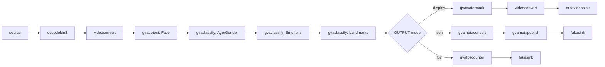

# Face Detection And Classification Sample (Windows)

This sample demonstrates face detection and classification pipeline constructed via `gst-launch-1.0` command-line utility on Windows.

## How It Works
The sample utilizes GStreamer command-line tool `gst-launch-1.0` which can build and run GStreamer pipeline described in a string format.
The string contains a list of GStreamer elements separated by exclamation mark `!`, each element may have properties specified in the format `property`=`value`.

This sample builds GStreamer pipeline of the following elements
* `filesrc` or `urisourcebin` or `ksvideosrc` for input from file/URL/web-camera (Windows uses `ksvideosrc` for webcam access)
* `decodebin3` for video decoding
* `videoconvert` for converting video frame into different color formats
* [gvadetect](https://docs.openedgeplatform.intel.com/dev/edge-ai-libraries/dlstreamer/elements/gvadetect.html) for face detection based on OpenVINO™ Toolkit Inference Engine
* [gvaclassify](https://docs.openedgeplatform.intel.com/dev/edge-ai-libraries/dlstreamer/elements/gvaclassify.html) inserted into pipeline three times for face classification on three DL models (age-gender, emotion, landmark points)
* [gvawatermark](https://docs.openedgeplatform.intel.com/dev/edge-ai-libraries/dlstreamer/elements/gvawatermark.html) for bounding boxes and labels visualization
* `autovideosink` for rendering output video into screen
> **NOTE**: `sync=false` property in `autovideosink` element disables real-time synchronization so pipeline runs as fast as possible


## Pipeline Architecture

This pipeline implements a cascaded inference architecture: a primary `gvadetect` element identifies face regions, which are then processed by three sequential `gvaclassify` elements to extract age/gender, emotions, and facial landmarks. The output branch is selected at start and routes the stream to either a visual display with watermark overlays, a JSON metadata file, or an FPS benchmark sink.



## Models

The example pipeline uses `centerface` for detection, `dima806/facial_age_image_detection` for age, `dima806/face_emotions_image_detection` for emotion, and `dima806/fairface_gender_image_detection` for gender. These are example models, not mandatory choices. Any compatible face detector and classifiers can be used if their OpenVINO models, paths, and matching model-proc configuration are supplied.

Prepare the example models with the general helpers documented in [`scripts/download_models/README.md`](../../../../../scripts/download_models/README.md): `download_other_models.py centerface` for CenterFace, and `download_hf_models.py` with the listed Hugging Face model IDs for the classifiers.

## Environment Variables

This sample requires the following environment variable to be set:
- `MODELS_PATH`: Path to the models directory

Example:
```batch
set MODELS_PATH=C:\models
```

## Running

```PowerShell
.\face_detection_and_classification.ps1 [-InputSource <path>] [-Device <device>] [-OutputType <type>] [-JsonFile <file>] [-FrameLimiter <element>]
```

### Parameters

| Parameter | Default | Description |
|-----------|---------|-------------|
| -InputSource | (required) | Local video file, URL, or USB camera path |
| -Device | CPU | Inference device: CPU, GPU, NPU |
| -OutputType | display | Output type: display, fps, json |
| -JsonFile | output.json | JSON output file name (for json output type) |
| -FrameLimiter | (empty) | Optional GStreamer element to insert after decode (e.g., " ! identity eos-after=1000") |

The input could be:
* local video file (`C:\path\to\video.mp4`)
* web camera device path (Windows USB camera path format like `\\?\usb#...`)
* RTSP camera (URL starting with `rtsp://`) or other streaming source (ex URL starting with `http://`)

Use any video or camera stream supported by the installed GStreamer plugins. Examples use `C:\videos\test.mp4`; a face-containing clip is useful for checking the output.

Pass `-InputSource` explicitly. For a remote URL, `urisourcebin` streams the video and requires an internet connection.

Please refer to OpenVINO™ toolkit documentation for supported devices:
https://docs.openvinotoolkit.org/latest/openvino_docs_IE_DG_supported_plugins_Supported_Devices.html

### Examples
```PowerShell
# Run with local video (CPU inference, display output)
.\face_detection_and_classification.ps1 -InputSource C:\videos\test.mp4

# Run with local video file
.\face_detection_and_classification.ps1 -InputSource C:\videos\test.mp4

# Run with GPU inference
.\face_detection_and_classification.ps1 -InputSource C:\videos\test.mp4 -Device GPU

# Run in FPS mode (no display)
.\face_detection_and_classification.ps1 -InputSource C:\videos\test.mp4 -Device CPU -OutputType fps

# Export to JSON
.\face_detection_and_classification.ps1 -InputSource C:\videos\test.mp4 -OutputType json -JsonFile results.json

# Process only first 1000 frames (for testing)
.\face_detection_and_classification.ps1 -InputSource C:\videos\test.mp4 -OutputType json -FrameLimiter " ! identity eos-after=1000"
```

## Sample Output

The sample
* prints gst-launch-1.0 full command line into console
* starts the command and either visualizes video with bounding boxes around detected faces, facial landmarks points and text with classification results (age/gender, emotion) for each detected face or prints out fps if you set SINK_ELEMENT = fps

## See also
* [Windows Samples overview](../../../../README.md)
* [Linux Face Detection and Classification Sample](../../../../gstreamer/gst_launch/face_detection_and_classification/README.md)
