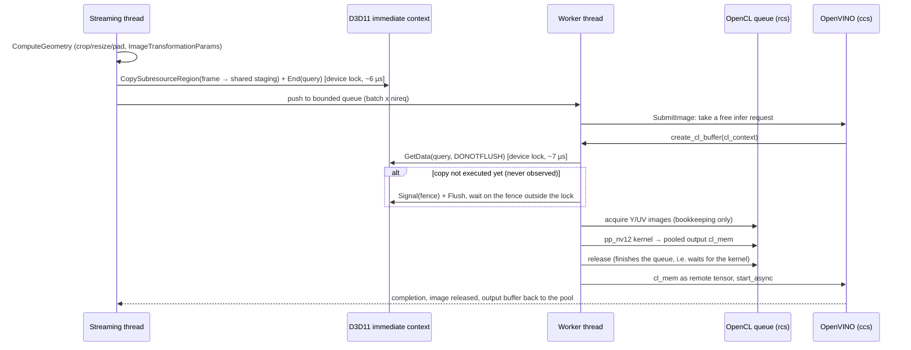

# OpenCL pre-processing backend (`pre-process-backend=opencl`)

**Status:** experimental prototype, Windows only.
**Scope:** `gvadetect`, `gvaclassify` and `gvainference` on a GPU device, with
D3D11Memory frames.

## 1. Summary

This backend pre-processes D3D11 video frames for OpenVINO™ with a single OpenCL
kernel. The kernel does the color conversion, crop, resize and padding, and
writes the model's input tensor (u8, planar NCHW) straight into an OpenCL buffer
that OpenVINO™ consumes in place. The existing D3D11 surface sharing path needs a
D3D11 converter pass, an OpenCL image-to-buffer copy and channel/layout
conversions in OpenVINO™ pre-processing; this backend needs none of them.

The kernel itself is cheap. The cost of GPU pre-processing is in the CPU-side
synchronization around it, and most of this design is about that:

- OpenVINO™ gets an OpenCL context created by us with
  `CL_CONTEXT_INTEROP_USER_SYNC=CL_TRUE`, so acquiring a D3D11 texture no longer
  makes the CPU wait for the GPU.
- The D3D11 copy is ordered before the kernel with a D3D11 event query: under
  20 µs of CPU per frame in total, with no submission on the hot path.

With the test setup in [section 7](#7-evaluation), this backend was the fastest
in the detection and per-ROI classification pipelines (+12-17% and +8-15% over the
D3D backends). In classify-only pipelines running at about 1100 fps it ties with
the D3D11 backends, where all D3D11Memory backends share the same decoder-side
ceiling.

## 2. Background

### 2.1 Existing Windows backends

| Backend | Pre-processing | Handed to OpenVINO™ |
|---|---|---|
| `d3d11`, `d3d12` | GstD3D11/D3D12Converter into a BGRA texture at model size, mapped to system memory | host tensor (OpenCV repacks it to planar) |
| `d3d11-surface-sharing` | GstD3D11Converter into a shared BGRA texture; OpenCL acquires it and copies the image into a buffer | `cl_mem` BGRX, NHWC |
| `d3d12-surface-sharing` | GstD3D12Converter, D3D12 copy into a shared buffer imported through `cl_khr_external_memory`, OpenCL buffer copy | `cl_mem` BGRX, NHWC |

For the BGRX NHWC tensors, OpenVINO™ pre-processing then drops the fourth
channel, transposes to the model layout, converts to the model precision and
applies mean/scale.

### 2.2 Where the per-frame cost goes

Each D3D11 frame goes through these steps on the CPU side:

1. The streaming thread records the conversion.
2. A single worker thread per model instance calls OpenVINO's `SubmitImage`.
3. `SubmitImage` takes a free infer request and asks the image for its tensor
   (`Image::create_cl_buffer`), which is where the D3D11 to OpenCL handoff
   happens.

Two properties of the platform make that handoff expensive:

- **OpenVINO's D3D11 context uses `CL_CONTEXT_INTEROP_USER_SYNC=CL_FALSE`**
  (`ocl_device_detector.cpp` in OpenVINO™). With that setting, Intel's OpenCL
  runtime implements `clEnqueueAcquireD3D11ObjectsKHR` as a D3D11 fence signal
  followed by a CPU wait, once per acquired object (`D3DSharing::synchronizeObject`
  in compute-runtime). It must be called with the D3D11 device lock held.
- **`enqueueReleaseSharedObjects` always finishes an in-order queue.** Releasing
  is therefore a blocking wait for all OpenCL work queued so far.

The `d3d11-surface-sharing` callback holds the D3D11 device lock across the whole
handoff, including these waits. Measured on the worker: 500-1100 µs per frame
depending on GPU load, of which about 150 µs was spent waiting for the device lock.

### 2.3 OpenCL needs shared textures

Intel's OpenCL runtime reads a D3D11 texture correctly only if the texture was
created with `D3D11_RESOURCE_MISC_SHARED`. For other textures it goes through an
internal staging copy that passes the NV12 plane-encoded subresource index
straight to `CopySubresourceRegion`. That copies the wrong array slice, or drops
the UV plane.

Decoder output is not shared. The D3D12 decoders, which `decodebin3` picks, emit
D3D11Memory through a D3D11 interop copy into a pool created with `MiscFlags=0`,
and they ignore downstream D3D11 pools. The watermark GPU renderer hit the same
constraint (see [`D3D11TargetPool`](../../../../../include/dlstreamer/d3d11/target_pool.h)).

## 3. Goals and non-goals

Goals:

- Do all of the image pre-processing on the GPU in one kernel, writing the final
  model input, and keep OpenVINO™ pre-processing down to the precision
  conversion and mean/scale.
- Keep CPU synchronization and D3D11 device lock time per frame as low as
  possible: the worker thread and the infer request are on the critical path.
- Keep the geometry semantics of the D3D11 backends (crop, resize, letterbox
  padding, and the `ImageTransformationParams` reported for post-processing).
- Keep inference results close to the D3D11 backends. Bit-exactness is not
  required.

Non-goals for the prototype:

- D3D12Memory input, cross-device frames, Linux.
- Automatic selection (`opencl` is only used when requested).
- Custom pre-processing libraries, and model-proc normalization or color-space
  overrides. Like the other D3D backends, mean/scale come from the model's
  `rt_info`.

## 4. Data path

| Stage | `d3d11-surface-sharing` | `opencl` |
|---|---|---|
| Streaming thread | Record D3D11 shader pass: NV12 → BGRA at model size (crop/resize/pad) | Record D3D11 copy: NV12 frame → shared NV12 staging texture, then `End(query)` |
| Worker thread | Acquire (CPU waits for GPU) → image-to-buffer copy → release (finish), under the device lock | Query check → acquire (bookkeeping) → **one kernel**: NV12 → planar RGB/BGR with crop/resize/pad → release (finish) |
| Tensor | u8 BGRX NHWC `{1,H,W,4}` | u8 planar NCHW `{1,3,H,W}` |
| OpenVINO™ pre-processing | drop X, NHWC→NCHW, u8→f32, mean/scale | u8→f32, mean/scale (folded into the GPU plugin's input reorder) |

## 5. Design

### 5.1 Components

| Component | Responsibility |
|---|---|
| [`ImageInferenceAsyncOpenCL`](image_inference_async_opencl.h) | `ImageInference` wrapper around `OpenVINOImageInference`: computes the geometry, stages frames into shared textures (one copy per frame, shared by its ROIs), orders the D3D11 copy before the kernel, and runs the bounded submit queue and worker thread (same model as `ImageInferenceAsyncD3D11`). |
| [`OpenCLPreproc`](opencl_preproc.h) | Bound to OpenVINO's `cl_context`: builds the program, keeps a cache of texture-plane imports, runs acquire → kernel → release, and owns the pool of output buffers (`OpenCLBufferPool`). |
| [`opencl_preproc_kernels.h`](opencl_preproc_kernels.h) | OpenCL C source: `pp_nv12` (NV12 planes) and `pp_rgba` (RGBA/BGRA/BGRX textures). |
| [`openvino_image_inference.cpp`](../openvino/openvino_image_inference.cpp) | Planar input format and NCHW tensor layout for `OPENCL`, the `cl_mem` → remote tensor path, and the user-sync `ClContext`. |
| [`OpenVINOContext`](../../../../../include/dlstreamer/openvino/context.h) | New constructor from an existing `ov::RemoteContext`. |
| [`inference_impl.cpp`](../../../gst/inference_elements/base/inference_impl.cpp), [`gva_base_inference.cpp`](../../../gst/inference_elements/base/gva_base_inference.cpp) | `opencl` property value, support checks, fallback to `d3d11`, D3D11Memory-only caps, cross-adapter fallback. |

### 5.2 Per-frame flow



### 5.3 Frame staging

`GetStagingFrame()` makes a frame readable by OpenCL:

- **Copy.** It takes a texture from a `GstD3D11PoolAllocator` of single
  `D3D11_RESOURCE_MISC_SHARED` textures of the frame's size and format, and
  `CopySubresourceRegion`s the frame's subresource into it under the device lock.
  The pool allocates on demand, so it settles at the number of frames in flight
  (4 in the tests). It is recreated when the frame size or format changes.
- **In place.** If the frame already is a single shared texture without a keyed
  mutex, it is read directly and no copy is made.
- **ROI sharing.** The ROIs of a frame arrive one after another. The latest
  `StagingFrame` is cached through a `weak_ptr`, keyed by the frame's `GstMemory`.
  The `StagingFrame` holds a reference on that memory, so while it is alive the
  decoder cannot recycle the surface, and the same pointer still means the same
  picture. The cache itself never extends any lifetime. With about 3 objects
  per frame in the tests, `gvaclassify` pays for one copy per frame, not one
  per ROI.

### 5.4 Geometry

`ComputeGeometry()` reproduces `D3D11Converter::SetupPreprocessing`:

- the ROI clamped to the frame
- resize with or without keeping the aspect ratio, with the 1.125 pre-scale
  before a crop
- all crop modes (central, the four corners, central-resize)
- centered padding with the model's fill color

It reports `ResizeHasDone`, `CropHasDone` and `PaddingHasDone` the same way, so
post-processing maps the results back to the frame unchanged. One deliberate
difference: a crop mapped back to source coordinates keeps fractional precision
instead of being truncated to integers.

The result is a source rectangle (in frame pixels), a destination rectangle (in
tensor pixels), and the fill color.

### 5.5 Kernel

One work item per tensor pixel (32×8 work-groups), writing 3 bytes to 3 planes:

```
if (x, y) is outside dst_rect:   out = fill
else:
    p   = src_origin + ((x, y) - dst_origin + 0.5) * src_per_dst      // pixel-center mapping
    Y   = read_imagef(y_plane,  LINEAR, clamp(p,       luma window))  // bilinear by the sampler
    UV  = read_imagef(uv_plane, LINEAR, clamp(p * 0.5, chroma window))
    out = 255 * (m0, m1, m2) . (Y, U, V, 1)                           // rows in model channel order
plane[c][y][x] = convert_uchar_sat_rte(out[c])
```

- **Sampling.** Hardware bilinear filtering on the imported `CL_R` / `CL_RG`
  UNORM plane images. The clamp windows keep the filter inside the logical
  frame, so the padding rows and columns of decoder surfaces are never blended
  in. Like the D3D11 shader there is no anti-aliasing for large downscales, and
  chroma is sampled center-sited.
- **Color.** The matrix is built on the host from `Kr`/`Kb` of the colorimetry
  that `gst_video_info_set_format()` gives the frame size (BT.601 up to 576
  lines, BT.709 above, BT.2020 from 2160 lines, limited range). These are the
  same defaults the D3D11 backends set up GstD3D11Converter with. The matrix
  rows and the fill color are permuted for BGR models, so the kernel never
  branches on channel order.
- **Packed sources.** RGBA, BGRA and BGRX textures (for example after
  `d3d11convert`) use `pp_rgba`, with the same mapping and one sampled image.

The program is built once per `OpenCLPreproc` with `-cl-fast-relaxed-math`.

### 5.6 OpenVINO™ integration

| Point | `OPENCL` behavior |
|---|---|
| `GetModelImageInputInfo` | memory type D3D11; format `BGRP`/`RGBP` from the channel order in the model's `rt_info` |
| `configure_image_input` | tensor layout `NCHW`, element type u8 (as for the system-memory backends); OpenVINO™ adds only the precision conversion and mean/scale |
| `image_to_tensors` | `BGRP`/`RGBP` with `create_cl_buffer` → `ClContext::create_tensor(u8, {1, 3, H, W}, cl_mem)` |
| `create_remote_context` | a user-sync `cl_context` on the frames' D3D11 device, wrapped as `ov::intel_gpu::ocl::ClContext` (section 5.7) |
| Batching | one remote tensor per image, through `set_input_tensors`, as for the other surface sharing backends |

### 5.7 Synchronization

Each frame needs three orderings:

1. The D3D11 copy completes before the kernel reads the staging texture.
2. The kernel completes before OpenVINO™ reads the output buffer. OpenVINO™ runs
   on its own queues, so only a CPU-side wait connects the two.
3. The kernel completes before the staging texture is handed out again.

**User-sync OpenCL context.** For `OPENCL`, OpenVINO's remote context is a
`ClContext` over a `cl_context` that we create with `clGetDeviceIDsFromD3D11KHR`
on the frames' D3D11 device, with `CL_CONTEXT_INTEROP_USER_SYNC=CL_TRUE`.
OpenVINO™ retains the context (`cl::Context(ctx, true)`), and our reference is
dropped right away. In this context, acquiring a shared texture does no D3D11
work besides `GetImmediateContext`. Releasing still finishes the queue; that is
the single CPU wait the backend needs anyway, for ordering 2.

**D3D11 → OpenCL (ordering 1): an event query instead of a fence.** After the
copy, the streaming thread ends a pooled `D3D11_QUERY_EVENT` and does not flush.
On the worker, `WaitForStaging()` calls
`GetData(query, D3D11_ASYNC_GETDATA_DONOTFLUSH)` under the device lock. The
decoder shares the D3D11 immediate context and submits it every frame, so by the
time a frame reaches the worker its copy has normally executed and the check
returns `S_OK` (~7 µs). Otherwise the worker signals a D3D11 fence, flushes, and
waits on the fence outside the lock. That fallback was never taken in testing.

Each D3D11 submission (`Signal`, `Flush`, `Flush1`) costs about 220-400 µs of
CPU on the test system, under the device lock. `End()` costs about 1 µs, so the
query keeps submissions off the hot path entirely.

**OpenCL → staging reuse (ordering 3).** The `create_cl_buffer` callback drops
its `StagingFrame` reference only after `convert()` has returned, by which point
the release has finished the queue. The texture goes back to the pool when the
last reference goes.

**Queue placement.** The OpenCL queue is created with
`CreateInteropCommandQueue()`, which puts it on an engine other than the one
OpenVINO™ runs inference on (`rcs` vs `ccs` on the test GPU). The finish
therefore waits for the kernel only, not for the inference work in flight.

**D3D11 device lock per frame:**

| Where | `opencl` | `d3d11-surface-sharing` |
|---|---|---|
| Streaming thread | copy + `End` (~6 µs) | converter draw (~44-94 µs) |
| Worker thread | query check (~7 µs) + acquire (~10-30 µs including the wait) | the whole handoff, including the GPU waits (~500 µs) |
| Rare | importing or releasing a texture's planes (once per staging texture) | once per pooled texture |

### 5.8 Threads

| Thread | Work |
|---|---|
| Streaming thread(s) | `SubmitImage`: geometry, staging copy (or a hit in the ROI cache), `End(query)`, push into the bounded queue (`batch × nireq`), which blocks when full |
| Worker (one per model instance) | OpenVINO's `SubmitImage`: take a free infer request, `create_cl_buffer` (query check, kernel, finish), `set_tensor`, `start_async` |
| OpenVINO™ completion threads | results to the element, frames dropped, output buffers back to the pool |

### 5.9 Resource lifetimes

| Object | Held by | Released when |
|---|---|---|
| `StagingFrame`: reference on the source `GstMemory`, pooled staging texture, event query | `OutputSlot`s of the frame's images, plus the weak ROI cache | the last image's kernel has finished |
| `OutputSlot`: geometry, output `cl_mem` | the `Image` (captured by `create_cl_buffer`) | the image is destroyed after inference; its buffer goes back to the pool |
| `OpenCLBufferPool` | `OpenCLPreproc` and the slots (`shared_ptr`) | last holder, so images may outlive the preprocessor |
| Texture-plane imports | `OpenCLPreproc`; each import references its texture, so pointer keys stay unique | wrapper teardown, under the device lock, before the staging pool |
| `cl_context` | OpenVINO™ and `OpenCLPreproc` | last holder |

Teardown: stop the worker → `Flush()` OpenVINO™ (in-flight images are
released) → destroy `OpenCLPreproc` (imports) → deactivate the staging pool
under the device lock.

### 5.10 Element integration

- `ImagePreprocessorType::OPENCL` is appended to the enum, so existing values are
  unchanged.
- `IsPreprocSupported`: a single GPU device (`GPU`, `GPU.<N>`), no custom
  pre-processing library, no aspect-ratio-multiple-of resize. Otherwise the
  element falls back to `d3d11` with a warning, as the surface sharing backends
  fall back.
- Caps: an explicit `opencl` keeps D3D11Memory only. OpenCL cannot import D3D12
  textures.
- `avoidCrossAdapterSurfaceSharing` also covers `opencl`: frames on another
  adapter fall back to `d3d11`.
- Auto selection never picks `opencl`.

## 6. Alternatives considered

The variants below were measured on the classify-only pipeline during
development, at different times on a GPU with fluctuating background load
(section 7.1), so only compare numbers within one row.

| Variant | Worker per frame | Streaming per frame | Verdict |
|---|---|---|---|
| A. OpenVINO's D3D11 context (user sync off), own fence wait before acquire | 870 µs at a busy moment (fence 314 + acquire 183 + kernel 338); ~400 µs calm | 43 µs | Three GPU round trips, partly under the device lock. |
| B. A without the fence pre-wait | ~335 µs (calm) | 43 µs | Shorter, but the acquire's GPU waits move inside the device lock and stall the decoder. |
| C. User-sync context, fence `Signal` + `Flush` right after the copy | ~260 µs (fence wait ~1 µs) | 210-450 µs | The worker became fast, but the submission moved to the streaming thread under the device lock; classify-only stayed at parity. A plain `Flush` alone costs ~225 µs; `Signal` after it ~55 µs. |
| D. C with `ID3D11DeviceContext3::Flush1(event)` | ~350 µs | ~280 µs | No cheaper than C. |
| **E. User-sync context, event query (chosen)** | **~217 µs** | **~6-13 µs** | No submission on the hot path. |

Other options:

- **Importing decoder textures directly.** Rejected: the runtime's staging-copy
  defect for non-shared textures (section 2.3).
- **Writing normalized f32/f16 in the kernel.** Not needed: the GPU plugin folds
  the u8 → f32 conversion and mean/scale into the input reorder it runs anyway,
  and u8 is 4× less memory traffic.
- **Running the kernel on OpenVINO's queue** (`ClContext(core, queue)`). Would
  remove the last CPU wait, but restricts OpenVINO™ to a single stream. Left as
  future work.
- **Taking D3D12Memory directly.** OpenCL cannot import D3D12 textures, only
  buffers through `cl_khr_external_memory`. Needs D3D11 views of D3D12 textures;
  future work.

## 7. Evaluation

### 7.1 Setup and methodology

- Intel Core Ultra 9 285H, Intel Arc 140T GPU (driver 32.0.101.8991),
  OpenVINO™ 2026.3, GStreamer 1.28.8.
- 640×360 H.264 at 30 fps, 1989 frames. `decodebin3` picks `d3d12h264dec`,
  which outputs D3D11Memory through a GPU copy when downstream only accepts
  D3D11.
- Models: yolo11n INT8 (640×640), resnet18 and mobilenetv2 (224×224).
- `nireq` and streams at element defaults.
- The machine is accessed through a remote display, whose driver host
  (`WUDFHost`) used about 34% of the 3D engine even at idle. Early runs varied by
  45-87%. All results below therefore come from runs with:
  - the backends run round-robin (one run of each backend per round, 5-6
    rounds), so that drift hits all backends alike;
  - the first 100 frames skipped (`gvafpscounter starting-frame=100`);
  - medians reported.

  The final rounds varied by 4-16%. The perf script used was a local
  `test_perf.ps1` with `-Interleave -StartingFrame 100`.

### 7.2 Throughput (median fps)

| Pipeline | `d3d11` | `d3d11-ss` | `d3d12` | `d3d12-ss` | `opencl` |
|---|---|---|---|---|---|
| `gvadetect` yolo11n | 229.2 | 234.2 | 229.5 | 239.3 | **268.2** |
| `gvadetect` yolo11n → `gvaclassify` resnet18 per object | 155.0 | 152.8 | 153.1 | 145.5 | **167.6** |
| `gvaclassify` mobilenetv2, `inference-region=full-frame` | 1082.9 | 1080.0 | **1163.9** | 1097.3 | 1105.1 |
| same, 4 streams sharing one model instance (total) | 1077.1 | 1081.1 | **1187.3** | 1119.9 | 1093.2 |

- **Detection.** `opencl` was the fastest backend in all 6 rounds; its slowest
  run (257 fps) beat every other backend's fastest. That is +12-17% by median.
- **Per-ROI classification.** Fastest in 5 of 6 rounds and tied in the sixth:
  +8-15%. Each frame needs one staging copy, shared by all of its ROIs.
- **Classify-only.** About 1100 fps is the shared ceiling of D3D11Memory input:
  the decoder's D3D12 → D3D11 interop copy. Decoding alone reaches 2150-3260 fps
  into D3D11Memory and 5300-6000 fps into D3D12Memory. `opencl` leads that group
  (ahead of `d3d11-ss` in 5 of 6 rounds), but the `d3d12` backends, which skip
  the interop copy, are ahead.

### 7.3 CPU cost per frame

Mean of 2 runs × 1000 frames, final design, measured with temporary timers:

| Pipeline | Backend | fps | Worker (holds an infer request) | Streaming thread |
|---|---|---|---|---|
| classify-only | `d3d11-surface-sharing` | 1051 | 511 µs | 44 µs |
| classify-only | `d3d12-surface-sharing` | 1103 | 466 µs | 92 µs |
| classify-only | `opencl` | 1135 | **217 µs** | **6 µs** |
| detect | `d3d11-surface-sharing` | 248 | 574 µs | 94 µs |
| detect | `d3d12-surface-sharing` | 253 | 734 µs | 210 µs |
| detect | `opencl` | 275 | **463 µs** | **12 µs** |

The `opencl` worker time is almost all one GPU round trip for the kernel. It is
longer in detection because the kernel shares the GPU with yolo inference.

### 7.4 Correctness

Results are not bit-exact (the resampling and rounding paths differ), but they
are as close to `d3d11-surface-sharing` as `d3d12-surface-sharing` is. Over
300 frames:

| Check | Result | Reference: `d3d12-ss` vs `d3d11-ss` |
|---|---|---|
| Detections (NV12) vs `d3d11-ss` | 97.9% matched, mean IoU 0.987, mean \|Δconf\| 0.008 | 97.3%, IoU 0.983, \|Δconf\| 0.011 |
| Detections, BGRA input (`d3d11convert`, `pp_rgba`) | 98.4% matched, IoU 0.988 | n/a |
| `batch-size=2` | same detections as batch 1 | n/a |
| Per-object top-1 label, resnet18 (ImageNet) | 87.2% identical (872 objects) | 89.5% |

The detections were the same before and after the synchronization changes,
which suggests no staging texture is read before its copy has completed.

## 8. Limitations and risks

- Windows and D3D11Memory only. D3D12 decoders feed this backend through their
  D3D11 interop copy.
- The frames must be on the inference D3D11 device. Another adapter falls back
  to `d3d11`; another device on the same adapter (`share-d3d-ctx=false`) is
  rejected.
- The model input tensor must be u8: a model-proc input precision other than
  U8 is not supported.
- Supported textures: NV12, RGBA, BGRA and BGRX; no P010.
- Model-proc normalization and color-space overrides are ignored, as in the
  other D3D surface sharing backends.
- Colorimetry comes from GStreamer's defaults for the frame size, not from the
  caps (the same as the D3D11 backends).
- The query check relies on another D3D11 user submitting the immediate context.
  The fallback is correct but costs a flush and a GPU round trip.
- The staging frame holds a reference on the decoder's memory until the kernel
  has run. If a buffer were released while that reference is still held, the
  decoder's buffer pool would discard the buffer instead of recycling it. In
  normal flow the reference is dropped long before inference completes.
- When the frame size changes, the imports of the old staging textures are kept
  until teardown.
- One GPU round trip (the kernel's finish) is still on each infer request's
  critical path.

## 9. Future work

1. **D3D12Memory input** through D3D11 views of D3D12 textures, as the watermark
   renderer does. This removes the decoder's interop copy, which is the ceiling
   in the classify-only pipelines.
2. **No CPU wait**: run the kernel on OpenVINO's queue, or order it against
   inference on the GPU.
3. **Cross-device frames** through shared NT handles, as
   `ImageInferenceAsyncD3D11` does.
4. **Linux**: the same kernel over VA surfaces through
   `cl_intel_va_api_media_sharing`.
5. **Kernel**: vector stores, an anti-aliased (area) downscale for large ratios,
   colorimetry and chroma siting taken from the caps.
6. Drop stale imports when the staging pool is recreated.
7. One tensor per batch instead of one per image.

## 10. Usage

```bash
gst-launch-1.0 filesrc location=video.mp4 ! decodebin3 ! \
  gvadetect model=yolo11n.xml device=GPU pre-process-backend=opencl ! queue ! \
  gvaclassify model=resnet18.xml device=GPU pre-process-backend=opencl ! queue ! \
  gvafpscounter ! fakesink
```

`GST_DEBUG=GVA_common:4` logs the setup, for example:

```
OpenCL pre-processing: OpenVINO uses an OpenCL context with D3D11 interop user sync
OpenCL preprocessing: 640x640 planar RGB (nireq=2, queue=2)
Surface sharing: OpenCL interop queue on engine 'rcs' (inference uses 'ccs')
OpenCL preprocessing: staging textures 640x360 format 103
```
