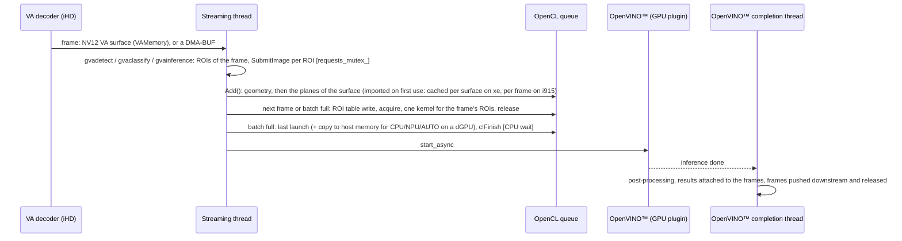
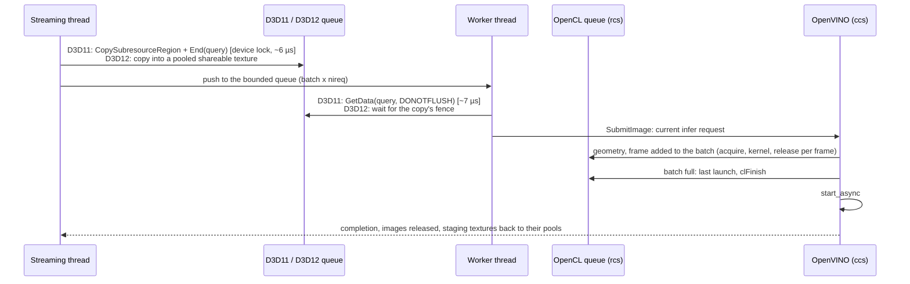

# OpenCL pre-processing backend (`pre-process-backend=opencl`)

**Status:** experimental. Linux (VA surfaces, DMA-BUFs, system memory) and
Windows (D3D11 and D3D12 textures, system memory).
**Scope:** `gvadetect`, `gvaclassify` and `gvainference`, on any inference
device.

This document started as the design of a D3D11-only prototype (commit
`038141e`). Sections 2.2.2 and 7.1, and the measured variants of section 6, are
still the prototype's analysis and measurements; the rest describes the
current implementation. Platform-specific parts are marked: on Linux the frames
come from VA (decoders, `vapostproc`), on Windows from D3D11 or D3D12. Section
7.2 evaluates the implementation on Windows, section 7.3 on Linux.

## 1. Summary

This backend pre-processes video frames for OpenVINO™ with a single OpenCL
kernel. The kernel does the color conversion, crop, resize and padding of a
frame or ROI and writes the model input (u8, planar NCHW, in the model's channel
order) straight into the memory the infer request reads. OpenVINO™
pre-processing only converts the precision and applies mean/scale.

- **Frames:** VA surfaces and DMA-BUFs (NV12) on Linux; D3D11 and D3D12
  textures (NV12, BGRA, RGBA, BGRx) on Windows; system memory (NV12, I420, BGR,
  RGB, BGRx, BGRA, RGBx, RGBA) on both. A frame is imported, uploaded or copied
  once and shared by its ROIs.
- **Inference device:** any. For GPU inference the kernel runs in OpenVINO's
  OpenCL context and writes device memory that the infer request reads in
  place. For other devices it runs on the GPU the frames are on and writes host
  memory (through device memory on a discrete GPU, section 5.7), so GPU frames
  can be inferred on the CPU or NPU without a VPP pass into system memory.
- **Batches:** each infer request has one model input for its whole batch. The
  ROIs of a frame are pre-processed by one kernel launch.
- **Model-proc:** all resize types except `aspect-ratio-multiple-of`, all crop
  types, padding, BGR/RGB, and normalization (applied by OpenVINO™). The
  regions are computed as by the `va` backend, with the same rounding.
- **Color:** YUV frames are converted with the color matrix and range of the
  `colorimetry` in their caps, or GStreamer's default for the frame size.

The kernel itself is cheap; what differs between the platforms is the cost it
replaces and the synchronization around it:

- **Linux:** the VA backends make one VPP call per ROI, each a full media
  driver submission that the CPU waits for. With many small ROIs per frame these
  calls, not the inference, limit the pipeline (section 2.2.1). `opencl` reads
  the decoder's surfaces in place and makes one kernel launch per frame and
  element.
- **Windows:** the cost of GPU pre-processing is in the CPU-side
  synchronization of D3D11 interop, which most of the D3D design is about
  (sections 2.2.2 and 5.8).

## 2. Background

### 2.1 Existing backends

| Backend | Platform | Pre-processing | Handed to OpenVINO™ |
|---|---|---|---|
| `va` | Linux | VA VPP into a surface at model size, mapped to system memory | host tensor |
| `va-surface-sharing` | Linux | VA VPP into an NV12 surface at model size | NV12 surface; OpenVINO™ converts the color |
| `d3d11`, `d3d12` | Windows | GstD3D11/D3D12Converter into a BGRA texture at model size, mapped to system memory | host tensor (OpenCV repacks it to planar) |
| `d3d11-surface-sharing` | Windows | GstD3D11Converter into a shared BGRA texture; OpenCL acquires it and copies the image into a buffer | `cl_mem` BGRX, NHWC |
| `d3d12-surface-sharing` | Windows | GstD3D12Converter, D3D12 copy into a shared buffer imported through `cl_khr_external_memory`, OpenCL buffer copy | `cl_mem` BGRX, NHWC |
| `opencv`, `ie` | both | on the CPU, system memory only (GPU frames are mapped first) | host tensor |

On Linux, the VA backends make one VPP call per ROI, and `opencv` converts
with BT.601 whatever the caps say; `va-surface-sharing` leaves the NV12 to RGB
conversion to OpenVINO™, also BT.601.

For the BGRX NHWC tensors, OpenVINO™ pre-processing then drops the fourth
channel, transposes to the model layout, converts to the model precision and
applies mean/scale.

### 2.2 Where the per-frame cost goes

#### 2.2.1 Linux (VA)

With `va` and `va-surface-sharing`, `gvaclassify` and `gvainference` crop and
scale every ROI with a VPP call of their own (`VaApiConverter::Convert`). The
pipeline of issue #1259 runs yolov8n-pose, then 3 models on every person and 3 on
every face. With about 6 persons and 2.8 faces per frame, it makes about 26 VPP
calls per frame. Measured on an Arc Pro B60 (xe, kernel 7.0, iHD 26.3.2):

- **Fixed cost per call.** The pixel work of a call takes microseconds, but the
  call costs about 400 µs, nearly all of it in `vaEndPicture`
  (`vaBeginPicture` + `vaRenderPicture`: about 3 µs). For every call, the media
  driver builds a VP pipeline and command buffer, allocates and maps temporary
  GPU memory, and submits through `XE_EXEC` with a dma-fence. The CPU waits for
  the result.
- **Serial.** An element converts its ROIs one after another. A process-wide
  mutex in `VaApiConverter` also serialized the elements (#1286 makes it per
  converter). The 26 calls are therefore about 10.5 ms of serialized work per
  frame: a cap of about 90 fps, whatever the models cost. With the six models
  replaced by near-zero-compute ones, the pipeline still ran at 93-95 fps.
- **Small ROIs.** A ROI too small for the SFC goes to the render/compute path.
  That path shares the xe engine group with the long-running compute queues of
  OpenCL and OpenVINO™, so each such submission switches the engine-group
  mode: about 1.3 ms per frame in this pipeline on kernel 7.0. On older kernels
  these switches could stall the inference badly.
- **NV12 out.** `va-surface-sharing` hands an NV12 surface per ROI to OpenVINO™,
  which still converts it to BGR and assembles the batch.

`opencl` removes the VPP calls. The ROIs of a frame become one kernel launch per
element, on surfaces imported once, and the kernel writes the final model input
of the whole batch. The CPU waits once per batch (section 5.8). The gain is
largest with many small ROIs per frame. With a few large ROIs, VPP takes its
fast SFC path and the two are close (section 7.3).

#### 2.2.2 Windows (D3D11)

Measured on the prototype. Each D3D11 frame goes through these steps on the CPU
side:

1. The streaming thread records the conversion.
2. A single worker thread per model instance calls OpenVINO's `SubmitImage`.
3. `SubmitImage` takes a free infer request and asks the image for its tensor,
   which is where the D3D11 to OpenCL handoff happens.

Two properties of the platform make that handoff expensive:

- **OpenVINO's D3D11 context uses `CL_CONTEXT_INTEROP_USER_SYNC=CL_FALSE`**
  (`ocl_device_detector.cpp` in OpenVINO™). With that setting, Intel's OpenCL
  runtime implements `clEnqueueAcquireD3D11ObjectsKHR` as a D3D11 fence signal
  followed by a CPU wait, once per acquired object (`D3DSharing::synchronizeObject`
  in compute-runtime). It must be called with the D3D11 device lock held.
- **`enqueueReleaseSharedObjects` always finishes an in-order queue.** Releasing
  is therefore a blocking wait for all OpenCL work queued so far.

The `d3d11-surface-sharing` callback holds the D3D11 device lock across the whole
handoff, including these waits: 500-1100 µs per frame on the worker depending on
GPU load, of which about 150 µs was spent waiting for the device lock.

### 2.3 What OpenCL can read

- **D3D11.** Intel's OpenCL runtime reads a D3D11 texture correctly only if the
  texture was created with `D3D11_RESOURCE_MISC_SHARED`. For other textures it
  goes through an internal staging copy that passes the NV12 plane-encoded
  subresource index straight to `CopySubresourceRegion`, which copies the wrong
  array slice or drops the UV plane. Decoder output is not shared: the D3D12
  decoders, which `decodebin3` picks, emit D3D11Memory through a D3D11 interop
  copy into a pool created with `MiscFlags=0`, and they ignore downstream D3D11
  pools.
- **D3D12.** There is no `cl_khr_d3d12_sharing`. `cl_khr_external_memory`
  imports D3D12 buffers (`d3d12-surface-sharing` uses that), but on the test
  driver (32.0.101.8991) it offers only opaque NT handles, and images imported
  from texture handles faulted the GPU at the first kernel read. A D3D12 texture
  on a shared heap that allows render target and simultaneous access opens in
  D3D11, though (`gst_d3d12_memory_get_d3d11_texture()`), and that D3D11 view
  imports through `cl_khr_d3d11_sharing`, both NV12 planes included. The
  watermark GPU renderer draws on D3D12 frames that way
  ([`D3D12TargetPool`](../../../../../include/dlstreamer/d3d12/target_pool.h)).
- **VA.** `cl_intel_va_api_media_sharing` imports the planes of a VA surface.
  A DMA-BUF is first imported into a VA surface of the display. On `i915`, an
  import must not outlive its frame: it keeps the surface attached to the GPU
  context, which breaks CPU maps of the surface elsewhere.

## 3. Goals and non-goals

Goals:

- Do all of the image pre-processing on the GPU in one kernel, writing the final
  model input, and keep OpenVINO™ pre-processing down to the precision
  conversion and mean/scale.
- Keep CPU synchronization per frame as low as possible: on Linux no VA
  submission or wait per ROI, on Windows little D3D11 device lock time. The
  submitting thread and the infer request are on the critical path.
- Give a model-proc the same meaning as the `va` backend does (regions,
  rounding, the `ImageTransformationParams` reported for post-processing), and
  convert YUV as the caps say.
- Take GPU frames for any inference device.

Non-goals:

- Automatic selection (`opencl` is only used when requested).
- Custom pre-processing libraries, `aspect-ratio-multiple-of` resize, grayscale
  models, model inputs other than u8 with 3 channels.
- Frames on another GPU than the inference one (the element falls back, see
  section 5.11).

## 4. Data path

| Frames | Made readable by OpenCL | Kernel input |
|---|---|---|
| System memory | uploaded once per frame into pooled images (a buffer for 3-byte pixels) | `CL_R`/`CL_RG` planes, an RGBA image or a buffer |
| VA surface (Linux) | planes imported, cached per surface (per frame on `i915`) | `CL_R` Y, `CL_RG` UV |
| DMA-BUF (Linux) | imported into a VA surface, then as above, per frame | same |
| D3D11 texture (Windows) | GPU copy into a pooled shared texture on the streaming thread, unless the frame already is one; for a frame of another D3D11 device, on that device, into a texture shared through an NT handle | Y/UV planes or an RGBA image of the shared texture |
| D3D12 texture (Windows) | GPU copy into a pooled shareable D3D12 texture on the streaming thread, read through its D3D11 view | same as D3D11 |

Then, in every case:

| Stage | Work |
|---|---|
| Inference `SubmitImage` (worker or streaming thread) | geometry of the ROI, frame added to the batch of the current infer request |
| Same, when the frame changes or the batch is full | one kernel launch for the ROIs of the previous frame, writing their batch elements |
| Batch full | the remaining launch (and, for host outputs on a discrete GPU, the copy to host memory), `clFinish`, `start_async` |
| OpenVINO™ pre-processing | u8 → model precision, mean/scale (folded into the GPU plugin's input reorder) |

## 5. Design

### 5.1 Components

| Component | Responsibility |
|---|---|
| [`OpenclPreprocessor`](opencl_preprocessor.h) | Builds the program, owns the model inputs (`OpenclBatch`, one per infer request), adds frames to batches, groups the ROIs of a frame into one launch, and waits for a batch before its inference. |
| [`OpenclFrameSource`](opencl_frame_source.h) | Makes the frames of one memory type readable by the kernels: [system memory](opencl_frame_source_host.cpp) (uploads), [VA and DMA-BUF](opencl_frame_source_va.cpp), [D3D11](opencl_frame_source_d3d11.cpp) (imports of shared textures). |
| [`ImageInferenceAsyncOpenCL`](image_inference_async_opencl.h) | Windows only. Wraps `OpenVinoImageInference`: copies D3D11 and D3D12 frames into textures OpenCL can read, orders the copy before the kernel, and runs the bounded submit queue and worker thread. |
| [`ComputeRoiGeometry`](opencl_preproc_geometry.h) | The source and destination rectangles and the fill color of a ROI, and the `ImageTransformationParams` for post-processing. |
| [`opencl_preproc_kernels.h`](opencl_preproc_kernels.h) | OpenCL C source: `pp_nv12`, `pp_i420`, `pp_rgbx` (images) and `pp_rgb24` (a buffer). |
| [`CreateOpenclPreprocContext`](opencl_context.h) | An OpenCL context on the frames' device: D3D11 interop with user sync on Windows, VA sharing on Linux, the first Intel GPU for system memory. |
| [`openvino_image_inference.cpp`](../openvino/openvino_image_inference.cpp), [`openvino_model_compilation.cpp`](../openvino/openvino_model_compilation.cpp) | u8 NCHW image input, one tensor per infer request bound once, OpenVINO's remote context (a user-sync D3D11 one on Windows). |
| [`D3D12TargetPool`](../../../../../include/dlstreamer/d3d12/target_pool.h), [`d3d11_device_for`](../../../../../include/dlstreamer/d3d12/d3d11_device.h) | Shared with the watermark: pooled D3D12 textures that D3D11 can open, and the D3D11 device of a D3D12 adapter. |
| [`inference_impl.cpp`](../../../gst/inference_elements/vision/base/inference_impl.cpp), [`gva_base_inference.cpp`](../../../gst/inference_elements/vision/base/gva_base_inference.cpp) | `opencl` property value, support checks and fallback, caps, cross-adapter and cross-GPU fallback. |

### 5.2 Per-frame flow

#### 5.2.1 Linux



There is no wrapper and no worker thread on Linux. The element's
`SubmitImage` goes straight to `OpenVinoImageInference`, under its
`requests_mutex_`. The streaming thread therefore waits for the kernels once
per batch, in `Finish()` (section 5.8). Elements that share a model instance
(`model-instance-id`) share its `OpenclPreprocessor`, and their calls are
serialized by that mutex. VA surfaces are read in place: the decoder's pool is
fixed, so each surface is imported once and the import is kept. The other
frames are prepared as follows:

- A DMA-BUF is imported into a VA surface per frame.
- System memory is uploaded once per frame.

With GPU inference, the model input is a buffer in OpenVINO's VA context (the
context OpenVINO™ creates for the frames' VA display), bound once per infer
request. With CPU, NPU or AUTO inference, the preprocessor creates its own VA
context on the same display. The model input is then USM host memory, written
through a device buffer and one copy on a discrete GPU (section 5.7).

#### 5.2.2 Windows



For a D3D11 frame of another device than the inference one, D is the frame's
device: the copy, the query and the wait are there (section 5.3).

System memory frames on Windows take the Linux flow: no wrapper, and the
streaming thread waits for the kernels.

### 5.3 Frame sources

- **System memory.** Each frame is uploaded once (`clEnqueueWriteImage`, not
  blocking: the frame stays mapped until its inference is done) into images
  taken from a pool keyed by format and size, and shared by the ROIs that
  follow. The images go back to the pool when the kernels that read them have
  completed.
- **VA surfaces.** Both planes are imported through
  `cl_intel_va_api_media_sharing`, and the import is cached per surface: the
  decoder's pool is fixed. On `i915` only the current frame's import is kept
  (section 2.3).
- **DMA-BUFs.** Imported into a VA surface of the display (one NV12 layer with
  its modifier), then as above. The surface is destroyed with the import, once
  the kernels reading it have completed.
- **D3D11 textures.** `ImageInferenceAsyncOpenCL` copies the frame's
  subresource into a texture from a `GstD3D11PoolAllocator` of single
  `D3D11_RESOURCE_MISC_SHARED` textures of the frame's size and format, under
  the device lock, on the streaming thread. If the frame already is a single
  shared texture without a keyed mutex, it is read in place. There is a pool
  per size and format, as for D3D12 frames below. The OpenCL frame source
  imports each texture once (both planes for NV12, through
  `cl_intel_d3d11_nv12_media_sharing`) and keeps the import while the texture is
  in use (section 5.10).
- **D3D11 textures of another device.** The frames may come from another D3D11
  device on the inference device's adapter: with `share-d3d-ctx=false` each
  inference element creates a device of its own, and the decoders of several
  pipelines in one process, which can share a model instance, each have one.
  Such a frame is never read in place. It is copied on its own device, under
  that device's lock, into a texture from a pool on that device, created with
  `D3D11_RESOURCE_MISC_SHARED | D3D11_RESOURCE_MISC_SHARED_NTHANDLE`, and the
  query is ended there. The inference device opens each pooled texture once
  (`CreateSharedHandle()`, then `OpenSharedResource1()`) and the opened texture
  is kept as qdata of the pooled `GstMemory`: every open makes a new texture
  object, which the OpenCL frame source would import anew. Each other device
  has its own pools per size and format, and a device that none of the last
  1024 frames came from is dropped with its pools. Frames on another adapter
  are refused; the element falls back before that (section 5.11).
- **D3D12 textures.** The frame is copied on the GPU (`gst_d3d12_buffer_copy_into()`)
  into a texture from a `D3D12TargetPool`: a shared heap, render target and
  simultaneous access, not zeroed (a pool that zeroes new textures can deadlock
  with the D3D12 queue's completion thread). A pool serves one texture size and
  format, and there is one per size and format, so streams of different sizes
  sharing a model instance don't make a pool start over. A pool that none of
  the last 1024 frames used is dropped, with its idle textures: the stream
  stopped or changed its frame size. The copy's D3D11 view
  is opened once per pooled texture, on the inference's D3D11 device, which
  must be on the frame's adapter: for an instance created for D3D12 frames, the
  device `d3d11_device_for()` keeps for that adapter. The view goes to the
  pre-processing as a D3D11 frame; from there on, D3D12 frames take the D3D11
  path.
- **ROI sharing.** The ROIs of a frame arrive one after another. The latest
  copy (or upload) is cached through a `weak_ptr` keyed by the frame, and the
  copy holds a reference on the frame's memory, so the same pointer still means
  the same picture. A frame is therefore copied once, whatever its number of
  ROIs.

### 5.4 Batches and launches

`OpenclBatch` is the model input of one infer request,
`[batch, 3, height, width]` u8, bound to the request once at setup, plus a table
of per-ROI parameters. `Add()` computes the ROI geometry, gets the frame's
planes from its source, and appends the ROI to the batch. Consecutive ROIs of
the same frame (same planes, size and colorimetry) form a group, launched as one
kernel over `width x height x ROIs` work items (32×8 work-groups) when the next
frame comes or the batch is finished. `Finish()` launches the last group and
waits for the queue before the inference starts. The planes of the launched
groups are kept until then.

### 5.5 Geometry

`ComputeRoiGeometry()` follows `VaApiConverter::SetupPipelineRegionsWithCustomParams`
step by step: the ROI clamped to the frame; padding; resize with or without
keeping the aspect ratio, with the 1.125 pre-scale before a crop; all crop modes
(central, the four corners, central-resize); centering; the fill color. It
reports `ResizeHasDone`, `CropHasDone` and `PaddingHasDone` the same way, so
post-processing maps the results back unchanged, and it rounds as the VA
backend does. Two deliberate differences:

- A crop mapped back to the source keeps fractional precision and the scale of
  the rounded region, instead of being truncated to whole pixels, so it stays
  inside the region.
- `aspect-ratio-pad` (Model API's `fit_to_window`) keeps the aspect ratio and
  places the image at the top-left corner, padded at the bottom and right, as
  the `opencv` backend does. (The VA and D3D converters stretch it; their fix
  is on a separate branch.)

### 5.6 Kernel

One work item per model input pixel and ROI, writing 3 bytes to 3 planes:

```
if (x, y) is outside dst_rect:   out = fill
else:
    p   = src_origin + ((x, y) - dst_origin + 0.5) * src_per_dst      // pixel-center mapping
    Y   = read_imagef(y_plane,  LINEAR, clamp(p,       luma window))  // bilinear by the sampler
    UV  = read_imagef(uv_plane, LINEAR, clamp(p * 0.5, chroma window))
    out = (m0, m1, m2) . (Y, U, V, 1)                                 // rows in model channel order, to [0, 255]
plane[c][y][x] = convert_uchar_sat_rte(out[c])
```

- **Sampling.** Hardware bilinear filtering on the `CL_R` / `CL_RG` / RGBA
  UNORM images. The clamp windows keep the filter inside the frame, so the
  padding rows and columns of decoder surfaces are never blended in. There is
  no anti-aliasing for large downscales (as `cv::resize` with `INTER_LINEAR`),
  and chroma is sampled center-sited. `pp_rgb24` filters a buffer the same way
  by hand.
- **Color.** The rows are built on the host from `Kr`/`Kb` of the frame's color
  matrix and its range (`Image::colorimetry`, from the caps). Without a matrix in
  the caps, GStreamer's default for the frame height applies: BT.601 up to 576
  lines, BT.709 above, BT.2020 from 2160 lines. A frame of another colorimetry
  starts a new launch. For RGB sources the rows pick the channels. The rows and
  the fill color are in the model's channel order, so the kernel never branches
  on it.

The program is built once per preprocessor with `-cl-fast-relaxed-math`.

### 5.7 OpenVINO™ integration

| Point | `OPENCL` behavior |
|---|---|
| Model preparation | image input tensor layout `NCHW`, element type u8, as for the system-memory backends; OpenVINO™ adds only the precision conversion and mean/scale |
| Remote context (GPU) | Windows: a `cl_context` we create on the frames' D3D11 device with `CL_CONTEXT_INTEROP_USER_SYNC=CL_TRUE`, wrapped as `ov::intel_gpu::ocl::ClContext`. Linux: OpenVINO's VA context for VA frames, its default context otherwise |
| Model input (GPU) | a `cl_mem` in that context per infer request, as a remote tensor |
| Model input (other devices) | USM host memory (`clHostMemAllocINTEL`) in a context of the preprocessor's own on the frames' GPU, as a host tensor. On a GPU without host-unified memory (a discrete GPU), whose stores across PCIe are slow, the kernels write a device buffer, copied into the host memory in one transfer when the batch is finished |
| `SubmitImage` | `Add()` to the current infer request; `Finish()` before `start_async` |

### 5.8 Synchronization

Each frame needs three orderings:

1. The work that wrote the frame (or its copy) completes before the kernel
   reads it.
2. The kernel completes before OpenVINO™ reads the model input. OpenVINO™ runs
   on its own queues, so only a CPU-side wait connects the two: `Finish()`
   waits for the queue (`clFinish`) once per batch. OpenVINO's API offers no
   way to order them on the GPU (section 6).
3. The kernel completes before the frame's planes or copy are reused: the batch
   keeps the planes until `Finish()`, and the copy is released with the image,
   after the inference.

**D3D11 (ordering 1).** OpenVINO's context is a user-sync one, in which
acquiring a shared texture does no D3D11 work besides `GetImmediateContext`.
After the copy, the streaming thread ends a pooled `D3D11_QUERY_EVENT` and does
not flush. The worker checks it with `GetData(query, D3D11_ASYNC_GETDATA_DONOTFLUSH)`
under the device lock. The decoder shares the immediate context and submits it
every frame, so by then the copy has normally executed (~7 µs). Otherwise the
worker signals a D3D11 fence, flushes, and waits on the fence outside the lock.
Each D3D11 submission costs 220-400 µs of CPU on the test system, under the
device lock; `End()` costs about 1 µs.

For a frame of another device, the query is ended, checked and waited for on
that device, under its lock; its decoder submits its immediate context. Textures
shared between devices without a keyed mutex have no synchronization of their
own: the CPU wait is what orders the copy on one device before the kernel that
reads it through the other.

**D3D12 (ordering 1).** OpenCL sees no D3D12 fences. The copy is submitted on
the D3D12 device's direct queue and becomes the fence of the pooled memory; the
worker waits for it on the CPU (`gst_d3d12_memory_sync()`) before submitting the
frame. D3D12 submits at once, so by the time a frame reaches the worker its
copy has normally completed.

**VA (ordering 1).** The VA contexts have no user sync: the acquire orders the
kernel after the VA work on the surface. That holds for OpenVINO's VA context
(`CL_CONTEXT_INTEROP_USER_SYNC` is `CL_FALSE` in it, checked with
`clGetContextInfo` on OpenVINO™ 2026.5) and for the preprocessor's own. There is
one acquire and one release per launch, so one per frame and element, not per
ROI.

**Host outputs (Linux and Windows).** For CPU, NPU and AUTO inference the batch
is complete in host memory when `Finish()` returns. On a discrete GPU the copy
from the device buffer is enqueued before the `clFinish`, on the same in-order
queue.

**Queue placement.** The OpenCL queue is created with
`CreateInteropCommandQueue()`. Where the GPU has a second engine that can run
the kernels, the queue goes there: on the Windows test GPU it is on `rcs`, while
OpenVINO™ runs inference on `ccs`. The `clFinish` then waits for the
pre-processing only, not for the inference in flight. The Arc Pro B60 (Linux
test GPU) has no such engine, so the queue shares the compute engine with the
inference, and a launch can wait behind inference work already queued there.
That wait is paid once per batch, which is why per-object models should run
with `batch-size` greater than 1 (section 7.3).

### 5.9 Threads

| Thread | Work |
|---|---|
| Streaming thread(s) | Windows, D3D frames: the copy (or a hit in the ROI cache) and a push into the bounded queue (`batch × nireq`), which blocks when full. Linux, and system memory on Windows: `SubmitImage` itself: `Add()` (the import or upload, and a launch when the frame changes), and `Finish()` (the CPU wait) + `start_async` when the batch is full. |
| Worker (Windows, one per model instance) | the wait for the copy, then OpenVINO's `SubmitImage`: `Add()`, and `Finish()` + `start_async` when the batch is full |
| OpenVINO™ completion threads | results to the element; images released, copies back to their pools |

### 5.10 Resource lifetimes

| Object | Held by | Released when |
|---|---|---|
| Copy of a D3D frame (`StagingFrame`): reference on the frame's `GstMemory`, pooled texture | the images of the frame's ROIs, plus the weak ROI cache | the last of them is destroyed, after its inference |
| Planes of a frame (`OpenclSourcePlanes`) | the frame source's import cache (VA, D3D11) or the ROI cache, and the batch until `Finish()` | system memory: back to the upload pool once the kernels completed |
| Model inputs (`OpenclBatch`) | the preprocessor | teardown |
| Copy pools (D3D11 and D3D12, per size and format) | `ImageInferenceAsyncOpenCL` | unused by the last 1024 frames, or teardown; textures in use go when released |
| Other D3D11 devices (`CopyDevice`): a reference on the device, its queries, fence and copy pools | `ImageInferenceAsyncOpenCL`, and the copies made there | none of the last 1024 frames came from the device, or teardown; copies in flight keep it |
| Texture imports | the D3D11 frame source; each import references its texture, so pointer keys stay unique | unused by the last 1024 frames, or teardown, under the device lock |
| D3D12 copies' D3D11 views | their pooled `GstD3D12Memory`, and the import | with the pooled texture and the import |
| Other devices' copies, opened on the inference device | their pooled `GstD3D11Memory` (qdata), and the import | with the pooled texture and the import |
| `cl_context` | OpenVINO™ and the preprocessor | last holder |

An import keeps its texture alive, so a texture whose pool was dropped, or a
decoder texture read in place after the decoder recreated its pool, is freed
when its import is dropped.

Windows teardown: stop the worker → `Flush()` OpenVINO™ (in-flight images are
released) → destroy the inference (the preprocessor and its imports) → the
D3D11 pools (under the device lock), the D3D12 pools, and the other devices
with their pools.

### 5.11 Element integration

- `ImagePreprocessorType::OPENCL` is appended to the enum, so existing values are
  unchanged.
- `IsPreprocSupported`: no custom pre-processing library, a supported model-proc
  (section 1) and frames of a supported memory type and format.
  Otherwise the element falls back, with a warning, to the backend it would
  select automatically.
- Caps: an explicit `opencl` keeps D3D11Memory and D3D12Memory. A D3D12 decoder
  then outputs D3D12Memory, which saves its interop copy into D3D11Memory.
  GPU memory caps are also kept with `device=CPU`.
- Frames on another adapter than the GPU inference device fall back to `d3d11`
  or `d3d12` on Windows (`avoidCrossAdapterSurfaceSharing`), and to
  `va-surface-sharing` on Linux (`avoidCrossGpuOpencl`).
- `batch-timeout` is not supported, as with the VA and D3D backends.
- Auto selection never picks `opencl`.

## 6. Alternatives considered

The D3D11 synchronization variants below were measured on the prototype, on the
classify-only pipeline during development, at different times on a GPU with
fluctuating background load (section 7.1), so only compare numbers within one
row.

| Variant | Worker per frame | Streaming per frame | Verdict |
|---|---|---|---|
| A. OpenVINO's D3D11 context (user sync off), own fence wait before acquire | 870 µs at a busy moment (fence 314 + acquire 183 + kernel 338); ~400 µs calm | 43 µs | Three GPU round trips, partly under the device lock. |
| B. A without the fence pre-wait | ~335 µs (calm) | 43 µs | Shorter, but the acquire's GPU waits move inside the device lock and stall the decoder. |
| C. User-sync context, fence `Signal` + `Flush` right after the copy | ~260 µs (fence wait ~1 µs) | 210-450 µs | The worker became fast, but the submission moved to the streaming thread under the device lock; classify-only stayed at parity. A plain `Flush` alone costs ~225 µs; `Signal` after it ~55 µs. |
| D. C with `ID3D11DeviceContext3::Flush1(event)` | ~350 µs | ~280 µs | No cheaper than C. |
| **E. User-sync context, event query (chosen)** | **~217 µs** | **~6-13 µs** | No submission on the hot path. |

Other options:

- **Importing decoder textures directly.** Rejected: the runtime's staging-copy
  defect for non-shared textures (section 2.3).
- **Writing normalized f32/f16 in the kernel.** Not needed: the GPU plugin folds
  the u8 → f32 conversion and mean/scale into the input reorder it runs anyway,
  and u8 is 4× less memory traffic.
- **Running the kernel on OpenVINO's queue** (`ClContext(core, queue)`), which
  would order the inference after it without a CPU wait. Rejected: OpenVINO™
  supports such a context in latency mode only. The GPU plugin asserts a single
  stream, enqueues the inference on the caller's thread in `start_async`, and
  lets one request of a graph be in flight at a time: `enqueue_notify()` waits
  until the previous request has completed (`Graph::wait(Stage::EXECUTE)`). That
  trades the wait for the kernel, one GPU round trip, for a wait for the whole
  previous inference. With OpenVINO™ 2026.5 on the test system,
  `compile_model` also crashed with such a context (not investigated further).
- **Ordering the inference after the kernel on the GPU**, with an event or a
  marker. Not possible through OpenVINO's API: remote tensors carry no events,
  and the GPU plugin's in-order streams ignore input dependency events. It
  would take an OpenVINO™ API to make an infer request wait for a `cl_event`
  on its queue, as a marker or barrier before the network.
- **Starting the inference from a thread that waits for the kernels**, so that
  the submitting thread doesn't wait. Possible without OpenVINO™ changes, but
  the round trip stays in each request's latency, and removing the wait
  altogether gains at most about 2% on the test system (section 7.2): not done.
- **D3D12 textures through `cl_khr_external_memory`.** Rejected: images
  imported from texture handles faulted the GPU on the test driver (section
  2.3).
- **D3D12 frames through a shared buffer** (a texture-to-buffer copy, imported
  through `cl_khr_external_memory` as `d3d12-surface-sharing` does). Works
  without a D3D11 device, but needs kernels that read NV12 from a buffer. The
  D3D11 view of a texture copy reuses the D3D11 import and the kernels as they
  are, and was already proven by the watermark renderer.

## 7. Evaluation

### 7.1 Prototype (D3D11 only, commit `038141e`)

- Intel Core Ultra 9 285H, Intel Arc 140T GPU (driver 32.0.101.8991),
  OpenVINO™ 2026.3, GStreamer 1.28.8.
- 640×360 H.264 at 30 fps, 1989 frames. `decodebin3` picks `d3d12h264dec`,
  which outputs D3D11Memory through a GPU copy when downstream only accepts
  D3D11.
- Models: yolo11n INT8 (640×640), resnet18 and mobilenetv2 (224×224).
- Backends run round-robin (one run of each per round, 5-6 rounds), the first
  100 frames skipped, medians reported. The remote display's driver host used
  about 34% of the 3D engine even at idle; the final rounds varied by 4-16%.

Throughput (median fps):

| Pipeline | `d3d11` | `d3d11-ss` | `d3d12` | `d3d12-ss` | `opencl` |
|---|---|---|---|---|---|
| `gvadetect` yolo11n | 229.2 | 234.2 | 229.5 | 239.3 | **268.2** |
| `gvadetect` yolo11n → `gvaclassify` resnet18 per object | 155.0 | 152.8 | 153.1 | 145.5 | **167.6** |
| `gvaclassify` mobilenetv2, `inference-region=full-frame` | 1082.9 | 1080.0 | **1163.9** | 1097.3 | 1105.1 |
| same, 4 streams sharing one model instance (total) | 1077.1 | 1081.1 | **1187.3** | 1119.9 | 1093.2 |

About 1100 fps is the ceiling of D3D11Memory input in the classify-only
pipelines: the decoder's D3D12 → D3D11 interop copy. Decoding alone reaches
2150-3260 fps into D3D11Memory and 5300-6000 fps into D3D12Memory.

CPU time per frame (mean of 2 runs × 1000 frames):

| Pipeline | Backend | fps | Worker (holds an infer request) | Streaming thread |
|---|---|---|---|---|
| classify-only | `d3d11-surface-sharing` | 1051 | 511 µs | 44 µs |
| classify-only | `d3d12-surface-sharing` | 1103 | 466 µs | 92 µs |
| classify-only | `opencl` | 1135 | **217 µs** | **6 µs** |
| detect | `d3d11-surface-sharing` | 248 | 574 µs | 94 µs |
| detect | `d3d12-surface-sharing` | 253 | 734 µs | 210 µs |
| detect | `opencl` | 275 | **463 µs** | **12 µs** |

The `opencl` worker time is almost all one GPU round trip for the kernel.

The current implementation differs from the prototype (one model input per
batch, launches per frame, any device, VA, D3D12). Section 7.2 repeats the
throughput comparison on it.

### 7.2 Current implementation, Windows

Correctness:

- Unit tests ([opencl_preproc_tests.cpp](../../../../../tests/unit_tests/check/components/preprocessing/opencl_preproc_tests.cpp)):
  the geometry of every resize, crop and padding mode against the VA rules; a
  batch mixing BGR and NV12 frames against a CPU reference; NV12 frames of
  different colorimetries in one batch; letterbox fill.
- Unit tests of `ImageInferenceAsyncOpenCL` ([test_d3d_async_inference.cpp](../../../../../tests/unit_tests/check/components/d3d-pre-proc/test_d3d_async_inference.cpp)),
  with a fake inference that reads back the textures it is handed. For D3D11
  and D3D12 frames: the copy is exact, the ROIs of a frame share one copy,
  streams of different sizes share an instance with a pool per size, an idle
  pool is dropped and comes back when needed, a frame smaller than its texture
  is copied whole, teardown with frames still in the inference, frames without
  their memory are refused. Also: shared D3D11 frames are read in place,
  D3D12 frames on an instance created for D3D11 frames are read through its
  device, and D3D12 frames of another `GstD3D12Device` object of the adapter are
  accepted. D3D11 frames of another device on the adapter are copied there:
  alternating with frames of the inference device at two sizes (a pool per
  size on each device), each pooled texture opened once on the inference
  device, the ROIs of a frame sharing one copy, teardown with such frames in
  the inference, an idle device dropped and set up again for its next frame,
  and on an instance created for D3D12 frames.
- Model input checked pixel by pixel with identity models (input → ReLU →
  output) and `gvametaconvert add-tensor-data=true`: for a solid color encoded
  by `videoconvert` with a given colorimetry, the model input is the exact
  decode of the 8-bit YUV.
- D3D12 frames, model input: with the identity models, D3D12 frames
  (`d3d12upload`) give byte-identical model inputs to D3D11 frames and to
  system memory, for SMPTE bars at 640×360 and 1280×720, NV12 in BT.601,
  BT.709 and full-range BT.601 with the `standard`, `fit_to_window` and
  `fit_to_window_letterbox` resize types, and BGRA.
- D3D12 frames, pipelines: with `decodebin3` (D3D12 decoder) and
  yolo11n → resnet18 per object on the GPU, the detections and labels on D3D12
  frames are identical to those on D3D11 frames (5221 objects in 449 HD frames,
  1732 in 599 SD frames), as are the detections with `device=CPU` (905 objects
  in 299 frames). Four SD streams sharing a model instance give four identical
  results, and SD and HD streams sharing one get a pool per texture size. The
  watermark renderer, which shares `D3D12TargetPool` and `d3d11_device_for()`,
  still draws on D3D12 frames on the GPU.
- D3D11 frames of another device, pipelines: with `share-d3d-ctx=false`, D3D11
  frames (`video/x-raw(memory:D3D11Memory)` after `decodebin3`) and
  yolo11n → resnet18 per object, each element reads the frames of the
  decoder's device through a device of its own, and the detections and labels
  are identical to those with the decoder's device shared (5221 objects in 449
  HD frames, 1732 in 599 SD frames). Two pipelines in one process sharing a
  yolo11n instance, each with a decoder on a device of its own, give identical
  detections to each other and to a single pipeline (5549 objects in 1989 SD
  frames). A stream of D3D11 frames and one of D3D12 frames with the same
  `model-instance-id` get an instance each: the element keys the instances by
  memory type as well.

Throughput against the other backends, with the pipelines of 7.1 plus the
two-stage one on a 1920×1080 clip. `decodebin3` picks the D3D12 decoder, which
outputs D3D11Memory for `d3d11` and `d3d11-surface-sharing`, and D3D12Memory for
the others. Same machine and GPU driver as 7.1, OpenVINO™ 2026.5. The session
was remote (RDP), but no remote display process used the GPU at idle; the
editor used about 6% of the 3D engine. Five rounds: in each, every pipeline ran
with every backend, one after another, in an order that rotates every round.
The first 100 frames were skipped, and no run fell back to another backend.
Median fps:

| Pipeline | `d3d11` | `d3d11-ss` | `d3d12` | `d3d12-ss` | `opencl` |
|---|---|---|---|---|---|
| `gvadetect` yolo11n | 272.6 | 309.9 | 275.4 | 304.4 | **331.0** |
| `gvadetect` yolo11n → `gvaclassify` resnet18 per object | 214.2 | 218.0 | 210.9 | 210.2 | **228.3** |
| same, 1920×1080 | 100.3 | 98.1 | 97.8 | 96.8 | **104.6** |
| `gvaclassify` mobilenetv2, `inference-region=full-frame` | 1620.2 | 1614.6 | **1689.4** | 1649.7 | 1684.5 |
| same, 4 streams sharing one model instance (total) | 1617.4 | 1621.1 | **1710.5** | 1656.4 | 1659.9 |

`opencl` against each backend, median of the per-round ratios:

| Pipeline | `d3d11` | `d3d11-ss` | `d3d12` | `d3d12-ss` |
|---|---|---|---|---|
| detect | +20.5% | +4.5% | +20.4% | +8.7% |
| detect → classify per object | +6.7% | +4.7% | +9.2% | +8.6% |
| same, 1920×1080 | +5.9% | +6.4% | +7.0% | +8.7% |
| classify | +4.9% | +4.0% | −0.3% | +3.8% |
| classify, 4 streams | +5.7% | +3.3% | −1.4% | +2.2% |

`opencl` is the fastest with detection and with per-object classification: by
4-9% over the surface sharing backends and by 6-21% over `d3d11` and `d3d12`.
On whole-frame classification `d3d12` is as fast with one stream, and 1-4%
faster with four, in every round. The first round was about 6% slower in the
classify pipelines, which ran first; without it the conclusions are the same.
D3D11Memory input no longer stops classification at about 1100 fps as in 7.1:
`d3d11` reaches 1620 fps.

Throughput of D3D12 frames against D3D11 frames: the same pipelines with
`video/x-raw(memory:D3D11Memory)` after `decodebin3`, which makes the D3D12
decoder copy each frame into D3D11Memory, which the wrapper then copies into a
shared texture. D3D12 frames are copied once. Five rounds of one run each,
alternating the order (AB, BA, ...), the first 100 frames skipped, on the same
day as the comparison above. Median fps, and the median of the per-round
ratios with their range:

| Pipeline | D3D11 frames | D3D12 frames | D3D12 / D3D11 |
|---|---|---|---|
| `gvaclassify` mobilenetv2, `inference-region=full-frame`, SD | 1716.8 | 1696.7 | +3.3% (−9.7% to +4.8%) |
| `gvadetect` yolo11n, SD | 290.3 | 294.3 | +2.9% (−1.8% to +12.7%) |
| yolo11n → resnet18 per object, SD | 224.9 | 230.8 | +4.2% (+0.1% to +12.2%) |
| yolo11n → resnet18 per object, HD | 108.7 | 113.6 | +5.4% (+3.7% to +6.8%) |

The two-stage pipelines are 4-5% faster on D3D12 frames, in every round. For
classify or detect alone the difference is within the run-to-run variation.

The absolute numbers move between sessions: the two tables above differ by up
to 12.5%, in both directions, for the same code (`opencl` detect 331 and 294
fps, two-stage 1920×1080 105 and 114 fps). They are higher than in 7.1, which ran
older code on OpenVINO™ 2026.3 with a remote display that kept a third of the
3D engine busy. Compare within a table only.

Throughput of D3D11 frames of another device: D3D11 frames
(`video/x-raw(memory:D3D11Memory)` after `decodebin3`) with the decoder's
device shared, and with `share-d3d-ctx=false`, for `opencl` and, as the
reference for the same situation, `d3d11-surface-sharing`. Four rounds on the
next day, the order of the four variants rotating every round, the first 100
frames skipped, no fallbacks. Median fps, and the median of the per-round
ratios of the other device to the shared one, with their range:

| Pipeline | `opencl`, shared | `opencl`, other device | ratio | `d3d11-ss`, shared | `d3d11-ss`, other device | ratio |
|---|---|---|---|---|---|---|
| `gvadetect` yolo11n, SD | 321.2 | 320.3 | +3.0% (−3.0% to +20.9%) | 293.0 | 303.9 | +3.8% (+0.1% to +6.4%) |
| yolo11n → resnet18 per object, SD | 230.0 | 232.9 | +1.2% (−14.0% to +2.0%) | 217.5 | 215.6 | −0.2% (−1.2% to +6.6%) |
| same, HD | 107.0 | 105.7 | −1.3% (−2.9% to +0.4%) | 98.0 | 97.8 | 0.0% (−6.0% to +4.4%) |

Frames of another device cost nothing measurable with either backend. With
`opencl`, the HD two-stage pipeline lost 1-3% in three rounds of four, which
would fit the per-frame wait on the decoder's device, but within the run-to-run
variation. Something else slowed two runs of round 2 (`opencl` detect on the
shared device at 261 fps against 321-325 in the other rounds, two-stage SD on
another device at 195 against 231-236), hence the wide ranges. On frames of
another device too, `opencl` is faster than `d3d11-surface-sharing`, by 6.6%,
6.9% and 8.1%. GPU memory in the test of section 9 (SD and HD streams sharing a
yolo11n instance): 279 MB with frames of another device, 274 MB with the
decoder's device, flat after the first seconds, with one pool per frame size
in either case.

Cost of the CPU wait before each inference (`clFinish` in `Finish()`), as an
upper bound: builds that flush instead of waiting, whose results are racy,
against the regular wait. Four rounds, the order alternating, the first 100
frames skipped, on the same day as the table above. D3D12 frames, then system
memory frames (`video/x-raw,format=NV12` after `decodebin3`). Median fps, and
the median of the per-round ratios with their range:

| Pipeline | wait | no wait | no wait / wait |
|---|---|---|---|
| `gvaclassify` mobilenetv2, `inference-region=full-frame`, SD | 1681.2 | 1715.0 | +2.5% (−1.3% to +4.1%) |
| `gvadetect` yolo11n, SD | 332.2 | 332.5 | −0.5% (−2.1% to +4.0%) |
| yolo11n → resnet18 per object, SD | 232.1 | 232.5 | +0.3% (−1.4% to +0.4%) |
| same, HD | 106.6 | 106.1 | −0.5% (−1.6% to +2.0%) |
| system memory: classify | 1425.0 | 1434.8 | +0.3% (−1.9% to +2.3%) |
| system memory: detect | 319.0 | 321.6 | +1.4% (−0.6% to +3.3%) |
| system memory: detect → classify per object | 224.1 | 228.5 | +1.9% (−0.2% to +2.5%) |

On D3D frames the wrapper's worker thread waits, and the wait costs nothing
measurable: the pipelines are bound by the GPU. With system memory frames the
streaming thread waits, as on Linux, and the two-stage pipeline lost about 2%
in three rounds of four. The latency did not change either, at 30 fps
(`identity sync=true` after the decoder, three runs each, the latency tracer's
average per element): `gvadetect` 9.5-11.0 ms with the wait and 9.9-11.0 ms
without; per-object `gvaclassify` 4.2-5.9 ms and 4.3-5.6 ms.

### 7.3 Current implementation, Linux

**Setup.**

- Hardware: Intel Core Ultra 7 265 and an Arc Pro B60 (discrete, `xe`).
- Software: kernel 7.0, iHD 26.3.2, compute runtime 26.31.39395, OpenVINO™
  2026.5, GStreamer 1.28.8. Commit `aebb81c3` (with the colorimetry change).
- Clip: 1920×1080 H.265 at 30 fps, 1800 frames, decoded by `vah265dec` into
  VAMemory. The caps colorimetry is `2:0:7:1`: limited range and no matrix, so
  GStreamer's default for 1080 lines applies, BT.709. The clip shows two bottles
  on a white background, so there are 2 detections per frame, about 200×660
  pixels each.
- Models:
  - yolo11n: 640×640, RGB, letterbox, from its rt_info.
  - resnet-v1-50-tf and mobilenet-v2-1.0-224: 224×224, BGR. Their model-procs
    ask for `aspect-ratio` resize with `central` crop. Labels:
    `imagenet_2012_bkgr.txt`.

**Model input.** An identity model (input → output, 64×48 planar BGR) ran on
four ROIs on the bottles and on the full frame, over 10 frames. Its model input
was compared with two references computed from the decoded NV12. The first
is an exact emulation of the kernel: bilinear on the planes at pixel centers,
then limited-range YUV → RGB with the BT.709 or the BT.601 matrix. The second
is OpenCV's conversion (`cvtColor` NV12 → BGR, BT.601) followed by
`resize INTER_LINEAR`. Mean / max absolute difference:

| Backend | vs emulation, BT.709 | vs emulation, BT.601 | vs OpenCV |
|---|---|---|---|
| `opencl`: VA frames with GPU, CPU and AUTO inference; batch 3; system memory NV12 and I420 | **0.002 / 1** | 4.03 / 25 | 4.20 / 29 |
| `opencv` | 4.20 / 29 | 0.76 / 17 | **0.000 / 0** |
| `va` | 8.32 / 141 | 6.55 / 141 | 6.57 / 140 |
| `va-surface-sharing` | 9.43 / 157 | 7.74 / 157 | 7.80 / 156 |

- `opencl` writes the same model input on every path. It follows the caps'
  BT.709, and it differs from the emulation only by rounding.
- For BGR and BGRx frames (converted by `videoconvert`), its input equals
  bilinear sampling of the converted frames (max 1).
- The other backends convert with BT.601. The VA backends also sample
  differently: VPP's scaler differs by up to 157 at the bottles' edges.

**Classifier outputs.** yolo11n ran with `opencl` in every run, so all runs
classified the same ROIs. resnet-50 and mobilenet-v2 then classified them with
each backend: 300 ROIs per model in 150 frames. The reference cuts each ROI
with the model-proc's geometry (as computed by `ComputeRoiGeometry` and
`VaApiConverter`), samples the decoded NV12 bilinearly in floating point,
converts it with BT.709 or BT.601, and runs the model on the CPU in FP32. Every
backend agrees with both references on 100% of the top-1 labels. Total
variation distance of the output distributions, 0.5 Σ|p − q| (lower is
closer):

| Backend | resnet-50, BT.709 ref. | resnet-50, BT.601 ref. | mobilenet-v2, BT.709 ref. | mobilenet-v2, BT.601 ref. |
|---|---|---|---|---|
| `opencl` | **0.0019** | 0.0219 | **0.0016** | 0.0046 |
| `va-surface-sharing` | 0.0191 | 0.0096 | 0.0049 | 0.0017 |
| `va` | 0.0259 | 0.0084 | 0.0048 | 0.0016 |
| `opencv` | 0.0189 | 0.0107 | 0.0036 | 0.0014 |

Each backend is closest to the reference with its own matrix. Against its own
matrix, `opencl` is 4-5× closer than the others on resnet-50; on mobilenet-v2
all four are equal.

**Unit tests.** The 13 tests of `opencl_preproc_tests.cpp` pass on the B60.
Their host outputs go through device memory, as on any discrete GPU.

**Throughput, GPU inference.** Three pipelines:

- P1: `gvadetect` yolo11n;
- P2: P1 + `gvaclassify` resnet-50 per object;
- P3: P2 + `gvaclassify` mobilenet-v2 per object.

Every inference element ran on the backend under test, with `device=GPU`.
Each run covered the whole clip, with N copies of the pipeline in one process
sharing a model instance per model. The fps is the frame count integrated over
the `gvafpscounter` windows. Two runs per cell, interleaved; the tables give
their mean, and both runs where they differ by more than 5%. No run fell back
to another backend, and the kernel log stayed clean. Total fps, with DL
Streamer's default `batch-size=1`:

| Pipeline | N | `va-surface-sharing` | `va` | `opencv` | `opencl` | `opencl` vs `va-surface-sharing` |
|---|---|---|---|---|---|---|
| P1 | 1 | 984 | 68 | 521 | **1013** | +3% |
| P2 | 1 | **684** | 41 | 333 | 634 (706 / 561) | −7% |
| P3 | 1 | **538** | 30 | 222 | 524 | −3% |
| P1 | 4 | **1018** | 68 | 484 | 1011 | −1% |
| P2 | 4 | **677** | 39 | 317 | 596 | −12% |
| P3 | 4 | **511** | 29 | 212 | 501 | −2% |

The same with `batch-size=8` on the classifiers, N = 1:

| Pipeline | `va-surface-sharing` | `va` | `opencv` | `opencl` | `opencl` vs `va-surface-sharing` |
|---|---|---|---|---|---|
| P2 | **842** | 48 | 324 | 817 | −3% |
| P3 | 756 | (incomplete runs) | 219 | **788** | +4% |

On this clip, `opencl` and `va-surface-sharing` are within a few percent of
each other: the clip has the case section 2.2.1 calls close.

- **Detection** has one full-frame conversion per frame. Both backends run at
  the detector's speed, twice as fast as `opencv`.
- **Per-object classification** has only two large ROIs per frame. VPP takes
  its fast SFC path and makes 2 calls per classifier per frame.
- **The wait per batch.** `opencl` waits for its kernel once per batch, so with
  `batch-size=1` it waits once per ROI. On the B60 its queue shares the compute
  engine with the inference (section 5.8), so the wait includes inference work
  queued before the kernel. That fits the 7-12% loss on P2 and the spread
  between P2's runs, though the wait was not measured directly.
- **Batching.** It removes most of that: from `batch-size` 1 to 8, `opencl`
  gains 29% on P2 and 50% on P3, against 23% and 41% for
  `va-surface-sharing`, and `opencl` is ahead on P3.
- **Many small ROIs per frame** (section 2.2.1) are the case where the VPP
  calls dominate. That is where `opencl` is designed to win.
- **`va`** maps each VPP output to system memory, which on a discrete GPU reads
  across PCIe. That makes it the slowest.

**Throughput, other inference devices.** The same clip with P1 and P2, N = 1,
`batch-size=1`, `opencl` against the backend the element selects by default
for the device. Total fps:

| Device | Pipeline | default backend | `opencl` | ratio |
|---|---|---|---|---|
| CPU | P1 | 224 (216 / 232, `opencv`) | **248** | 1.11× |
| CPU | P2 | 104 (`opencv`) | **117** | 1.13× |
| NPU | P1 | 23 (`va`) | **86** | 3.8× |
| NPU | P2 | 23 (`va`) | **87** | 3.8× |
| AUTO | P1 | 40 (`va`) | **380** | 9.5× |
| AUTO | P2 | 35 (`va`) | **375** | 10.9× |

With these devices, the frames stay in VAMemory and the kernel runs on the B60.
It writes the model input through device memory and one copy into host memory
per batch. The default backends instead read VPP output, or the decoded frame
itself, back across PCIe.

## 8. Limitations and risks

- The frames must be on the inference device's adapter (or display): frames on
  another one make the element fall back. On Windows, D3D11 frames of another
  D3D11 device on that adapter cost a CPU wait on that device per frame, and
  the copy runs on that device's immediate context, under its lock. D3D12
  frames on an instance created for D3D11 frames are read through that
  instance's device, and D3D11 frames on one created for D3D12 frames are
  copied on their device (unit tests only: the element keys model instances by
  memory type).
- The model input must be u8 with 3 channels. A model-proc `precision` other
  than U8 on the image input is not supported by the element with any backend:
  it trips an assert in `UpdateConfigWithLayerInfo()` (release builds keep
  asserts), before a backend is set up.
- Supported formats: NV12 for VA and DMA-BUF; NV12, BGRA, RGBA, BGRx for D3D11
  and D3D12; no P010.
- Chroma is sampled center-sited, while most H.264/HEVC content is co-sited
  left.
- The D3D11 query check relies on another D3D11 user submitting the immediate
  context. The fallback is correct but costs a flush and a GPU round trip.
- A copy holds a reference on the decoder's memory until its inference has
  completed. If the decoder's buffer went back to its pool while that reference
  is held, the pool would discard it instead of recycling it. In the tested
  pipelines (detect, detect + classify) no buffer was discarded.
- Copy pools and D3D11 imports unused for 1024 frames are dropped, which bounds
  them by the sizes in use; until then a stream that stopped keeps its pool and
  imports. On Linux the VA imports are cached per surface ID until teardown: if
  the decoder recreated its surfaces with the same IDs, a stale import could be
  used (not verified).
- D3D12 frames are copied with a submission per frame on the D3D12 device's
  direct queue, and the worker waits for the copy on the CPU.
- The CPU waits for the kernels of a batch (`clFinish`, one GPU round trip)
  before its inference starts. On the Windows test system that costs at most
  about 2% of throughput, and no measurable latency (section 7.2).
- **Linux, GPUs without a second compute engine.** On the Arc Pro B60, the
  kernels share the engine with the inference, and each batch's wait includes
  the inference work queued before the kernel. With `batch-size=1`,
  per-object classification on a few large ROIs per frame ran 2-12% slower
  than `va-surface-sharing` (section 7.3). Per-object models should use a
  larger `batch-size`.
- **Linux, DMA-BUF.** DMA-BUFs from `vapostproc` are Tile4. The DMA-BUF mapper
  reports their modifier as 0, with linear strides, so the import reads them
  wrongly; so do the VA backends. The mapper needs a separate fix. The decoders'
  VA surfaces are not affected.
- **Linux, `i915`.** The current implementation was tested on `xe` (Arc B60)
  only. On `i915` the VA imports are made per frame (section 2.3); that path
  is untested.

## 9. Future work

Done since the prototype: Linux (VA surfaces and DMA-BUFs), system memory, any
inference device, one tensor per batch, colorimetry from the caps, model-proc
normalization and color space, D3D12Memory input, copy pools per frame size
with idle pools and imports dropped, and D3D11 frames of another device on the
adapter. Before the copy pools per frame size, two streams of D3D11
frames of different sizes sharing a model instance recreated the staging pool
at every frame and kept every old texture through its import: 985 pools and
5.2 GB of GPU memory in 12 seconds (SD and HD, yolo11n), against 2 pools and
274 MB now.

1. **No CPU wait**: order the inference after the kernels on the GPU. It needs
   an OpenVINO™ API for an infer request to wait for a `cl_event` (section 6).
   It gains little on the Windows test system (section 7.2). On Linux, on a GPU
   whose kernels share the inference engine, it is the likely cause of the 2-12%
   that `batch-size=1` per-object pipelines lose (section 7.3).
2. **VA imports**: check the import cache when the decoder recreates its
   surfaces (Linux).
3. **Kernel**: vector stores, an anti-aliased (area) downscale for large ratios
   (optional, as it changes results compared with `opencv` and `va`), chroma
   siting from the caps.
4. **Formats**: P010 (10-bit HEVC and AV1), grayscale models.
5. **Inference on another GPU** than the frames: run the kernel on the frames'
   GPU and write host memory, as for CPU and NPU inference.
6. **Automatic selection** where the backend wins, after a benchmark across
   platforms, devices and pipelines.
7. **Functional tests** of `opencl` pipelines in CI, on both platforms.
8. **`aspect-ratio-multiple-of`** resize, which needs the model input reshaped
   per frame size.

## 10. Usage

```bash
# Linux
gst-launch-1.0 filesrc location=video.mp4 ! parsebin ! vah264dec ! \
  gvadetect model=yolo11n.xml device=GPU pre-process-backend=opencl ! queue ! \
  gvaclassify model=resnet18.xml device=GPU pre-process-backend=opencl batch-size=8 ! queue ! \
  gvafpscounter ! fakesink

# Windows: decodebin3 picks the D3D12 decoders
gst-launch-1.0 filesrc location=video.mp4 ! decodebin3 ! \
  gvadetect model=yolo11n.xml device=GPU pre-process-backend=opencl ! queue ! \
  gvaclassify model=resnet18.xml device=GPU pre-process-backend=opencl ! queue ! \
  gvafpscounter ! fakesink
```

`GST_DEBUG=GVA_common:4` logs the setup. For example on Linux, with VA frames,
yolo11n on the GPU, resnet-50 on the GPU with `batch-size=8`, and resnet-50 on
the CPU:

```
OpenCL pre-processing on 'Intel(R) Arc(TM) Pro B60 Graphics': 640x640 planar RGB, batch 1, into device memory of the inference context
OpenCL pre-processing on 'Intel(R) Arc(TM) Pro B60 Graphics': 224x224 planar BGR, batch 8, into device memory of the inference context
OpenCL pre-processing on 'Intel(R) Arc(TM) Pro B60 Graphics': 224x224 planar BGR, batch 1, into host memory, through device memory
OpenCL pre-processing: VA surfaces of a 'xe' device, imports cached per surface
OpenCL pre-processing: YUV to RGB with BT.709, limited range
```

On Windows, with D3D12 frames:

```
OpenCL pre-processing: OpenVINO uses an OpenCL context with D3D11 interop user sync
OpenCL pre-processing on 'Intel(R) Arc(TM) 140T GPU (16GB)': 640x640 planar RGB, batch 1, into device memory of the inference context
OpenCL pre-processing: shareable copies of 640x368 D3D12 textures of format 103
OpenCL pre-processing: YUV to RGB with BT.601, limited range
```
